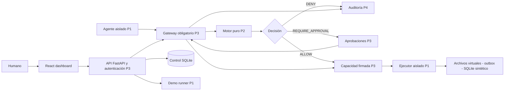
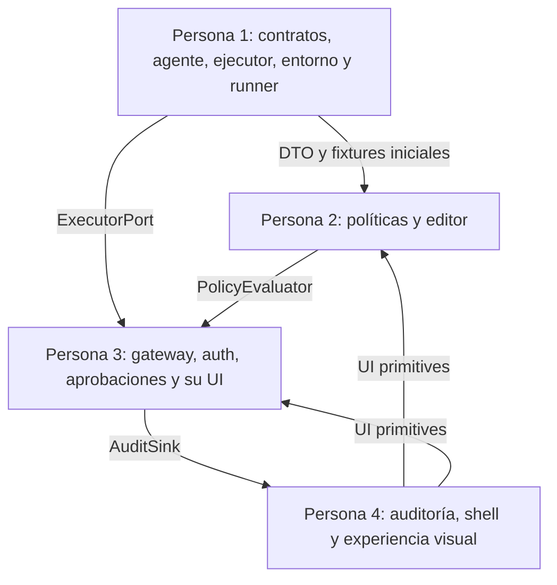
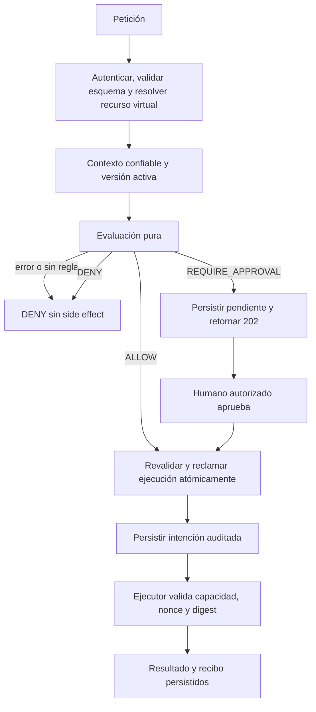
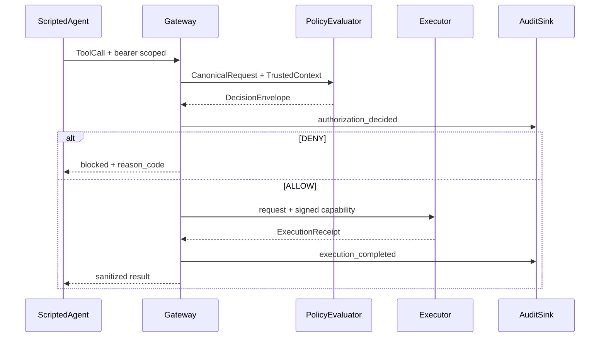
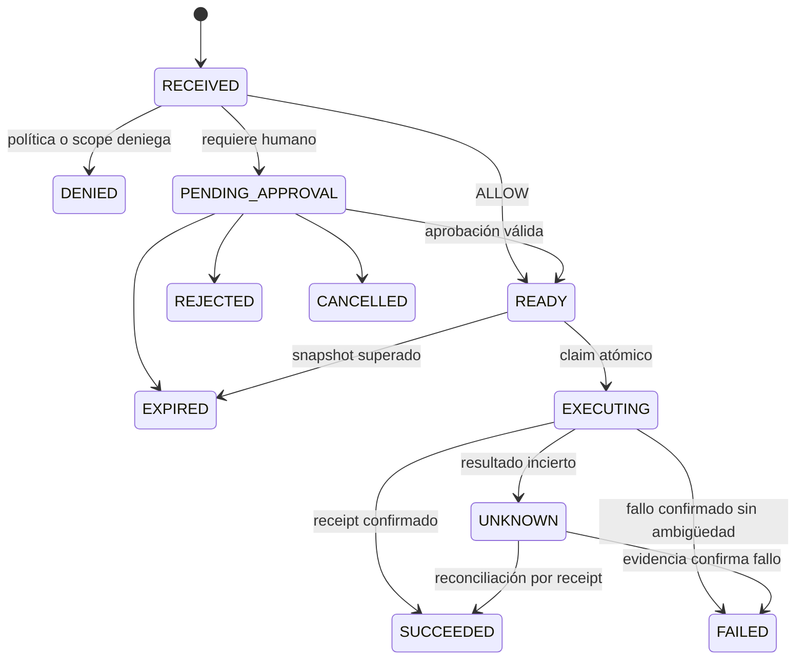

# Arquitectura de WALLBA

Un backend modular contiene control, políticas y auditoría; un proceso separado contiene herramientas. La separación del ejecutor es necesaria: una convención de imports en un monolito no impide el bypass de un agente comprometido. No se necesita una red de microservicios para separar este límite.



## Componentes y propiedad



Las flechas indican contratos, no esperas completas. En el primer hito todos obtienen fixtures y puertos falsos. P2/P3 usan HTML accesible mínimo hasta que P4 entregue componentes; no esperan al dashboard.

## Flujo de autorización



## Interacción del agente



## Despliegue local

### Estados de una solicitud



No hay transición automática UNKNOWN -> READY. Denegación es una decisión de autorización; FAILED es un resultado de ejecución. Mantener esa distinción en API, métricas y UI.

`web` publica solo `127.0.0.1:8080` y proxifica `/api`; API sin puerto público adicional. `agent` solo llega a API, carece de mounts/credenciales del ejecutor. `executor` comparte red interna con API, sin puertos del host y con filesystem read-only salvo sandbox sintético y journal. El runner baseline usa otro ejecutor y volúmenes desechables, activados por perfil Compose `demo`, sin identidad válida para el ejecutor protegido. No hay flag público `firewall=false` sobre recursos protegidos.

El host administrador puede acceder a contenedores y secretos: la garantía no incluye root. No montar Docker socket ni directorios del usuario. Los ejemplos de comandos serán del entorno ficticio; destruir una demo requiere run_id y volumen con label del proyecto.

## Estructura propuesta de código (aún no creada)

```text
backend/wallba/
  contracts/        # P1 DTO base; revisión P2/P3/P4
  foundation/      # P1 app factory, config y DB
  agent/           # P1 simulador y adapter live opcional
  executor/        # P1 herramientas y servicio interno
  demo/            # P1 fixtures, runner, comparación
  policy/          # P2 parser/evaluator/repository/API
  auth/            # P3 sesiones y bearer
  gateway/         # P3 enforcement y ejecución
  approvals/       # P3 state machine y API
  observability/   # P4 auditoría/métricas/read API
frontend/src/
  app/             # P4 shell/routing/provider
  components/      # P4 primitives accesibles
  features/
    policies/      # P2
    approvals/     # P3
    dashboard/ agents/ audit/ playground/ attack-matrix/ # P4
contracts/         # P1 OpenAPI, ejemplos y cliente generado
infra/             # P1 Compose, Dockerfiles
policies/          # P2 políticas de ejemplo
tests/             # Cada persona posee su subdirectorio
```

Futuro: PostgreSQL y múltiples workers, OIDC, adapters reales, política externa, exportación WORM. Cada incremento requiere nuevo threat model; no se promete que el MVP ya lo soporte.

[Seguridad](SECURITY_MODEL.md) · [Contratos](INTEGRATION_CONTRACTS.md) · [Índice](../README.md)
