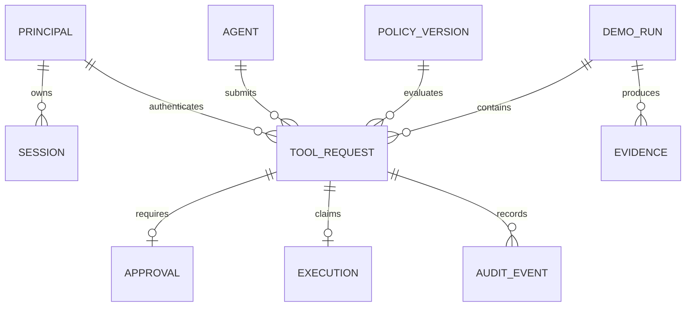

# Persistencia y migraciones

Dos límites de datos: SQLite de control en API y SQLite sintético/journal en ejecutor. Baseline y protected tienen archivos/volúmenes distintos. Ningún proceso agente monta las bases. P1 proporciona configuración, Alembic y migración inicial coordinada; P2/P3/P4 poseen modelos y migraciones de sus dominios. Cada revisión Alembic declara parent único; resolver heads mediante migración merge revisada, no renumerar migraciones publicadas.

| Tabla / dueño | Campos esenciales y restricciones | Índices |
|---|---|---|
| principals P3 | id PK, username UNIQUE, password_hash, roles_json, disabled, kind human/agent | username |
| sessions P3 | id_hash PK, principal FK, csrf_hash, expires_at,last_seen_at, revoked_at | principal, expiry |
| agent_credentials P3 | token_hash UNIQUE, agent FK, scopes_json, revoked_at | agent |
| agents P1 | id PK, name, tools_json, resource_scopes_json, status | status |
| policy_versions P2 | (policy_id,version) PK, normalized_json, checksum, created_by, created_at; immutable | checksum |
| policy_activation P2 | singleton_id=1, policy_id/version FK, revision integer | singleton |
| tool_requests P3 | request_id PK, principal_id FK, agent FK, env, canonical_json,digest, state, row_version, policy_id/version, decision, reason,risk,idempotency_key | UNIQUE(principal_id,idempotency_key), state, created_at/id |
| approvals P3 | id PK, request_id UNIQUE FK, snapshot_json,digest, policy_id/version, resource_version, expires_at,status,row_version,approver_id,reason,consumed_at | status/expiry |
| executions P3 | execution_id PK, request_id UNIQUE FK, state, nonce_hash UNIQUE, claimed_at,result_digest,receipt_json | state |
| audit_events P4 | event_id PK, sequence UNIQUE, request_id nullable FK, type,timestamp,fields_json,previous_hash,event_hash | request_id, timestamp/id, agent/tool/decision |
| agent_runs P1 | run_id PK, agent FK, scenario_id, status, request_ids_json, transcript_json, created_by, created_at | status |
| demo_runs P1 | run_id PK,scenario_id,seed,fixture_digest,status,baseline_env,protected_env,created_by, started_at,completed_at,state_json | status,scenario_id; UNIQUE parcial de un solo run activo |
| evidence P1 | evidence_id PK,run_id FK,manifest_json,manifest_digest,schema_version | run_id |

En ejecutor P1: `execution_journal(execution_id PK, nonce_hash UNIQUE, request_digest, state, result_json, effect_count)`, `demo_records(id PK, tenant_marker, label, version)`, `outbox(message_id PK, execution_id UNIQUE, to_address, subject, body_digest, status='SIMULATED')`, `resource_versions(resource_id PK, version)`. Cada run tiene su propio archivo en un directorio etiquetado. No usar foreign keys hacia otra DB; enlazar por UUID en receipts.

JSON no es excusa para omitir esquema: validar al entrar/salir y migrar versiones. UTC consistente. Configurar foreign_keys ON por conexión, WAL y busy_timeout acotado 5s; probar BEGIN IMMEDIATE/CAS con el driver seleccionado, no asumir semántica de PostgreSQL. Un worker de API no elimina carreras entre requests o reinicios. No mantener transacción de control abierta durante HTTP al ejecutor.

## Invariantes

- No activar versión inexistente ni modificar documento versionado.
- Solo un claim por request_id y nonce; estados terminales no vuelven a READY.
- Aprobación referencia mismo digest/principal/env/version que ejecución.
- Auditoría y transición crítica en una transacción de control.
- Efecto y receipt del ejecutor confirmados juntos donde es posible; query/lectura tiene receipt aunque efecto cero.
- UNKNOWN no incrementa contador de éxito; effect_count nulo no equivale a cero.
- Dashboard calcula con consultas agregadas de datos persistidos, no contadores del navegador.

## Seed, reset y backup

Seed crea IDs constantes, catálogo de archivos y usuarios sintéticos sin password fijo en Git. Runner copia fixture inmutable para ambos lados y compara digest previo. Reset se limita al volumen con run_id y etiqueta WALLBA, bloqueado durante ejecución y nunca sobre DB control. Registra antes/después. P1 añade backup local y restore probado sobre copia; no versionar DB, hashes de sesión ni outbox con contenido. Migraciones se prueban de DB vacía y de fixture de versión previa; downgrade destructivo requiere backup y revisión humana.

Migrar a PostgreSQL cuando se necesiten múltiples writers intensivos o hosts; separar repositorios permite sustituir SQL sin reescribir motor puro. Repetir pruebas de CAS, aislamiento, timezone y recuperación; SQLite no valida semántica PostgreSQL por sí mismo.

[Seguridad](SECURITY_MODEL.md) · [Índice](../README.md)
