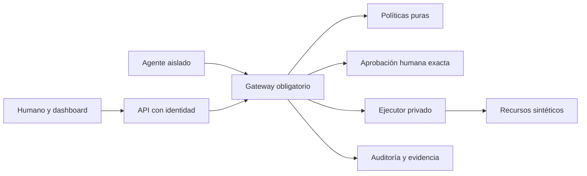

# Informe final de planificación

## A. Resumen ejecutivo

WALLBA interceptará llamadas de un agente a leer archivos, enviar correo simulado, eliminar registros ficticios y consultar queries permitidas. Autorizará mediante políticas YAML/JSON deterministas, aprobación humana de un solo consumo y auditoría verificable. El Playground comparará diez escenarios sobre entornos sintéticos equivalentes. Alcance aprobado pendiente; no se implementó la aplicación.

## B. Arquitectura elegida

Frontend React 19/TypeScript/Vite/Tailwind 4; API FastAPI/Pydantic 2; SQLAlchemy 2.0/SQLite para control; ejecutor separado con journal, credenciales y red privada; Compose y CI propuestos. Se evita SSR y una red innecesaria de servicios. [Comparación y fuentes](TECH_STACK.md).

[Diagramas completos](ARCHITECTURE.md): arquitectura, componentes, autorización, interacción y dependencias; [estados/aprobación](SECURITY_MODEL.md), [ER](DATABASE_DESIGN.md) y [comparación](DEMO_SCENARIOS.md).

## C. Distribución del trabajo

| Integrante | Responsabilidades finales | Tareas | Unidades | Porcentaje |
|---|---|---:|---:|---:|
| P1 | Contratos/base, agente/ejecutor, fixtures/runner, infraestructura/CI | 10 | 25 | 25 % |
| P2 | Motor y seguridad de políticas, API, editor | 10 | 25 | 25 % |
| P3 | Identidad, gateway, aprobación exacta y centro visual | 10 | 25 | 25 % |
| P4 | Sistema visual, auditoría, dashboard, Playground, matriz, E2E coordinado | 9 | 25 | 25 % |
| **Total** | **Cuatro humanos** | **39** | **100** | **100 %** |

No hay quinta responsabilidad. Pruebas, integración y documentación están en cada presupuesto. [Matriz con justificaciones](TASK_MATRIX.md) y [paths](OWNERSHIP_MATRIX.md).

## D. Subagentes

| Archivo real | Responsabilidad | Cuándo |
|---|---|---|
| [p1-system-architect](../.cursor/agents/p1-system-architect.md) | Base, contratos e infraestructura | Preparación y cambios compartidos |
| [p1-ai-agent-engineer](../.cursor/agents/p1-ai-agent-engineer.md) | Agent/tools/ejecutor/runner | Implementación y demo |
| [p2-policy-engineer](../.cursor/agents/p2-policy-engineer.md) | Parser, motor, API y editor | Reglas y administración |
| [p2-security-auditor](../.cursor/agents/p2-security-auditor.md) | Revisión adversarial readonly | Cambios de permisos y trust boundaries |
| [p3-proxy-engineer](../.cursor/agents/p3-proxy-engineer.md) | Gateway, auth y ejecución | Enforcement e integración |
| [p3-approval-engineer](../.cursor/agents/p3-approval-engineer.md) | Flujo humano exacto/UI | Aprobación, TTL y concurrencia |
| [p4-frontend-designer](../.cursor/agents/p4-frontend-designer.md) | Diseño, shell y accesibilidad | Pantallas y revisión visual |
| [p4-observability-demo](../.cursor/agents/p4-observability-demo.md) | Auditoría y experiencia demo | Evidencia, métricas y comparación |
| [wallba-verifier](../.cursor/agents/wallba-verifier.md) | Verificación independiente readonly | Cada bloque entregable |

Configuración contrastada con [documentación oficial de Cursor](https://cursor.com/docs/subagents). Reconocimiento en la instalación del equipo pendiente; archivos escritos no equivalen a agentes ejecutándose. [Protocolo](CURSOR_WORKFLOW.md).

## E. Documentación creada

El [índice completo](../README.md) enlaza todos los documentos y su función. Incluye 21 documentos globales, cuatro manuales, cuatro JSON fuente, README/AGENTS, nueve agentes, diez reglas, dos plantillas y dos scripts documentales. Los manuales están exactamente en `docs/team/PERSON_1_MASTER_PLAN.md` hasta `PERSON_4_MASTER_PLAN.md`.

Reglas: [architecture](../.cursor/rules/architecture.mdc), [api-contracts](../.cursor/rules/api-contracts.mdc), [security](../.cursor/rules/security.mdc), [code-quality](../.cursor/rules/code-quality.mdc), [testing](../.cursor/rules/testing.mdc), [ownership](../.cursor/rules/ownership.mdc), [frontend-design](../.cursor/rules/frontend-design.mdc), [delegation](../.cursor/rules/delegation.mdc), [documentation](../.cursor/rules/documentation.mdc), [collaboration](../.cursor/rules/collaboration.mdc). El frontmatter usa [campos oficiales](https://cursor.com/docs/rules).

Scripts: [generador de tablas](../scripts/build_plan_tables.py) y [validador](../scripts/validate_plan.py). No contienen lógica productiva.

## F. Cronograma

Seis ciclos relativos: 0 contratos y mocks; 1 cortes iniciales; 2 integración de enforcement/UI; 3 seguridad y paired demo; 4 E2E/diseño/CI; 5 ensayo reproducible y entrega. Las cuatro personas trabajan simultáneamente; capacidad y calendario se fijan al conocer disponibilidad. [Roadmap](ROADMAP.md) detalla riesgos, entregables y gates.

## G. Riesgos

Acceso remoto no verificado; compatibilidad exacta por resolver; parser y carreras; autenticación/identidad de aprobador; timeout tras efecto; alcance de interfaz. Mitigaciones: inspección previa, locks probados, esquemas cerrados, CAS/journal, UNKNOWN y UI compartida. Política se autoriza en el commit del claim: revocación posterior no retira capacidades de TTL30s. Auditoría local no resiste root. Agente guionado no demuestra robustez universal ante prompt injection. [Modelo](SECURITY_MODEL.md) y manuales detallan riesgos restantes.

## H. Validación del equilibrio

10+10+10+9 tareas no implican cargas diferentes: los esfuerzos suman 25 por persona, 100 total. Se trasladaron editor de políticas a P2, centro de aprobaciones a P3 y backend de evidencia/runner a P1 para equilibrar la carga original de P4. Desgloses incluyen investigación, incertidumbre, implementación, pruebas, integración y docs. Reestimar al terminar contratos y cada ciclo; no garantizar horas idénticas ni esconder desviaciones. [Balance](WORKLOAD_BALANCE.md).

## I. Inicio del desarrollo

Después de aprobar este plan: obtener checkout real, comparar archivos y abrir raíz en Cursor. Cada persona lee AGENTS, contratos y su manual, comprueba reglas/subagentes y usa el prompt final de la sección 23.

| Persona | Primera tarea desbloqueada | Manual |
|---|---|---|
| P1 | WAL-P1-001: DTO y fixtures de contrato | [P1](team/PERSON_1_MASTER_PLAN.md) |
| P2 | WAL-P2-001: schemas de políticas contra DTO acordado | [P2](team/PERSON_2_MASTER_PLAN.md) |
| P3 | WAL-P3-001: identidades/auth, con puertos simulados | [P3](team/PERSON_3_MASTER_PLAN.md) |
| P4 | WAL-P4-001 y diseño AuditSink WAL-P4-003 en paths separados | [P4](team/PERSON_4_MASTER_PLAN.md) |

Una tarea pequeña por ciclo de delegación; principal revisa diff/tests; humano revisa entrega. No push o merge sin autorización explícita.

## J. Pendientes y aprobación

Decisiones humanas: aprobar alcance y diseño propuesto; asignar los cuatro nombres y capacidad; facilitar acceso al repositorio y reconciliar estado real; confirmar si habrá referencias visuales posteriores. No bloquea el MVP carecer de proveedor LLM: simulación determinista es obligatoria y adaptador live es futuro. No se requieren cuentas de correo o DB reales.

La [auditoría documental](PLAN_AUDIT.md) distingue validaciones ejecutadas de pruebas de producto pendientes. El trabajo se detiene antes de implementación funcional, conforme a las reglas 18 y paso 22 de la solicitud original. La aprobación solicitada es para este plan concreto, sin incluir publicación remota.

[Índice](../README.md)
