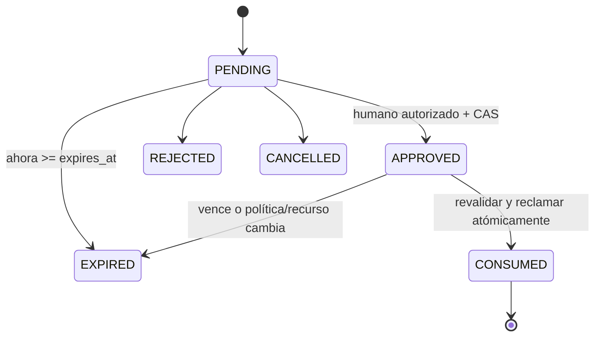
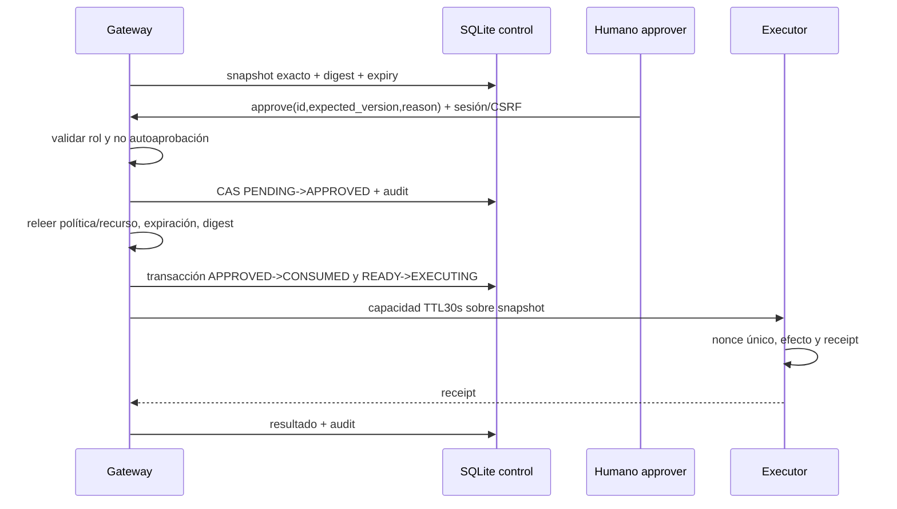

# Modelo de seguridad

WALLBA controla capacidades, recursos y parámetros. No detecta toda instrucción maliciosa ni hace confiable al LLM. Una instrucción inyectada puede inducir llamadas; el gateway debe impedir sus efectos si exceden permisos. La identidad y el contexto proceden del servidor.

## Activos, adversarios y límites

Activos: datos sintéticos protegidos, política activa, sesiones humanas, claves de capacidad, integridad de aprobaciones y evidencia. Adversario: agente comprometido, documento con instrucciones hostiles, usuario sin privilegios, cliente que manipula HTTP o repite mensajes. Dentro de confianza: API, motor determinista, ejecutor y host. Fuera: prompts, resultados de herramientas, navegador, arguments y contenido YAML antes de validar. Un actor root o con escritura sobre el proceso puede eludir el MVP; no se afirma protección contra él.

| Amenaza / fallo | Control específico | Dueño / comprobación |
|---|---|---|
| Prompt injection | Decidir por identidad y scope, jamás por texto del modelo | P2 + P1: escenario S08 |
| Argumentos manipulados | Unión estricta, canonical digest y resource_version | P3: cambiar un byte tras aprobar -> 409/denegación |
| Path traversal/symlink | ID virtual -> catálogo fijo; filesystem read-only, no rutas proporcionadas | P1: ../, NUL, symlink y recurso inexistente |
| SQL y alcance | Query IDs y sentencias parametrizadas fijas; límites de filas | P1: SQL/raw query rechazado |
| Exfiltración correo | Outbox sintético, `.test`, sin SMTP, política de destinatario | P1/P2: no tráfico saliente |
| Escalada de identidad | Bearer scoped, roles server, sesiones separadas | P3: agent bearer no aprueba |
| Política ausente/inválida | DENY al no existir activa válida; validar antes de activar | P2: fallo cerrado |
| Reglas contradictorias | DENY > REQUIRE_APPROVAL > ALLOW; orden no cambia efecto | P2: pruebas por permutación |
| Bypass proxy | Secretos/mounts/red privados; capacidad firmada validada por ejecutor | P1/P3: llamada directa falla |
| Replay/expiración | TTL 5 min, CAS, nonce UNIQUE, check hora servidor al consumir | P3: concurrencia y fake clock |
| TOCTOU | Releer policy version y resource_version antes de reclamar; invalidar aprobación vieja | P3/P2: activar nueva política entre aprobación y ejecución |
| Carreras | Transiciones condicionales SQL, journal persistente, no locks solo de memoria | P3/P1: doble submit/doble approve |
| Fallo de conexión | 503 antes de ejecución; UNKNOWN tras envío ambiguo | P3/P1: timeout y reconciliación |
| Manipular auditoría | Append-only aplicación, hash chain, export/checkpoint digest | P4: modificación rompe verificación |
| XSS / CSRF | Escapar contenidos, sin HTML arbitrario, CSP y token CSRF + Origin | P4/P3: contenido hostil y cross-origin |
| Brute force / abuso | Rate limit login; payload 64KiB; una demo activa; 100 reglas | P3/P2/P1: límites y 429 |

## Evaluación determinista

1. Validar sintaxis, tipos y límites; unknown tool/operation/resource -> DENY o 422 sin side effect.
2. Cargar snapshot válido e inmutable; ausente -> DENY `POLICY_MISSING`; inválido -> DENY `POLICY_INVALID`; fallo interno -> bloqueo `AUTHORIZATION_UNAVAILABLE`.
3. Calcular riesgo y contexto confiable. Coincidir agente, tool, recurso y todas las condiciones explícitas; listas son OR interno, campos son AND.
4. Recolectar reglas coincidentes. Cualquier DENY domina; luego REQUIRE_APPROVAL, luego ALLOW; sin coincidencias -> DENY `DEFAULT_DENY`.
5. Ordenar matched_rule_ids lexicalmente para reproducibilidad. `priority` numérica no forma parte del MVP; no se permiten campos ignorados.
6. Devolver reason_code, policy_id/version y riesgo, sin ejecutar herramientas.

Scope del bearer es un límite externo: una regla ALLOW no amplía scopes de credencial ni capacidades del ejecutor. Verificar scopes antes de evaluar. Política inválida nunca reemplaza la última activa válida. Si el almacenamiento activo está corrupto, no usar caché sin integridad comprobada.

## Aprobaciones

El estado de aprobación y el de ejecución son distintos: CONSUMED no significa SUCCEEDED. El job de expiración mejora UI, pero cada operación comprueba expiry por sí misma. No se reabre un estado terminal; nueva solicitud requiere nueva aprobación. `EXPIRED` por cambio de versión incluye reason `STALE_POLICY` o `STALE_RESOURCE`.

La API aprobar no acepta nuevos parámetros. Justificación obligatoria se almacena saneada. El approver siempre debe ser humano autorizado y distinto del principal solicitante, como invariante global; no hay herramientas de aprobación disponibles para el agente. El usuario operador que crea una demo no se convierte implícitamente en aprobador.

## Integridad y recuperación

Requests y decisiones persisten antes del efecto. Errores de auditoría previa bloquean. Se recomienda un checkpoint de exportación con digest guardado fuera del archivo de auditoría; la cadena local detecta corrupción accidental y cambios sin recomputar, pero un administrador puede reescribirla. Al reiniciar, EXECUTING se reconcilia con receipt del ejecutor; no pasa automáticamente a FAILED ni se reenvía. Evidencia y UI admiten UNKNOWN.

Retención MVP: conservar toda evidencia de demos hasta limpieza explícita de volúmenes del proyecto; secretos jamás en export. Eliminar una demo no elimina auditoría del plano de control. Registrar la limpieza y su run_id. Antes de futuras herramientas reales: vault, TLS, RBAC por organización, revocación distribuida, auditoría externa y revisión de amenazas.

[Políticas de ejemplo](POLICY_EXAMPLES.md) · [Pruebas](TEST_STRATEGY.md) · [Índice](../README.md)
