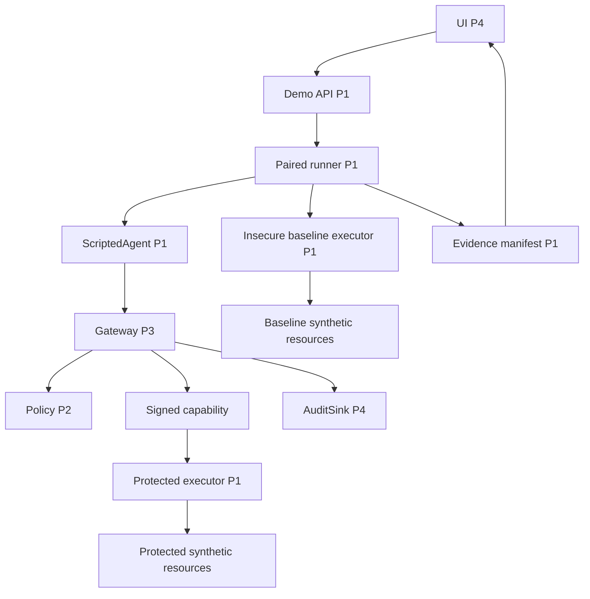

# Persona 1 — Fundación, agente, ejecutor y laboratorio reproducible

Contrato de trabajo para una de las **cuatro** personas de WALLBA.
Presupuesto: **25 unidades de esfuerzo; 25 % del total de 100**.
El esfuerzo incluye arquitectura, investigación, implementación, pruebas, documentación e integración.
Ninguna prueba de producto se considera ejecutada por existir este plan.
Implementar sólo después de aprobación humana del plan maestro.

Consultar [plan global](../MASTER_PLAN.md), [arquitectura](../ARCHITECTURE.md),
[API](../API_CONTRACTS.md), [puertos](../INTEGRATION_CONTRACTS.md),
[persistencia](../DATABASE_DESIGN.md), [demo](../DEMO_SCENARIOS.md),
[propiedad](../OWNERSHIP_MATRIX.md), [pruebas](../TEST_STRATEGY.md) y [stack](../TECH_STACK.md).

## 1. Identidad de la parte

- Responsable humano: Persona 1, sin transferir responsabilidad a subagentes.
- Módulo: Foundation, Agent, Executor and Demo.
- Objetivo: entorno reproducible y efectos sintéticos verificables detrás de un límite de ejecución real.
- Entregable: contratos materializados, app base, storage base, agente guionado, herramientas y runner paired.
- Incluye entorno Compose, CI coordinada y recuperación sobre copias.
- Carga: 25 puntos exactamente; las diez tareas de sección 10 son el presupuesto completo.
- Recibe de P2 el evaluador/políticas; de P3 gateway/auth/aprobaciones; de P4 AuditSink y frontend.
- P1 coordina integración de CI; no absorbe pruebas ni tareas de los otros tres.
- No existe un quinto equipo para integración, seguridad o documentación.

## 2. Contexto del proyecto

WALLBA intercepta solicitudes de herramientas de un agente y aplica políticas antes del efecto.
El agente no es autoridad para concederse acceso ni aprobar sus propias solicitudes.
Las decisiones `ALLOW`, `DENY` y `REQUIRE_APPROVAL` las produce el motor puro de P2.
El gateway P3 aplica la decisión y prepara una capacidad interna para el ejecutor P1.
P4 registra auditoría y presenta resultados; el frontend no autoriza efectos.
El ejecutor vive separado del agente y exige credencial de ejecución vinculada a parámetros exactos.
La demo compara solicitudes funcionalmente iguales en recursos distintos y desechables.
El baseline inseguro existe únicamente dentro del laboratorio, aislado del ejecutor protegido.
El MVP usa ScriptedAgent: un simulador de llamadas de herramientas, no un LLM general.
La interfaz debe rotular esa limitación para no atribuir inteligencia o detección no demostradas.
El puerto AgentAdapter permite introducir un proveedor real en una fase futura revisada.
No se necesita gastar créditos de un modelo para demostrar cumplimiento de permisos.

## 3. Objetivos funcionales

1. Materializar DTO, puertos y fixtures compartidos al comienzo para permitir trabajo paralelo.
2. Proporcionar app factory, configuración validada y dependencias reproducibles.
3. Crear infraestructura de persistencia y migración inicial sin apropiarse de dominios ajenos.
4. Mantener catálogo de agentes y sus herramientas/recursos asignados.
5. Ejecutar ScriptedAgent con escenarios cerrados y transcript identificable.
6. Implementar file.read, email.send, record.delete y db.query sobre recursos sintéticos.
7. Rechazar ejecución directa sin capacidad válida y defender nonce/digest/entorno.
8. Persistir journal/receipts y tratar timeout/reinicio sin duplicar efectos.
9. Sembrar dos entornos con el mismo fixture funcional y seed.
10. Ejecutar S01..S10 en modo paired y conservar resultados parciales.
11. Generar manifest y matriz derivados de observaciones reales.
12. Levantar Compose con redes/secretos/mounts mínimos y CI verificable.
13. Documentar backup, restore, reset y procedimiento reproducible de demostración.

## 4. Objetivos técnicos

- Contratos cerrados, tipados y versionados; no admitir parámetros SQL, rutas o comandos libres.
- Pydantic strict y extra forbid, Unicode NFC y límites de tamaño del contrato global.
- API con un worker; SQLite control separado de SQLite sintético/journal de cada ejecutor.
- No mantener transacciones de control abiertas durante HTTP al ejecutor o espera humana.
- Efectos de demo y receipt se confirman juntos donde el almacenamiento permite transacción local.
- Un request/execution/nonce no produce un segundo efecto por reintento de transporte.
- UNKNOWN conserva incertidumbre; no equivale a FAILED ni a cero efectos.
- No montar filesystem personal, Docker socket, credenciales humanas ni DB de control en agente.
- Publicar sólo web en 127.0.0.1:8080; API y ejecutor permanecen en redes internas.
- El ejecutor protegido exige capacidad firmada aun cuando la red interna sea alcanzable.
- Timeout de ejecución: 10 s inicial; un solo demo run concurrente y cinco llamadas por run.
- API listados p95 <300 ms con 10.000 eventos es objetivo de medida, no resultado certificado.
- Capturar versiones e imagen digest; evitar tags latest y locks regenerados sin revisión.
- Redactar datos sensibles; ningún token o secreto se imprime en logs/manifest.

## 5. Alcance y exclusiones

P1 posee contracts, foundation, agent, executor, demo, infra y su propio subdirectorio de tests.
También custodia OpenAPI y cliente generado; los consumidores revisan cambios de contrato.
P1 crea baseline Alembic y coordina heads; cada dueño escribe/revisa migraciones de su dominio.
P2 posee motor y editor de políticas; P3 auth/gateway/aprobaciones y su interfaz.
P4 posee auditoría persistente, read API de auditoría/dashboard, shell y pantallas de demostración.
P1 no decide permiso dentro del ejecutor reproduciendo el lenguaje de políticas.
El ejecutor valida capacidad y límites estructurales; P3/P2 deciden si se autoriza.
No implementar correo real, bases externas, lectura libre de host o consultas SQL del usuario.
No incluir Kubernetes, Redis, colas distribuidas, multiempresa ni varios workers.
No incluir proveedor LLM live como requisito del MVP ni prometer exactly-once distribuido.
El alcance mínimo conserva cuatro herramientas, diez escenarios y comparación verificable.
Funciones futuras requieren reestimar y actualizar threat model antes de añadir conectividad real.

## 6. Tecnologías

| Área | Elección | Motivo / condición |
|---|---|---|
| Runtime | Python 3.12.x | Base backend común y mantenible |
| API | FastAPI + Uvicorn un worker | OpenAPI y composición modular |
| Validación | Pydantic 2 strict | Contratos discriminados y límites cerrados |
| DB | SQLAlchemy 2.0 + SQLite | MVP local con transacciones explícitas |
| Migraciones | Alembic | Evolución de esquema coordinada |
| Backend deps | uv + uv.lock | Resolver/fijar runtime y dependencias |
| Frontend base | React 19, TS 5, Vite, Node 22.12+ | Dashboard privado sin SSR requerido |
| Estilos | Tailwind 4 | P4 entrega diseño/componentes |
| HTTP interno | httpx | Timeout explícito y dobles de transporte |
| Firma/digest | HMAC-SHA256 / SHA-256 | Integridad de capacidad y evidencia según contrato |
| Pruebas | pytest/httpx, Vitest, Playwright | Cada persona conserva sus suites |
| Entorno | Docker Compose + GitHub Actions | Reproducibilidad local/CI sin orquestador pesado |

P1 fija parches exactos e imágenes digest tras resolver compatibilidad; no se afirma instalación actual.
Fuentes oficiales y alternativas comparadas están en [TECH_STACK.md](../TECH_STACK.md).
Los comandos de este manual son objetivos de la futura estructura, no comandos ya disponibles.
No añadir un framework de agentes si un protocolo y un guion bastan para esta demostración.

## 7. Arquitectura particular



`create_app` compone routers y dependencias inyectables; no crea conexiones durante import.
`Settings` valida rol del proceso, rutas internas permitidas y secretos requeridos.
`AgentAdapter.next_calls` genera intenciones a partir de escenario/resultados.
`ToolGateway.submit` es el único puerto de herramientas disponible para agente.
`ExecutorService.execute` valida capacidad y reclama ejecución antes de dispatch.
`ToolRegistry` selecciona sólo cuatro adaptadores conocidos; sin imports dinámicos del payload.
`ExecutionJournal` conserva resultado recuperable por execution_id.
`FixtureFactory` crea recursos baseline/protected con digest equivalente.
`DemoRunner` coordina, persiste estado y reanuda tras aprobación/receipt sin reiniciar el run.
`EvidenceBuilder` produce manifest versionado y observaciones separadas de expectativas.
`MatrixQuery` lee evidencia persistida; nunca fabrica filas de un catálogo de escenarios.

## 8. Estructura de archivos

```text
backend/
  pyproject.toml                         # P1 dependencias backend
  uv.lock                                # P1 lock exacto
  alembic/                               # P1 baseline; revisiones por dominio
  wallba/
    contracts/                           # P1 DTO/puertos compartidos
    foundation/
      app.py                             # composición y lifecycle
      config.py                          # configuración tipada
      database.py                        # engine/session/pragmas
    agent/
      adapter.py                         # interfaz AgentAdapter
      scripted.py                        # guiones deterministas
      service.py                         # runs y transcripts
      routes.py                          # agents y agent-runs
    executor/
      service.py                         # validación y dispatch interno
      capabilities.py                    # verificación HMAC/TTL/audience
      journal.py                         # claim y receipt duradero
      tools/
        file_reader.py                   # catálogo inmutable
        email_sender.py                  # outbox simulado
        record_deleter.py                # SQL parametrizado interno
        database_query.py                # consultas predefinidas
    demo/
      fixtures.py                        # seed y copias independientes
      scenarios.py                       # S01..S10
      runner.py                          # máquina del paired run
      evidence.py                        # manifest/observaciones
      routes.py                          # demo/matrix/evidence API
      README.md                          # operación y recuperación
contracts/
  openapi.json                           # snapshot generado P1
  examples/                              # fixtures contractuales P1
frontend/
  package.json                           # P4 crea/posee; P1 revisa compatibilidad
  package-lock.json                      # P4 lock; P1 consume en CI
  src/api/generated.ts                   # P1 generado, no editar a mano
infra/
  compose.yaml                           # P1 redes/perfiles/mounts
  Dockerfile.api                         # P1 imagen backend
  Dockerfile.executor                    # P1 proceso separado
  Dockerfile.agent                       # P1 agente sin recursos
  Dockerfile.web                         # P1 build/proxy local
.github/workflows/ci.yml                  # P1 coordinación CI
.env.example                             # P1 sólo nombres/valores no secretos
 tests/contracts/                        # P1
 tests/foundation/                       # P1
 tests/agent/                            # P1
 tests/executor/                         # P1
 tests/demo/                             # P1
 tests/infra/                            # P1
 tests/integration/test_foundation_demo.py # P1 integración propia
```

Los espacios iniciales en el árbol son ilustrativos; las rutas reales comienzan `tests/`.
No crear directorios de producción durante planificación; este árbol guía implementación aprobada.
No editar policy/auth/gateway/approvals/observability o features de UI de otros propietarios.
Cambiar código generado implica cambiar fuente y regenerar, con diff/revisión de consumidores.

## 9. Contratos

La referencia canónica es [API_CONTRACTS.md](../API_CONTRACTS.md).
P1 no puede ampliar DTO unilateralmente mientras otros trabajan contra sus fixtures.

### 9.1. ToolCall y recursos

ToolCall contiene request_id, agent_id, tool, operation, resource_id y parameters.
Principal, roles, environment_id, riesgo y tiempo son derivados por servidor.
`agent_id` coincide con bearer o agente seleccionado por un operador autorizado.

| Tool | Operation | Resource | Parameters exhaustivos |
|---|---|---|---|
| file.read | read | file:public-guide / file:restricted-ledger | max_bytes entero 1..16384 |
| email.send | send | mailbox:demo-outbox | to string `.test`, subject <=120, body <=4096 |
| record.delete | delete | table:demo-records | record_id UUID |
| db.query | query | query:demo-records | query_id list_records/count_records, limit 1..100 |

No recibir SQL, command, filepath, arbitrary_url ni claves extra.
El cuerpo de correo es sólo fixture sintético; no se entrega a SMTP.
El adaptador resuelve recurso en catálogo de su entorno; rechaza identificadores desconocidos.
`record_id` se vincula al entorno demo y no permite cambiar DB/tabla.
La lectura de archivo protege symlinks y mounts: catálogo inmutable sólo dentro del sandbox.

### 9.2. Puertos compartidos

- AgentAdapter: `next_calls(scenario, tool_results) -> list[ToolCall]`.
- ToolGateway P3: `submit(call, principal, idempotency_key) -> RequestView`.
- ExecutorPort P1: `execute(canonical_request, capability) -> ExecutionReceipt`.
- ExecutorPort P1: `receipt(execution_id) -> ExecutionReceipt | not_found` autenticado.
- AuditSink P4: `append(event, transaction) -> event_id`.
- DemoRunner P1: `run_pair(scenario_id, seed) -> DemoRun`.

ExecutionReceipt incluye execution_id, request_id, state, result_digest, effect_count,
evidence_id y completed_at. state es SUCCEEDED, FAILED o UNKNOWN; effect_count puede ser null.
CanonicalRequest y firma siguen exactamente [INTEGRATION_CONTRACTS.md](../INTEGRATION_CONTRACTS.md).
No incluir policy_version dentro del digest base de ToolCall; queda enlazada en capacidad/snapshot.

### 9.3. API pública propiedad P1

| Método/ruta bajo /api/v1 | Entrada | Salida y autorización |
|---|---|---|
| GET /agents | cursor/limit | listado id/name/tools/status, viewer |
| GET /agents/{id} | id | detalle y scopes, viewer |
| POST /agent-runs | scenario_id | run_id, operator + CSRF, demo only |
| GET /agent-runs/{id} | run id | estado y request_ids, viewer |
| GET /scenarios | filtros de catálogo | expectativas rotuladas, viewer |
| POST /demo-runs | scenario_id,seed,mode:'paired' | 202 run_id/status, operator + CSRF |
| GET /demo-runs/{id} | run id | lados baseline/protected y receipts, viewer |
| GET /demo-runs/{id}/evidence | run id | manifest y refs, viewer |
| GET /matrix | filtros tipados | filas observadas, inicialmente [], viewer |
| GET /health/live | vacío | status ok, loopback |
| GET /health/ready | vacío | DB/policy/executor booleans, 503 si falta, loopback |

El control RBAC/CSRF se inyecta desde P3; mocks sólo en tests/dev rotulados.
No existe query parameter o endpoint `firewall=false` en herramientas protegidas.
Listado retorna items/next_cursor con cursor opaco y límite máximo 100.
Conflicto por otro run activo usa 409; esquema usa 422; autorización/auditoría indisponible usa 503.
La API de receipt del ejecutor es interna, autenticada y fuera de esta superficie pública.

### 9.4. Eventos y persistencia

P1 publica demo_started/completed y receipts por puertos, sin escribir tablas de auditoría directamente.
Control DB contiene agents, demo_runs y evidence de P1 además de dominios ajenos.
Ejecutor mantiene execution_journal, demo_records y outbox en almacenamiento propio.
Baseline y protected no comparten archivos, credenciales, nonce store ni outbox.
FK no cruza bases; correlacionar por UUID y digest.
Conservar manifest y estado parcial incluso cuando un lado falla; no fabricar receipt de bloqueo.

## 10. Plan de implementación paso a paso

Todas las tareas se reflejan en [TASK_MATRIX.md](../TASK_MATRIX.md).
Las subtareas forman parte de la estimación; no son trabajo extra sin dueño.
La dependencia técnica entre módulos se resuelve con fixtures/puertos tempranos, no esperando todo P1.

### WAL-P1-001 — Contratos compartidos y fixtures iniciales

- Historia: Como integrante necesito contratos antes de depender de otro módulo.
- Prioridad: Crítica; esfuerzo: **2 puntos**; estado: Pendiente.
- Dependencias: ninguna; contrato de planificación aprobado.
- Delegación: p1-system-architect; revisión final del humano.
- Archivos: `backend/wallba/contracts/`, `contracts/openapi.json`, `contracts/examples/`, `frontend/src/api/generated.ts`.
1. Materializar DTO Pydantic discriminados y estados de API con extra forbid.
2. Definir puertos sin imports de implementaciones y generar cliente TypeScript.
3. Publicar fixtures allow/deny/pending/error saneados; revisar con P2/P3/P4.

Aceptación: Given un campo extra o tool/operation incoherentes, When se valida el DTO, Then se rechaza y Python/TypeScript conservan el mismo contrato.

Validación prevista: `pytest tests/contracts; npm --prefix frontend run typecheck`.

Estimación razonada: 0.8 tipos/puertos + 0.5 generador/fixtures + 0.4 revisión/pruebas + 0.3 documentación.

Evidencia requerida: diff, comando/fecha/entorno, resultado observado y artifacts trazables.

### WAL-P1-002 — Scaffold reproducible y configuración segura

- Historia: Como equipo necesito instalar y arrancar desde una base reproducible.
- Prioridad: Alta; esfuerzo: **2 puntos**; estado: Pendiente.
- Dependencias: WAL-P1-001.
- Delegación: p1-system-architect; revisión final del humano.
- Archivos propios: `backend/wallba/foundation/app.py`, `backend/wallba/foundation/config.py`, `backend/pyproject.toml`, `backend/uv.lock`, `.env.example`. P4 crea `frontend/package.json` y su lock; P1 solicita y revisa compatibilidad, sin editarlos simultáneamente.
1. Crear app factory sin registrar endpoints ajenos prematuramente.
2. Resolver versiones compatibles y locks; separar perfiles control/executor/agent/demo.
3. Validar configuración y secretos al inicio, sin valores reales en Git.

Aceptación: Given un entorno limpio y configuración válida, When se instalan locks, Then arranca health local; con secreto requerido ausente falla cerrado.

Validación prevista: `pytest tests/foundation/test_config.py; npm --prefix frontend run build`.

Estimación razonada: 0.8 estructura/locks + 0.5 configuración + 0.4 pruebas smoke + 0.3 guía.

Evidencia requerida: diff, comando/fecha/entorno, resultado observado y artifacts trazables.

### WAL-P1-003 — Persistencia base y migraciones coordinadas

- Historia: Como desarrollador necesito almacenamiento con invariantes y evolución explícitas.
- Prioridad: Alta; esfuerzo: **2 puntos**; estado: Pendiente.
- Dependencias: WAL-P1-002.
- Delegación: p1-system-architect; revisión final del humano.
- Archivos: `backend/wallba/foundation/database.py`, `backend/alembic/`, `tests/foundation/test_migrations.py`.
1. Preparar engine/session SQLite, foreign keys, WAL y busy_timeout de 5s.
2. Crear baseline Alembic y modelos agents/demo_runs/evidence; integrar revisiones de modelos ajenos con sus dueños.
3. Probar DB vacía y upgrade desde fixture previo; definir backup/restore sobre copia.

Aceptación: Given DB vacía o fixture previo, When se aplica migración, Then existen restricciones y no se pierden datos anteriores.

Validación prevista: `pytest tests/foundation/test_migrations.py`.

Estimación razonada: 0.7 base/DDL propio + 0.5 coordinación migraciones + 0.5 pruebas + 0.3 recuperación.

Evidencia requerida: diff, comando/fecha/entorno, resultado observado y artifacts trazables.

### WAL-P1-004 — Cuatro herramientas con efectos sintéticos

- Historia: Como demostrador necesito efectos verificables sin recursos reales.
- Prioridad: Crítica; esfuerzo: **3 puntos**; estado: Pendiente.
- Dependencias: WAL-P1-001, WAL-P1-003.
- Delegación: p1-ai-agent-engineer; revisión final del humano.
- Archivos: `backend/wallba/executor/tools/`, `tests/executor/test_tools.py`.
1. Implementar file.read por catálogo inmutable y max_bytes acotado.
2. Implementar email.send como outbox SIMULATED, record.delete parametrizado y db.query por query_id cerrado.
3. Validar de nuevo DTO/recurso en ejecutor y producir resultados saneados con digest.

Aceptación: Given parámetros válidos sobre fixture, When se ejecuta cada herramienta, Then el efecto/resultados son medibles; parámetros extra/rutas/SQL se rechazan.

Validación prevista: `pytest tests/executor/test_tools.py`.

Estimación razonada: 1.4 adaptadores + 0.5 aislamiento/catálogos + 0.8 pruebas/errores + 0.3 documentación.

Evidencia requerida: diff, comando/fecha/entorno, resultado observado y artifacts trazables.

### WAL-P1-005 — Agente guionado y APIs de catálogo

- Historia: Como usuario necesito un agente demostrativo que genere solicitudes trazables.
- Prioridad: Alta; esfuerzo: **2 puntos**; estado: Pendiente.
- Dependencias: WAL-P1-001, WAL-P1-002.
- Delegación: p1-ai-agent-engineer; revisión final del humano.
- Archivos: `backend/wallba/agent/`, `tests/agent/`.
1. Definir AgentAdapter y ScriptedAgent con escenarios cerrados y máximo cinco llamadas.
2. Enviar solicitudes sólo por ToolGateway con credencial scope, sin acceso al ejecutor ni datos.
3. Implementar GET agents/detalle y POST/GET agent-runs con estados y transcripciones saneadas.

Aceptación: Given S08 con instrucción maliciosa ficticia, When corre ScriptedAgent, Then genera la llamada destructiva guionada y declara que no es inferencia de LLM.

Validación prevista: `pytest tests/agent`.

Estimación razonada: 0.8 adapter y trace + 0.5 API + 0.5 pruebas + 0.2 límites de demostración.

Evidencia requerida: diff, comando/fecha/entorno, resultado observado y artifacts trazables.

### WAL-P1-006 — Servicio ejecutor con capacidades y journal

- Historia: Como proxy necesito un ejecutor que rechace acceso directo y replay.
- Prioridad: Crítica; esfuerzo: **3 puntos**; estado: Pendiente.
- Dependencias: WAL-P1-003, WAL-P1-004.
- Delegación: p1-ai-agent-engineer; revisión final del humano.
- Archivos: `backend/wallba/executor/service.py`, `backend/wallba/executor/capabilities.py`, `backend/wallba/executor/journal.py`, `tests/executor/test_capabilities.py`, `tests/executor/test_recovery.py`.
1. Validar HMAC, audience, TTL, nonce, digest, principal, entorno, resource_version y policy version según contrato de P3.
2. Reclamar execution_id/nonce de forma única y confirmar efecto/receipt juntos cuando sea posible.
3. Exponer receipt interno autenticado y resolver timeout/reinicio sin reintentar efectos a ciegas.

Aceptación: Given capacidad alterada, expirada, replay o entorno distinto, When se invoca ejecutor, Then cero efecto nuevo; receipt duradero preserva resultado tras reinicio.

Validación prevista: `pytest tests/executor/test_capabilities.py tests/executor/test_recovery.py`.

Estimación razonada: 1.0 seguridad del puerto + 0.8 journal/transacciones + 0.9 fallos/concurrencia + 0.3 revisión P3.

Evidencia requerida: diff, comando/fecha/entorno, resultado observado y artifacts trazables.

### WAL-P1-007 — Fixtures duales y catálogo de diez escenarios

- Historia: Como equipo necesito comparar condiciones iniciales equivalentes.
- Prioridad: Alta; esfuerzo: **2 puntos**; estado: Pendiente.
- Dependencias: WAL-P1-004, WAL-P1-005.
- Delegación: p1-ai-agent-engineer; revisión final del humano.
- Archivos: `backend/wallba/demo/fixtures.py`, `backend/wallba/demo/scenarios.py`, `tests/demo/test_fixtures.py`.
1. Crear fixture inmutable con filas UUID, archivos públicos/restringidos y outbox vacía.
2. Preparar S01..S10 y secuencias especiales S07/S09/S10 junto a P2/P3.
3. Copiar baseline/protected con seed común, digest inicial y recursos separados por run_id.

Aceptación: Given una seed idéntica, When se preparan los dos entornos, Then los digests funcionales iniciales coinciden y los volúmenes son distintos.

Validación prevista: `pytest tests/demo/test_fixtures.py`.

Estimación razonada: 0.7 dataset + 0.5 catálogo + 0.6 reproducibilidad + 0.2 coordinación/documentación.

Evidencia requerida: diff, comando/fecha/entorno, resultado observado y artifacts trazables.

### WAL-P1-008 — Runner paired, matriz y evidencia

- Historia: Como presentador necesito observar la misma intención con y sin firewall.
- Prioridad: Crítica; esfuerzo: **4 puntos**; estado: Pendiente.
- Dependencias: WAL-P1-005, WAL-P1-006, WAL-P1-007.
- Delegación: p1-ai-agent-engineer; revisión final del humano.
- Archivos: `backend/wallba/demo/runner.py`, `backend/wallba/demo/evidence.py`, `backend/wallba/demo/routes.py`, `tests/demo/test_runner.py`, `tests/demo/test_evidence.py`.
1. Ejecutar pareja aislada sin flag de bypass sobre protegido; persistir estados parciales y espera humana.
2. Implementar APIs scenarios/demo-runs/evidence/matrix con RBAC y CSRF de P3.
3. Generar manifest de inputs, before/after, receipts, decisiones, versiones y audit IDs.
4. Mantener matriz vacía hasta runs reales; distinguir observado/esperado/N/A/UNKNOWN y no autoaprobar S06.

Aceptación: Given S04 desde fixture limpio, When completa runner real, Then baseline elimina y protected conserva fila con decisión, journal y manifest verificables.

Validación prevista: `pytest tests/demo/test_runner.py tests/demo/test_evidence.py`.

Estimación razonada: 1.5 orchestration + 0.8 API/persistencia + 0.9 evidencia/fallos + 0.5 integración + 0.3 guía demo.

Evidencia requerida: diff, comando/fecha/entorno, resultado observado y artifacts trazables.

### WAL-P1-009 — Aislamiento Compose y coordinación CI

- Historia: Como equipo necesito levantar el sistema y validar cambios de forma consistente.
- Prioridad: Crítica; esfuerzo: **3 puntos**; estado: Pendiente.
- Dependencias: WAL-P1-002, WAL-P1-003, WAL-P1-006.
- Delegación: p1-system-architect; revisión final del humano.
- Archivos: `infra/compose.yaml`, `infra/Dockerfile.api`, `infra/Dockerfile.executor`, `infra/Dockerfile.agent`, `infra/Dockerfile.web`, `.github/workflows/ci.yml`, `tests/infra/`.
1. Crear redes/volúmenes/secret mounts mínimos y publicar sólo web en loopback.
2. Separar baseline por perfil demo y negar reachability agente-ejecutor.
3. Configurar CI de locks, tipos, tests por dueño, build, OpenAPI diff y seguridad de dependencias.

Aceptación: Given Compose de demo, When agente intenta acceder al ejecutor o sus volúmenes, Then no tiene red/credenciales/mounts y las pruebas de aislamiento fallan si se añade acceso.

Validación prevista: `docker compose -f infra/compose.yaml config; pytest tests/infra`.

Estimación razonada: 1.1 Compose/Docker + 0.7 CI + 0.8 pruebas seguridad/build + 0.4 instrucciones.

Evidencia requerida: diff, comando/fecha/entorno, resultado observado y artifacts trazables.

### WAL-P1-010 — Integración final y recuperación demostrable

- Historia: Como equipo necesito una demo recuperable con limitaciones explícitas.
- Prioridad: Alta; esfuerzo: **2 puntos**; estado: Pendiente.
- Dependencias: WAL-P1-008, WAL-P1-009.
- Delegación: Humano + wallba-verifier; revisión final del humano.
- Archivos: `tests/integration/test_foundation_demo.py`, `tests/foundation/test_restore.py`, `backend/wallba/demo/README.md`.
1. Conectar gateway real P3, motor P2 y AuditSink P4 sin asumir sus suites.
2. Probar backup/restore en copia y reset limitado a volúmenes etiquetados por run_id.
3. Preparar procedimiento de demo, evidencia final y PR con riesgos/rollback.

Aceptación: Given un fallo a mitad de run o reinicio tras efecto, When se recupera, Then se conserva evidencia y no se repite una operación por ausencia de respuesta.

Validación prevista: `pytest tests/integration/test_foundation_demo.py tests/foundation/test_restore.py`.

Estimación razonada: 0.7 integración + 0.5 recuperación + 0.5 evidencia/revisión + 0.3 documentación.

Evidencia requerida: diff, comando/fecha/entorno, resultado observado y artifacts trazables.

## 11. Guías de implementación

### 11.1. Inspección inicial y preservación del repositorio

El workspace inicial inspeccionado no era Git y contenía archivos ajenos a WALLBA.
La planificación se creó en una carpeta Wallba separada para preservar esos documentos.
La consulta remota por web y git falló; no se verificaron commits, ramas ni contenido remoto.
Esto no demuestra que https://github.com/Gelomiterizzio/Wallba esté vacío ni que no exista.
Antes de implementar, reintentar inspección read-only con acceso disponible.
Si contiene código, comparar arquitectura, ownership y contratos antes de crear scaffold.
No ejecutar git init/primer commit en la carpeta de planificación suponiendo historia inexistente.
Si se clona, usar carpeta nueva y trasladar documentos mediante diff sin sobrescribir archivos existentes.
Si el remoto está realmente vacío, documentar ese hecho verificable y acordar primer commit local.
No realizar push, merge ni modificar remotamente el repositorio sin autorización explícita.
No aplicar limpieza recursiva en la carpeta padre ni sobre archivos desconocidos.
La aprobación del plan habilita implementación acordada, no publicación remota automática.

### 11.2. Base reproducible

Crear app factory con settings explícitos por rol de proceso.
El API registra rutas de otros módulos sólo cuando existan sus puertos y dependencias.
No silenciar módulos que no importan devolviendo readiness ok.
Validar secret mounts y rutas internas antes de escuchar conexiones.
`.env.example` documenta nombres; secretos reales se generan localmente fuera de Git.
Ajustar `.gitignore` para DB, cache, outbox, manifests locales con payload y archivos de entorno.
Configurar CORS al origen local real; no combinar credenciales con wildcard.
El web proxy unifica origen; la protección CSRF la implementa P3.
Comprobar imagen build desde locks y ejecutar contenedores con usuario no root cuando sea viable.
Registrar versiones e imagen digest del entorno final de demo.
No “arreglar” incompatibilidad deshabilitando validaciones de seguridad o tipos estrictos.

### 11.3. Herramientas cerradas

`file.read`: resolver resource_id por catálogo; abrir sólo recursos inmutables permitidos del mount.
No concatenar rutas de usuario ni aceptar `..`, symlinks dinámicos o rutas absolutas.
Limitar bytes y producir content_digest sobre contenido efectivamente retornado.
No registrar contenido restringido completo; la demo muestra digest y longitud salvo fixture público.
`email.send`: insertar fila SIMULATED con execution_id único en outbox sintético.
No crear cliente SMTP, resolver MX ni permitir adjuntos/URLs remotas en MVP.
Almacenar body_digest y conservar body sólo si es fixture explícito necesario para comparación.
`record.delete`: consulta SQL parametrizada interna con record_id y tenant_marker del entorno.
Verificar versión del recurso antes del efecto; no aceptar nombre de tabla de la solicitud.
Retornar deleted_count 0 o 1 y receipt; eliminar inexistente no implica autorización distinta.
`db.query`: mapear query_id a consultas predefinidas de lectura y aplicar límite 1..100.
No usar conexión de escritura para SQL arbitrario ni intentar sanitizar cadenas SQL del agente.
La allowlist de columnas debe excluir campos no destinados a los resultados.
Cada adaptador produce output tipado; un resultado inválido no se presenta como éxito completo.

### 11.4. Verificación de capacidades

```text
parse and validate request/capability using strict schema
verify known key_id and constant-time HMAC signature
verify audience == wallba-executor, trusted environment and principal binding
verify expiry (TTL 30 s, clock tolerance <=2 s)
recompute canonical request digest and compare
verify policy_id/version binding (not online revocation)
begin local transaction
  if durable receipt exists for same execution_id/request: return that receipt
  atomically verify resource_version against the current synthetic resource
  otherwise claim execution_id and nonce through UNIQUE constraints
  execute known tool against this executor's synthetic resources
  persist effect and receipt in the same transaction where possible
commit
return sanitized receipt
```

El secreto de firma sólo está en API/gateway y ejecutor protegido.
El agente y baseline nunca reciben secreto ni capacidad reutilizable del ejecutor protegido.
La firma incluye versión, execution_id, request_digest, principal_id, environment_id,
resource_version, policy_id/version, expires_at, nonce, audience y key_id acordados.
P3 firma; P1 verifica exactamente el mismo formato y fixtures de bytes.
No reserializar flotantes: canonical request permite strings/bools/enteros/listas/objetos/null.
Ordenar claves recursivamente, UTF-8, NFC, sin whitespace, NaN ni claves duplicadas.
SHA-256 es digest de integridad; HMAC es autenticación interna y no firma pública verificable.
Redes internas y HMAC son controles complementarios, ninguno sustituye al otro.
Fuera del host local se requiere TLS/mTLS antes de reutilizar esta arquitectura.
Una capacidad inválida debe rechazarse antes de reclamar nonce o modificar recurso.
Un nonce reclamado para otra carga nunca devuelve receipt ajeno ni produce un nuevo efecto.

### 11.5. Timeout y recuperación

Si HTTP termina sin respuesta, P3 marca UNKNOWN y consulta receipt por execution_id.
No ejecutar de nuevo con nonce nuevo “por si acaso”.
Si hay receipt duradero, devolver el mismo resultado sin duplicar efecto.
Si no se puede determinar el resultado, conservar UNKNOWN y exigir reconciliación autorizada.
No considerar la ausencia de un log como prueba de ausencia de efecto.
Probar kill/restart después de commit y antes de responder para verificar recuperación.
Probar rollback antes de commit y confirmar recurso/journal coherentes.
La transacción local resuelve efectos SQLite/outbox; no extender esa garantía a servicios externos.
Lectura y consulta también tienen receipt aunque effect_count sea cero.
Si falla registrar resultado en control tras efecto, conservar receipt del ejecutor y reconciliar auditoría.
La API no debe reportar éxito hasta poder vincular el receipt persistido al request correcto.

### 11.6. Agente guionado

ScriptedAgent selecciona una secuencia cerrada por scenario_id y fixture version.
Cada salida incluye transcript de intención/herramienta, sin pensamientos internos inventados.
S08 lee un documento sintético con instrucción maliciosa y emite la intención destructiva prevista.
Eso demuestra bloqueo de una intención inducida guionada, no robustez general de modelos live.
Mostrar badge “Agente de demostración determinista” en datos que consume P4.
Límite de cinco llamadas y cancelación evitan bucles en demostración.
El agente sólo conoce URL de API y bearer scoped; no DSN, rutas de fixtures ni credenciales humanas.
El adapter live futuro recibiría herramientas a través del mismo gateway obligatorio.
Antes de habilitar live: threat model, presupuesto, límites, retención de prompts y proveedor aprobados.
No introducir una biblioteca LLM con permiso implícito durante preparación del MVP.

### 11.7. Runner y comparación paired

```text
authenticate operator and require demo profile
claim singleton active-run slot, otherwise return 409
prepare baseline and protected fixtures from same seed/version
assert equivalent functional initial digest, preserve environment separation
generate the exact same functional ToolCall or event sequence
run baseline only through unsafe isolated harness
run protected through real gateway and policy engine
if waiting for human approval: persist WAITING_APPROVAL and return progress
collect observed receipts/decisions and before/after evidence
classify complete/incomplete/unknown; preserve partial outputs
write versioned manifest and expose observed matrix rows
```

Environment_id e identidades pueden diferir deliberadamente; registrarlos en manifest.
ToolCall, parámetros, fixture funcional y seed deben coincidir para comparación válida.
No ajustar parámetros del baseline para fabricar un contraste favorable.
S07 y S10 son secuencias de eventos, no una simple llamada aislada.
S09 es ensayo del plano de control; herramienta N/A y resultado observado del harness explícito.
S06 exige humano approver distinto del solicitante y nunca se autoaprueba desde runner.
Si el humano rechaza/expira, registrar ese resultado; no completar correo para mostrar éxito.
Si un lado falla, estado INCOMPLETE/UNKNOWN y evidencia parcial, sin reemplazar por expectativas.
Una fila probada contiene riesgo, política, decisión, razón, estado y evidencia por cada lado.
La matriz vacía significa que no hubo runs medidos; no llenarla desde `GET /scenarios`.

### 11.8. Evidencia y no ejecución

Manifest mínimo: schema_version, git_sha o null con causa, runtime_versions, scenario_id/version,
seed, fixture_digest, ToolCall/digest, environment IDs, policy_id/version/checksum,
transcript_digest, before/after digests/counts, decisiones, matched_rule_ids y reason_code,
approval transition IDs, receipts, audit event IDs, timestamps UTC y observed assertions.
Calcular evidence_digest sobre manifest normalizado y registrar formato/versión.
Mantener expectativas en un bloque separado claramente etiquetado.
Para demostrar bloqueo combinar DENY, no-dispatch, journal sin execution_id y recurso intacto.
Para una lectura prohibida incluir contador de dispatch/lectura, no sólo estado final del archivo.
Preservar correlation IDs para que P4 muestre detalle sin reconstruir hechos por badges.
Exportación/redacción conserva trazabilidad sin publicar secretos o contenido restringido.
Un hash ayuda a detectar cambios; no prueba que la fuente era confiable por sí solo.

### 11.9. Aislamiento y reset

Compose separa redes agente-API y API-ejecutor; agente no comparte red con ejecutor.
Ejecutor no publica puertos del host y usa filesystem read-only salvo sandbox/journal.
Baseline tiene perfil demo, volúmenes y credencial distintos; no llega al protegido con autoridad válida.
No montar Docker socket ni permitir que el runner ejecute contenedores arbitrarios desde la API.
Reset recibe run_id validado y actúa sobre rutas/volúmenes creados por WALLBA con etiqueta conocida.
Antes de borrar resolver destino absoluto y verificar pertenencia al sandbox de ese run.
Rechazar reset mientras ejecución/approval del run siga activa; cancelar explícitamente antes.
No resetear DB de control, historial de auditoría ni archivos del usuario.
Registrar reset y conservar evidencia/exportación que deba persistir.
Backup/restore se prueba siempre sobre copia; nunca restaurar automáticamente sobre base activa.

## 12. Subagentes disponibles

| Nombre | Archivo | Responsabilidad específica |
|---|---|---|
| p1-system-architect | [.cursor/agents/p1-system-architect.md](../../.cursor/agents/p1-system-architect.md) | Contratos, base modular, storage e infraestructura/CI |
| p1-ai-agent-engineer | [.cursor/agents/p1-ai-agent-engineer.md](../../.cursor/agents/p1-ai-agent-engineer.md) | Agente guionado, adaptadores, ejecutor, fixtures y runner |
| wallba-verifier | [.cursor/agents/wallba-verifier.md](../../.cursor/agents/wallba-verifier.md) | Revisión independiente de evidencia y trabajo incompleto en lectura |

El principal siempre entrega contexto: los subagentes no heredan automáticamente el historial útil.
Cada invocación incluye ID, objetivo, rutas permitidas, contrato, aceptación y validación.
No confiar en una declaración de finalización sin inspeccionar diff y ejecutar pruebas.
El humano conserva decisiones de arquitectura, cambio de alcance y publicación remota.
Readonly no autoriza pruebas que escriben DB/cache; el principal ejecuta esas verificaciones aisladas.

## 13. Delegación de tareas

WAL-P1-001..003 y WAL-P1-009: arquitecto prepara cambios acotados y reporta decisiones.
WAL-P1-004..008: ingeniero implementa por herramienta/flujo, con pruebas y recursos sintéticos.
WAL-P1-010: humano integra y verificador revisa resultado/diff/evidencia.
La persona revisa especialmente firma/nonce, aislamiento de red y legitimidad de la comparación.
Ejemplo secuencial: primero fijar bytes de capacidad con P3, después implementar verificador HMAC.
Ejemplo paralelo: arquitecto revisa configuración de red en lectura mientras ingeniero escribe fixtures.
Ejemplo aislado: herramienta file.read y cliente generado en worktrees separados si no comparten archivos.
No delegar app.py a dos agentes ni regenerar locks en paralelo.
No lanzar todas las tareas a la vez: las dependencias técnicas y superficies compartidas requieren secuencia.
Detener una delegación si requiere editar policy/gateway/audit sin contrato aprobado.
El informe retorna ID, objetivo, archivos, decisiones, comandos, resultados, riesgos y pendientes.
No usar agentes asistentes como quinto responsable de integración o revisión final.

## 14. Dependencias entre integrantes

| Entrada externa | Proveedor | Doble inicial | Entrega P1 al proveedor |
|---|---|---|---|
| PolicyEvaluator y política demo | P2 | respuestas fixtures por escenario | DTO/fixtures/catálogo de recursos |
| ToolGateway y auth/RBAC/CSRF | P3 | FakeGateway con decisiones conocidas | ExecutorPort, receipt y vectores de capacidad |
| ApprovalService y estados | P3 | pending/rejected/expired fixtures | runner que persiste espera y secuencias S07/S10 |
| AuditSink transaccional | P4 | FakeAuditSink inspeccionable | eventos/IDs y evidencia del runner |
| UI de catálogo/playground | P4 | tests API y cliente generado | endpoints agents/scenarios/demo/matrix/evidence |

Los dobles son herramientas de desarrollo y nunca prueba final de protección real.
P1 publica fixtures tempranos tras revisar DTO; los demás no esperan infraestructura completa.
P2/P3/P4 proponen cambios de contratos junto con ejemplos; P1 integra con revisión de consumidores.
Los tests del dominio y migraciones ajenas siguen siendo responsabilidad de su propietario.
Las dependencias externas se registran por puerto y criterio de integración, no por “esperar a Persona X”.

## 15. Integración

1. Revisar DTO y puertos con los cuatro; publicar snapshot de fixtures y cliente.
2. Configurar base e instalar locks reproducibles; correr smoke mínimo sin lógica ajena.
3. Conectar gateway falso a agente y ejecutor falso a P3 para pruebas independientes.
4. Conectar verificación de capacidad P1 con firma P3 usando vectores compartidos.
5. Conectar motor P2 a gateway; probar DENY con contador de ejecutor cero.
6. Conectar ejecutor protegido real aislado y confirmar journal/receipt.
7. Conectar AuditSink P4 transaccional y manejar fallos sin ejecutar sin intención auditada.
8. Conectar runner paired y UI real; retirar mocks de demo final.
9. Ejecutar escenarios sintéticos y entregar manifest/UI con evidencias observadas.

Cambios incompatibles requieren propuesta con antes/después, versión y consumidores afectados.
No resolver un error de contrato metiendo `any`, ignorando enums o desactivando extra forbid.
Si se bloquea una dependencia, avanzar tests del puerto local y registrar pendiente real.
Si dos revisiones Alembic crean heads, coordinar merge revision; no renumerar historia compartida.
Un solo worker no elimina carreras de requests, aprobars o reinicios; mantener pruebas CAS/UNIQUE.
La integración final no queda completa si el Playground todavía usa MSW o FakeExecutorPort.

## 16. Pruebas

| Área | Casos exigidos | Verificación material |
|---|---|---|
| Contratos | tool/operation, claves extra, tipos erróneos, campos de autoridad | rechazo consistente y cliente tipado |
| Config | secreto ausente, perfil incorrecto, rutas no sandbox | inicio/readiness falla seguro |
| Migraciones | DB vacía, upgrade anterior, FK/UNIQUE | esquema/datos y rollback coherentes |
| file.read | público/restringido, bytes límite, recurso inexistente, symlink | contador/digest y cero lectura fuera de catálogo |
| email.send | `.test`, campos enormes, idempotencia | sólo outbox SIMULATED; cero red SMTP |
| record.delete | UUID válido/inexistente, recurso ajeno, SQL intentado | cambio exclusivo del fixture |
| db.query | dos query_id, límite/columnas, query desconocida | lectura acotada sin SQL del usuario |
| Capacidad | firma/TTL/audience/env/digest/versión inválidos | cero efecto y razón segura |
| Replay | mismo nonce/execution, carga alterada, concurrencia | efecto único y receipt estable |
| Recuperación | crash antes/después de commit, respuesta perdida | rollback o receipt; nunca repetición ciega |
| Fixture | seed idéntica, copias separadas, reset permitido/prohibido | digest inicial igual, aislamiento real |
| Runner | WAITING_APPROVAL, rechazo, timeout, un lado fallido | estados parciales preservados |
| Evidencia | manifest completo, digest alterado, matriz vacía inicial | observaciones trazables sin fabricación |
| Infra | agente sin red/secret/mount del ejecutor | rechazo en despliegue real, no sólo mock |
| Restore | backup copia, restore, reset con path escape | datos recuperados y destino limitado |

P2/P3/P4 ejecutan y entregan sus suites; CI de P1 invoca esos comandos, sin asumir resultados.
Los tests internos pueden usar mocks; E2E de demostración final usa servicios reales aislados.
Usar inyección de fallos antes/después de commit para comprobar el límite transaccional.
Registrar timestamp UTC, commit, seed, versiones, comando, exit code y artifact paths.
Las expectativas del escenario no deben copiar automáticamente la salida de implementación.
No llamar “seguro” a un flujo sólo por recibir 403: verificar no-dispatch y estado real del recurso.
Los comandos previstos se ajustan al runner final documentado sin reducir comprobaciones.
Nada de esta sección está marcado como superado durante planificación.

## 17. Criterios de aceptación globales

- Given entorno limpio, When se instala por locks y Compose, Then servicios arrancan sin secretos en Git.
- Given agente comprometido en su contenedor, When intenta ejecutar directamente, Then carece de red/credencial/mount válido.
- Given una capacidad con body alterado, When llega al ejecutor, Then digest mismatch y cero efecto.
- Given doble llamada con execution_id/nonce igual, When compiten, Then un solo efecto y receipt consistente.
- Given caída tras commit, When gateway consulta receipt, Then recupera resultado sin repetir operación.
- Given S04 desde seed limpio, When completa ambos lados, Then baseline borra y protegido bloquea con evidencia.
- Given S06 pendiente, When nadie aprueba, Then ningún correo protegido aparece en outbox.
- Given S08 guionado, When se visualiza, Then se rotula simulación determinista y decisión real del gateway.
- Given política inválida S09, When se ensaya, Then herramienta figura N/A y resultado refleja observación real.
- Given cero runs ejecutados, When se consulta matrix, Then retorna lista vacía y no expectativas fingidas.
- Given fallo parcial, When se solicita evidencia, Then muestra INCOMPLETE/UNKNOWN y preserva lo observado.
- Given reset fuera del sandbox o run activo, When se solicita, Then se rechaza sin tocar datos ajenos.

## 18. Definición de terminado

Cada tarea cumple su aceptación con pruebas ejecutadas y artifacts identificables.
Contrato, cliente generado y fixtures son compatibles y revisados por consumidores.
Dependencias/locks/build se verifican desde entorno limpio y versiones quedan registradas.
No hay recursos reales conectados, credenciales en Git ni mounts del host innecesarios.
Firma/nonce/TTL, recurso y entorno se validan en ejecutor con pruebas negativas.
No hay bypass público del protegido; baseline está aislado y claramente rotulado.
El runner no autoaprueba, no inventa PASS y no transforma UNKNOWN en cero efectos.
La UI final consume evidencia persistida y no mocks presentados como datos reales.
El humano inspecciona diff y verificador contrasta evidencias con criterios.
Documentación de arranque/demo/recuperación está actualizada y comandos son reproducibles.
PR incluye riesgos, limitaciones y rollback; no se publica ni mergea sin autorización.

## 19. Riesgos y mitigaciones

| Riesgo | Señal | Mitigación / dueño |
|---|---|---|
| P1 se convierte en cuello de botella | todos esperan base completa | contratos/fixtures primeros; puertos/mocks desde hito inicial, P1 |
| Bypass por límites sólo lógicos | agente importa ejecutor o monta DB | proceso/red/mount/credencial separados, P1 con revisión P3 |
| Duplicación tras timeout | reintento con nonce nuevo | journal/receipt y UNKNOWN, P1/P3 en sus módulos |
| Demo injusta | seed/params distintos entre lados | manifest/digest comunes y secuencias declaradas, P1 |
| Complejidad del runner | rutas para cada escenario ad hoc | catálogo versionado y pasos tipados compartidos, P1 |
| Claim distribuido frágil | HTTP con transacción control abierta | transacciones locales y reconciliación, P1/P3 |
| Red real accidental | SMTP/DSN/path libre | adaptadores cerrados y egress/mount mínimo, P1 |
| Repositorio remoto desconocido | scaffold sobrescribe trabajo | inspección read-only antes de implementar, P1 |
| CI aparenta cobertura | tests de otros nunca ejecutados | jobs por dueño con exit codes, cada persona conserva su suite |
| Estimación incierta | recuperación/infra consume más | revisar tras primera integración y reequilibrar 25/25/25/25 |

Los puntos son comparación relativa, no calendario en horas ni garantía de igualdad temporal.
Si el ejecutor requiere más investigación, reestimar antes de añadir features futuras.
Mover tareas exige actualizar ambos planes, matriz y trazabilidad, sin ocultar desviaciones.
No recortar aislamiento, auditoría o evidencia para mantener una cifra artificial.

## 20. Checklist de seguimiento

- [ ] Aprobación humana del plan antes de producción.
- [ ] Estado remoto verificado sin asumir repositorio vacío.
- [ ] WAL-P1-001: DTO, puertos y fixtures revisados.
- [ ] WAL-P1-002: scaffold, config y locks reproducibles.
- [ ] WAL-P1-003: DB base, migraciones y copia de recuperación.
- [ ] WAL-P1-004: cuatro herramientas sintéticas con resultados tipados.
- [ ] WAL-P1-005: agente guionado y APIs de catálogo.
- [ ] WAL-P1-006: capacidad, journal, replay y recuperación.
- [ ] WAL-P1-007: fixtures duales y diez escenarios.
- [ ] WAL-P1-008: runner/evidence/matrix observados.
- [ ] WAL-P1-009: redes, mounts, secretos y CI.
- [ ] WAL-P1-010: integración y procedimiento recuperable.
- [ ] Sin mocks activos en demostración final.
- [ ] Todos los resultados afirmados tienen evidencia real.
- [ ] Ningún push/merge remoto sin autorización explícita.

## 21. Procedimiento de inicio con Cursor

1. Abrir raíz Wallba y este manual; leer AGENTS.md y `.cursor/rules/`.
2. Leer API, integración, seguridad, propiedad, base de datos y escenarios.
3. Confirmar aprobación humana del plan antes de comenzar código de aplicación.
4. Inspeccionar carpeta y `git status` si existe Git; preservar cambios previos.
5. Reintentar inspección remota read-only; registrar limitaciones si sigue inaccesible.
6. No inicializar ni sobrescribir historia remota desconocida.
7. Cuando exista base acordada, crear rama `feature/person-1-foundation` desde main estable.
8. Elegir WAL-P1-001 y revisar DTO con los otros tres antes de implementar adaptadores.
9. Publicar fixtures/puertos localmente para habilitar trabajo paralelo.
10. Delegar bloques pequeños al arquitecto/ingeniero, verificando después de cada uno.
11. Resolver locks/config y entorno mínimo; no afirmar arranque sin ejecutarlo.
12. Si se bloquea un puerto externo, usar doble sólo para desarrollo y registrar pendiente de integración.

No asumir disponibilidad horaria de los integrantes; seguir hitos y criterios del roadmap.
Los comandos test/build presentes en este plan pertenecen a la estructura futura aprobada.
La verificación documental actual no implica que existan servicios listos para ejecutar.

## 22. Procedimiento de entrega

1. Revisar archivos modificados por propietario y preservar cambios de otros.
2. Ejecutar pruebas foundation/contracts/agent/executor/demo/infra que correspondan al bloque.
3. Ejecutar build/contratos y pedir suites afectadas a sus dueños.
4. Para ejecutor/infra, solicitar revisión P3/P2 del límite de confianza y evidencia negativa.
5. Para APIs de demo, solicitar revisión P4 del contrato/estados consumidos por UI.
6. Corregir hallazgos y repetir verificaciones afectadas con evidencia actualizada.
7. Documentar configuración, seed, versiones, artifacts, riesgos y recuperación.
8. Preparar commits convencionales, por ejemplo `feat(executor): persist replay-safe receipts`.
9. Preparar PR con IDs y before/after observable; no relatar sólo actividad del agente.
10. Mantener push y merge detenidos hasta autorización explícita.

Bloqueo: registrar tarea, entrada faltante, dueño, efecto y siguiente trabajo independiente.
Cambio de alcance: reestimar tareas y redistribuir presupuesto sin añadir quinto responsable.
Contrato incompatible: propuesta versionada, ejemplo, consumidores/mocks afectados y revisión conjunta.
Error de integración: reproducir con fixture mínimo y corregir en módulo dueño sin bypass temporal.
Rollback local: revertir commit afectado de forma revisable; no reescribir historia compartida.
Recuperación de datos: backup validado sobre copia y restore explícito; no borrar DB activa por defecto.

## 23. Prompt de ejecución personal

```text
Actúa como agente principal de Cursor de la PERSONA 1 de WALLBA.
Lee AGENTS.md, docs/team/PERSON_1_MASTER_PLAN.md, docs/API_CONTRACTS.md,
docs/INTEGRATION_CONTRACTS.md, docs/OWNERSHIP_MATRIX.md, docs/SECURITY_MODEL.md,
docs/DATABASE_DESIGN.md, docs/DEMO_SCENARIOS.md y docs/TEST_STRATEGY.md.
Aplica reglas de .cursor/rules/ y verifica aprobación humana del plan antes de producción.
Si falta aprobación, prepara el siguiente bloque sin implementar la aplicación.
Primero inspecciona estado local y remoto; no asumas que el repositorio está vacío.
Conserva archivos/cambios existentes y no sobrescribas historia desconocida.
Trabaja sólo en contracts/shared DTO, foundation, agent, executor, demo, infra,
cliente generado y tests propios indicados en el plan; coordina cualquier archivo compartido.
No modifiques policy, auth, gateway, approvals, observability ni features de otros propietarios.
Usa feature/person-1-foundation desde la base acordada cuando exista repositorio válido.
Selecciona un WAL-P1 desbloqueado y verifica criterio, dependencias y archivos permitidos.
Delega arquitectura/contratos/infra a .cursor/agents/p1-system-architect.md.
Delega agente/herramientas/ejecutor/runner a .cursor/agents/p1-ai-agent-engineer.md.
Pide revisión independiente a .cursor/agents/wallba-verifier.md al cerrar cada bloque.
Entrega a subagentes ID, contexto, rutas, contrato, aceptación y comandos de validación.
No permitas ediciones simultáneas sobre el mismo archivo; usa worktrees cuando corresponda.
Publica DTO y fixtures temprano para que P2/P3/P4 avancen con mocks contractuales.
Mantén ScriptedAgent explícitamente guionado; no lo presentes como LLM general.
Las cuatro herramientas sólo usan datos sintéticos y correo SIMULATED, nunca SMTP real.
Separa agente, ejecutor protegido y baseline por proceso/red/mount/credencial.
Exige capacidad firmada, nonce, digest, entorno y resource_version en el ejecutor protegido.
Persiste journal/receipt y conserva UNKNOWN tras resultado incierto sin reintentar a ciegas.
El runner compara misma ToolCall/seed/fixture con entornos distintos y no autoaprueba S06.
La matriz empieza vacía y sólo muestra resultados realmente observados con manifest verificable.
Implementa progresivamente y revisa diff/pruebas después de cada bloque antes de continuar.
Si falta contrato externo, registra bloqueo y usa doble sólo en desarrollo, sin fingir integración.
No marques tests superados sin ejecutarlos ni delegues pruebas ajenas como trabajo invisible.
Prepara commits/PR con evidencia, riesgos y rollback; no hagas push ni merge sin autorización.
Al finalizar informa IDs, archivos, decisiones, resultados reales, riesgos y pendientes.
```
