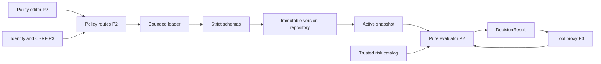

# Persona 2 — Motor de políticas, seguridad y editor administrativo

Este manual es un contrato de trabajo para una de las **cuatro** personas de WALLBA.
Su presupuesto es **25 unidades de esfuerzo de un total de 100 (25 %)**.
Todas las tareas comienzan pendientes; este documento no certifica pruebas de producto.
No implementar la aplicación hasta la aprobación humana del plan maestro.

Índice relacionado: [plan global](../MASTER_PLAN.md), [arquitectura](../ARCHITECTURE.md),
[contratos API](../API_CONTRACTS.md), [integración](../INTEGRATION_CONTRACTS.md),
[propiedad](../OWNERSHIP_MATRIX.md), [seguridad](../SECURITY_MODEL.md),
[pruebas](../TEST_STRATEGY.md) y [balance](../WORKLOAD_BALANCE.md).

## 1. Identidad de la parte

- Responsable: Persona 2; un único humano conserva la responsabilidad de entrega.
- Módulo: Policy and Security, incluida la interfaz de administración de políticas.
- Objetivo: decisiones deterministas que limiten herramientas, recursos y parámetros.
- Entregable: evaluador puro, carga/activación segura, API administrativa y editor accesible.
- Carga: 25 puntos; investigación, pruebas, documentación e integración ya incluidas.
- Dependencias: P1 entrega contratos/modelos base y adaptadores; P3 entrega identidad y proxy.
- P4 entrega tokens/componentes de UI; el editor tiene propietario P2 para equilibrar esfuerzo.
- La auditoría de P2 es transversal en lectura; no convierte a P2 en dueño del proxy.
- Las tablas compartidas se cambian mediante revisión de P1 y del consumidor.

## 2. Contexto del proyecto

WALLBA es una barrera de autorización entre un agente de IA y herramientas externas.
El modelo genera intenciones; no es una autoridad para conceder permisos.
El proxy recibe la intención, autentica, normaliza, consulta este motor y aplica la decisión.
Las únicas decisiones son `ALLOW`, `DENY` y `REQUIRE_APPROVAL`.
Una aprobación humana tampoco puede transformar una operación prohibida en permitida.
El frontend presenta resultados; nunca calcula una autorización vinculante.
El MVP usa recursos sintéticos y correo simulado para poder comparar ambos modos sin daño.
El modo sin firewall pertenece al laboratorio aislado, no a la API de herramientas protegidas.
Una instrucción maliciosa puede cambiar la intención del agente; los límites siguen en servidor.
La solución limita efectos autorizados; no promete detectar todo prompt injection.

## 3. Objetivos funcionales

1. Leer políticas YAML y JSON equivalentes mediante un parser seguro.
2. Rechazar esquemas inválidos antes de publicar una versión.
3. Evaluar agente autenticado, identidad, herramienta, operación, recurso y parámetros.
4. Utilizar contexto confiable (entorno, roles y riesgo calculado) separado del texto del agente.
5. Explicar reglas coincidentes y razón de decisión con códigos estables.
6. Resolver conflictos con `DENY > REQUIRE_APPROVAL > ALLOW`.
7. Denegar si no existe política activa o ninguna regla concede permiso.
8. Mantener versiones inmutables y una activación atómica con control de concurrencia.
9. Proporcionar snapshot consistente y versión al proxy antes de ejecutar.
10. Ofrecer lista/detalle, edición de borradores, validación y activación administrativa.
11. Proveer políticas y vectores adversariales para diez escenarios reproducibles.
12. Entregar resultados comprobables y revisión de los controles críticos de P3.

## 4. Objetivos técnicos

- El núcleo no importa FastAPI, SQLAlchemy, red, reloj global ni SDK de IA.
- Tiempo y contexto se inyectan; idénticos valores producen la misma decisión.
- Las listas de reglas se evalúan sin depender de su orden documental.
- El riesgo se deriva en servidor y el agente no puede rebajarlo; CRITICAL siempre es DENY.
- Un error, timeout o configuración desconocida nunca equivale a ALLOW.
- Pydantic usa validación estricta y `extra='forbid'` en todos los límites.
- Tamaño inicial máximo: 64 KiB por documento, 100 reglas, profundidad 10 y strings de 2048 caracteres.
- Arrays de agentes, herramientas y recursos: 100 elementos como máximo por regla.
- Objetivo de medida: p95 menor de 20 ms para 100 reglas en máquina de CI documentada.
- Esa cifra es un presupuesto inicial, no un benchmark ejecutado; registrar hardware y distribución.
- No ejecutar expresiones Python, JavaScript, plantillas ni SQL definidos por políticas.
- No aceptar plugins del evaluador en el MVP; incorporar condiciones requiere código revisado.
- Mensajes públicos no incluyen claves, tokens, cuerpos de correo ni contenidos de archivos.

## 5. Alcance y exclusiones

P2 crea `backend/wallba/policy/`, `policies/`, `tests/policy/`
y `frontend/src/features/policies/` con su documentación de uso.
P2 puede proponer cambios contractuales; P1 custodia los modelos compartidos.
P3 implementa autenticación, sesiones, CSRF, transacciones de ejecución y aprobaciones.
P1 implementa agente, herramientas y aislamiento de los recursos demostrativos.
P4 implementa shell, tokens, componentes comunes, auditoría visual y Playground.
P2 entrega contenido de seguridad para esos flujos y revisa sus decisiones en lectura.
Quedan fuera del MVP: ABAC de lenguaje general, OPA/Cedar, multiempresa y políticas distribuidas.
También quedan fuera firmas con PKI, detección semántica universal y sandbox para código arbitrario.
Migrar a un motor externo requeriría preservar interfaces y volver a validar precedencia y evidencias.
Si aumenta el alcance se reestima, se divide o se sustituye trabajo; no se añade una quinta persona.

## 6. Tecnologías

| Capa | Selección | Motivo y restricción |
|---|---|---|
| Runtime | Python 3.12 | Base común conservadora; dependencias fijadas por P1 |
| Modelos | Pydantic 2 | Validación estricta, uniones discriminadas y JSON Schema |
| API | FastAPI | Contrato OpenAPI, dependencias RBAC reutilizables de P3 |
| Persistencia | SQLAlchemy 2 + SQLite | Versiones y puntero activo transaccionales en un worker |
| Parser | PyYAML 6, cargador restringido | SafeLoader por sí solo no impone todos los límites |
| UI | React 19 + TypeScript + Vite | Editor interactivo separado del backend |
| Estilos | Tailwind CSS 4 | Tokens y componentes comunes propiedad P4 |
| Pruebas | pytest, Hypothesis, Vitest, Testing Library | Casos deterministas, propiedades e interacción |
| API mocks | MSW | Misma forma de contrato para avanzar sin P3 |

Son familias compatibles propuestas; P1 fija parches concretos en lockfiles tras resolver instalación.
No elegir dependencias adicionales sin justificar beneficio, licencia y costo de mantenimiento.
No convertir el editor textual en IDE completo: textarea accesible basta para el MVP.
La configuración de Cursor se describe en [orquestación](../INTEGRATION_CONTRACTS.md).

## 7. Arquitectura particular



`PolicyLoader.parse` produce modelo validado o errores estructurados sin efectos de ejecución.
`PolicyValidator.validate` realiza validación estructural y semántica.
`PolicyRepository.save_version` agrega una versión y nunca sobrescribe la anterior.
`PolicyService.activate` comprueba rol, versión esperada y validez dentro de la operación.
`PolicyRepository.get_active_snapshot` devuelve documento, versión y hash juntos.
`PolicyEvaluator.evaluate` recibe un snapshot; no busca una política diferente a mitad del cálculo.
`ParameterMatcher.matches` interpreta sólo condiciones soportadas y tipadas.
`RiskClassifier.classify` consulta catálogo de herramientas y contexto confiable.
Las advertencias de redundancia no permiten activar una política estructuralmente inválida.
El servicio diferencia error administrativo de decisión de autorización denegada.

## 8. Estructura de archivos

```text
backend/wallba/policy/                  # propietario P2
  __init__.py                         # exportaciones públicas mínimas
  models.py                           # dominio puro
  schemas.py                          # límites de entrada, sin coerción
  loader.py                           # YAML/JSON seguro y acotado
  evaluator.py                        # reducción determinista
  matchers.py                         # conjunción y comparación tipada
  parameters.py                       # condiciones de cada herramienta
  risk.py                             # severidad confiable
  repository.py                       # versiones/snapshot transaccional
  service.py                          # publicación/activación
  routes.py                           # endpoints administrativos
policies/                             # propietario P2
  demo.yaml                           # ejemplo activo de laboratorio
  demo.json                           # mismo ejemplo en JSON
  invalid/duplicate-key.yaml           # fixture no activable
  examples/README.md                   # instrucciones de seguridad
frontend/src/features/policies/        # propietario P2
  PolicyListPage.tsx                   # listado y versión activa
  PolicyEditorPage.tsx                 # borrador y validación
  policyApi.ts                        # cliente del contrato
  __tests__/editor.test.tsx            # estados y navegación
  __tests__/activation.test.tsx        # concurrencia y permisos
tests/policy/                        # propietario P2
  test_schema.py
  test_loader.py
  test_evaluator.py
  test_parameters.py
  test_activation.py
  test_api.py
  test_adversarial.py
  test_demo_policy.py
  test_contract_integration.py
```

No editar `backend/wallba/proxy/`, `backend/wallba/approvals/`, `backend/wallba/auth/`.
No editar shell/tokens de P4 ni adaptadores de herramientas de P1 sin un cambio coordinado.
Las migraciones son de P1; P2 propone tablas e índices con pruebas y revisión.
Los nombres de archivos y símbolos son ingleses; explicaciones y documentación son españolas.

## 9. Contratos

La fuente canónica es [API_CONTRACTS.md](../API_CONTRACTS.md).
Si este manual difiere, detener el bloque y proponer corrección coordinada; no inventar compatibilidad.
El prefijo HTTP es `/api/v1`; el motor puro se integra mediante interfaz Python.

### 9.1. Entrada de evaluación

- `request_id`: UUID asignado por servidor; trazabilidad, no identidad.
- `agent_id` y `principal_id`: derivados de credenciales verificadas por P3.
- `tool`: uno de `file.read`, `email.send`, `record.delete`, `db.query`.
- `operation`: operación concreta vinculada al catálogo, no una cadena ejecutable.
- `resource_id`: ID virtual resuelto por adaptador, nunca ruta o DSN proporcionado por usuario.
- `parameters`: objeto tipado por herramienta y normalizado una sola vez por P3.
- `context`: entorno y roles confiables; datos del agente quedan en otro campo no autorizado.
- `risk`: calculado por servidor como `LOW`, `MEDIUM`, `HIGH`, `CRITICAL`.
- `snapshot`: versión y documento inmutable de política.

### 9.2. Salida y códigos

`DecisionResult` contiene `decision`, `reason_code`, `matched_rule_ids`,
`policy_id`, `policy_version`, `risk` y `request_id`; el checksum está en el snapshot interno.
Una política ausente devuelve DENY con `POLICY_MISSING`.
Ninguna regla aplicable devuelve DENY con `DEFAULT_DENY`.
Coincidencia de denegación devuelve `RULE_DENY`; aprobación devuelve `APPROVAL_REQUIRED`.
Un fallo de carga/validación usa `POLICY_INVALID`; un fallo interno usa `AUTHORIZATION_UNAVAILABLE`.
El proxy debe distinguir indisponibilidad de rechazo normal, pero bloquear en ambos casos.
El formato de error HTTP contiene código, mensaje seguro, request_id y detalles de campos.
No cambiar nombres de códigos en una implementación local sin revisión del contrato.

### 9.3. Operaciones administrativas propuestas

| Método y ruta | Entrada | Salida | Permiso |
|---|---|---|---|
| GET /policies | cursor y limit <=100 | items + next_cursor | humano viewer |
| GET /policies/{policy_id}/versions/{version} | IDs tipados | documento, hash, active | humano viewer |
| POST /policies/validate | format + content | valid + errors + normalized_policy | humano policy_admin + CSRF |
| POST /policies/{policy_id}/versions | documento validable | 201 versión inmutable | humano policy_admin + CSRF |
| POST /policies/{policy_id}/activate | version + expected_active_version | snapshot activo | humano policy_admin + CSRF |

`expected_active_version` puede ser null sólo para primera activación; dos creaciones concurrentes compiten.
422 corresponde a sintaxis/estructura/semántica inválida; 413 a límites de bytes.
401 significa sin sesión; 403 rol/tipo de credencial inválido; 409 versión o activación en conflicto.
503 indica persistencia/auditoría obligatoria indisponible; nunca continuar sin registro crítico.
La validación POST no modifica estado y no activa políticas como efecto secundario.
No existe endpoint para borrar versiones utilizadas en decisiones del MVP.

### 9.4. Esquema de política y semántica

El sobre requiere `schema_version: "1"`, `policy_id`, `version` y `rules`.
Cada regla requiere `id`, `effect`, listas explícitas `agents`, `tools`, `resources`; `conditions` es opcional.
Las listas no vacías usan identificadores exactos; no hay comodín que conceda herramientas futuras.
Condiciones de identidad/contexto son conjuntivas con los selectores principales.
Los operadores soportados son `equals`, `in` y `max_length` en campos previstos; los rangos numéricos se limitan por esquema.
Las condiciones omitidas no restringen; las presentes no soportadas se rechazan al validar, nunca se ignoran.
`principal_roles` requiere intersección con roles autenticados y nunca roles del payload.
`context_environments` limita environment_id del servidor, por ejemplo `protected-fixture`.
`risk_at_most` compara el orden LOW < MEDIUM < HIGH < CRITICAL.
`parameters` usa un esquema discriminado según la herramienta; regla multi-tool no admite parámetros ambiguos.
Una regla con parámetros específicos debe seleccionar exactamente una herramienta.
La activación valida agentes/herramientas/recursos contra catálogo versionado disponible.
Los identificadores desconocidos son errores; los IDs retirados se deniegan al ejecutar.
Los números se comparan como enteros con límites y booleans no equivalen a enteros.
Los destinatarios son emails sintéticos `.test`; comparar valores normalizados exactos sin regex.
No autorizar `endswith("trusted.com")`: comparar `parameters.to` con una lista exacta `in`.

## 10. Plan de implementación paso a paso

Cada bloque tiene un ID rastreable en [matriz global](../TASK_MATRIX.md).
Subtareas incluidas en puntos; no sumarlas otra vez como trabajo adicional.
La revisión humana es obligatoria para decisiones de política y publicación.
Las dependencias siguientes son técnicas internas; los contratos acordados permiten mocks externos.

### WAL-P2-001 — Esquemas y dominio de autorización

- Historia: Como integrador necesito entradas y decisiones inequívocas.
- Prioridad: Crítica; esfuerzo: **2 puntos**; estado: Pendiente.
- Dependencias internas: ninguna; partir del contrato aprobado.
- Ejecución: p2-policy-engineer; la persona revisa diseño, cambios y evidencia.
- Archivos: `backend/wallba/policy/models.py`, `backend/wallba/policy/schemas.py`, `tests/policy/test_schema.py`.
1. Definir PolicyDocument, Rule, EvaluationRequest y DecisionResult con campos extra prohibidos.
2. Crear modelos discriminados para los cuatro parámetros de herramientas.
3. Enumerar códigos de rechazo y fixtures válidos/ inválidos.

Aceptación: Given una política con campos desconocidos, When se valida, Then se rechaza con una ruta de error y no cambia la activa.

Validación prevista: `pytest tests/policy/test_schema.py`.

Razón de estimación: 1.0 implementación de esquemas + 0.5 investigación de coerción/duplicados + 0.5 pruebas y documentación.

Evidencia: diff revisable, salida íntegra con fecha/comando/entorno y casos fallidos preservados.

### WAL-P2-002 — Carga segura de YAML y JSON

- Historia: Como administrador necesito importar reglas sin ejecutar contenido.
- Prioridad: Crítica; esfuerzo: **2 puntos**; estado: Pendiente.
- Dependencias internas: WAL-P2-001.
- Ejecución: p2-policy-engineer; la persona revisa diseño, cambios y evidencia.
- Archivos: `backend/wallba/policy/loader.py`, `tests/policy/test_loader.py`.
1. Rechazar claves duplicadas, tags YAML, aliases, múltiples documentos y estructuras demasiado grandes.
2. Limitar bytes, profundidad, cantidad de reglas y longitud de strings antes de evaluar.
3. Convertir YAML/JSON al mismo modelo y serialización canónica.

Aceptación: Given YAML con alias o clave duplicada, When se importa, Then responde POLICY_INVALID y la herramienta no se ejecuta.

Validación prevista: `pytest tests/policy/test_loader.py`.

Razón de estimación: 0.8 parser y límites + 0.7 investigación de bombas/ambigüedad + 0.5 pruebas de equivalencia.

Evidencia: diff revisable, salida íntegra con fecha/comando/entorno y casos fallidos preservados.

### WAL-P2-003 — Evaluador determinista y precedencia

- Historia: Como proxy necesito una única decisión reproducible.
- Prioridad: Crítica; esfuerzo: **4 puntos**; estado: Pendiente.
- Dependencias internas: WAL-P2-001, WAL-P2-002.
- Ejecución: p2-policy-engineer; la persona revisa diseño, cambios y evidencia.
- Archivos: `backend/wallba/policy/evaluator.py`, `backend/wallba/policy/matchers.py`, `tests/policy/test_evaluator.py`.
1. Evaluar conjunción de campos y condiciones sobre contexto autenticado.
2. Aplicar DENY sobre REQUIRE_APPROVAL sobre ALLOW, con DENY si ninguna regla permite.
3. Ordenar IDs coincidentes para explicación estable y devolver versión/hash.
4. Probar permutaciones y equivalencia JSON/YAML sin confiar en texto del agente.

Aceptación: Given reglas ALLOW y DENY coincidentes, When cambia su orden, Then siempre devuelve DENY y los mismos IDs ordenados.

Validación prevista: `pytest tests/policy/test_evaluator.py`.

Razón de estimación: 1.8 algoritmo y matchers + 0.8 casos límite/investigación + 1.0 pruebas de propiedades + 0.4 contrato.

Evidencia: diff revisable, salida íntegra con fecha/comando/entorno y casos fallidos preservados.

### WAL-P2-004 — Restricciones de parámetros y clasificación de riesgo

- Historia: Como propietario de datos necesito que el permiso limite el efecto exacto.
- Prioridad: Crítica; esfuerzo: **3 puntos**; estado: Pendiente.
- Dependencias internas: WAL-P2-001, WAL-P2-003.
- Ejecución: p2-policy-engineer; la persona revisa diseño, cambios y evidencia.
- Archivos: `backend/wallba/policy/parameters.py`, `backend/wallba/policy/risk.py`, `tests/policy/test_parameters.py`.
1. Validar max_bytes, to/subject/body, record_id y query_id/limit con contratos tipados.
2. Denegar campos omitidos relevantes, tipos coercionados, recursos fuera de alcance y parámetros adicionales.
3. Calcular riesgo desde catálogo server y elevarlo por condiciones; ignorar riesgo declarado por agente.

Aceptación: Given to fuera de la lista autorizada o query_id desconocido, When se evalúa, Then DENY antes de ejecutar el adaptador.

Validación prevista: `pytest tests/policy/test_parameters.py`.

Razón de estimación: 1.2 controles específicos + 0.5 clasificación + 0.9 adversariales + 0.4 explicación e integración.

Evidencia: diff revisable, salida íntegra con fecha/comando/entorno y casos fallidos preservados.

### WAL-P2-005 — Repositorio inmutable y activación transaccional

- Historia: Como administrador necesito publicar una versión sin modificar decisiones históricas.
- Prioridad: Crítica; esfuerzo: **3 puntos**; estado: Pendiente.
- Dependencias internas: WAL-P2-002, WAL-P2-003.
- Ejecución: p2-policy-engineer; la persona revisa diseño, cambios y evidencia.
- Archivos: `backend/wallba/policy/repository.py`, `backend/wallba/policy/service.py`, `tests/policy/test_activation.py`.
1. Persistir versiones inmutables y único puntero activo en tablas definidas por P1.
2. Validar antes de guardar/activar y usar compare-and-swap expected_active_version.
3. Emitir evento de publicación mediante puerto de auditoría y exponer snapshot consistente al proxy.

Aceptación: Given dos activaciones con la misma versión esperada, When compiten, Then una gana y otra recibe 409; nunca queda una política parcial activa.

Validación prevista: `pytest tests/policy/test_activation.py`.

Razón de estimación: 1.1 repositorio/transacción + 0.5 concurrencia + 0.9 persistencia/reinicio + 0.5 revisión cruzada.

Evidencia: diff revisable, salida íntegra con fecha/comando/entorno y casos fallidos preservados.

### WAL-P2-006 — API de políticas y controles administrativos

- Historia: Como policy_admin necesito validar, guardar y activar políticas con autorización real.
- Prioridad: Alta; esfuerzo: **2 puntos**; estado: Pendiente.
- Dependencias internas: WAL-P2-005.
- Ejecución: p2-policy-engineer; la persona revisa diseño, cambios y evidencia.
- Archivos: `backend/wallba/policy/routes.py`, `tests/policy/test_api.py`.
1. Implementar lectura paginada y validación sin efectos secundarios.
2. Proteger creación/activación con dependencias RBAC y CSRF de P3.
3. Limitar tamaños, ocultar secretos y traducir fallos a Problem Details de WALLBA.

Aceptación: Given bearer de agente o humano viewer, When intenta activar política, Then recibe 403 y no se modifica el snapshot.

Validación prevista: `pytest tests/policy/test_api.py`.

Razón de estimación: 0.8 rutas + 0.4 integración auth/auditoría + 0.6 API tests + 0.2 OpenAPI.

Evidencia: diff revisable, salida íntegra con fecha/comando/entorno y casos fallidos preservados.

### WAL-P2-007 — Editor visual de políticas con borradores

- Historia: Como administrador necesito comprender y corregir políticas antes de publicarlas.
- Prioridad: Alta; esfuerzo: **3 puntos**; estado: Pendiente.
- Dependencias internas: WAL-P2-001.
- Ejecución: p2-policy-engineer; la persona revisa diseño, cambios y evidencia.
- Archivos: `frontend/src/features/policies/PolicyListPage.tsx`, `frontend/src/features/policies/PolicyEditorPage.tsx`, `frontend/src/features/policies/policyApi.ts`, `frontend/src/features/policies/__tests__/editor.test.tsx`.
1. Construir lista, detalle, editor textual YAML/JSON y panel de errores por ruta.
2. Mantener borrador separado de versión guardada y activa; activar sólo versión validada por servidor.
3. Consumir mocks contractuales durante desarrollo y manejar 401/403/409/422/503.
4. Añadir navegación por teclado, etiqueta de versión y confirmación con diff semántico.

Aceptación: Given un borrador inválido, When falla validación servidor, Then se preserva el texto y activar permanece deshabilitado sin cambiar la política activa.

Validación prevista: `npm --prefix frontend run test -- policies`.

Razón de estimación: 1.4 UI y estados + 0.5 integración accesible + 0.8 pruebas de interacción + 0.3 revisión P4.

Evidencia: diff revisable, salida íntegra con fecha/comando/entorno y casos fallidos preservados.

### WAL-P2-008 — Modelo de amenazas y revisión adversarial

- Historia: Como equipo necesito detectar bypass de autorización y documentar límites.
- Prioridad: Crítica; esfuerzo: **2 puntos**; estado: Pendiente.
- Dependencias internas: WAL-P2-003, WAL-P2-004.
- Ejecución: p2-security-auditor; la persona revisa diseño, cambios y evidencia.
- Archivos: `tests/policy/test_adversarial.py`, `policies/examples/README.md`.
1. Revisar identidad/contexto falsificados, reglas contradictorias y política ausente.
2. Preparar vectores de prompt injection con efecto real medible en recursos sintéticos.
3. Auditar la revalidación del proxy/aprobaciones en lectura y devolver hallazgos a P3.

Aceptación: Given texto malicioso que ordena borrar, When produce record.delete prohibido, Then el motor devuelve DENY independientemente del lenguaje del prompt.

Validación prevista: `pytest tests/policy/test_adversarial.py`.

Razón de estimación: 0.7 investigación/límites + 0.7 corpus adversarial + 0.4 revisión cruzada + 0.2 informe.

Evidencia: diff revisable, salida íntegra con fecha/comando/entorno y casos fallidos preservados.

### WAL-P2-009 — Catálogo reproducible de políticas y escenarios

- Historia: Como presentador necesito políticas comprensibles para los diez escenarios.
- Prioridad: Alta; esfuerzo: **2 puntos**; estado: Pendiente.
- Dependencias internas: WAL-P2-004, WAL-P2-005.
- Ejecución: p2-policy-engineer; la persona revisa diseño, cambios y evidencia.
- Archivos: `policies/demo.yaml`, `policies/demo.json`, `policies/invalid/duplicate-key.yaml`, `tests/policy/test_demo_policy.py`.
1. Preparar ejemplos equivalentes YAML/JSON y reglas allow/deny/approval sobre recursos ficticios.
2. Definir fixture inválido explícitamente separado de políticas activables.
3. Entregar a P1/P3/P4 IDs estables y expectativas, sin afirmar resultados ejecutados.

Aceptación: Given los ejemplos demo YAML y JSON, When se evalúa la matriz contractual, Then ambos producen decisiones equivalentes.

Validación prevista: `pytest tests/policy/test_demo_policy.py`.

Razón de estimación: 0.6 ejemplos + 0.6 coordinación de escenarios + 0.6 verificación + 0.2 instrucciones.

Evidencia: diff revisable, salida íntegra con fecha/comando/entorno y casos fallidos preservados.

### WAL-P2-010 — Integración de seguridad y entrega de módulo

- Historia: Como equipo necesito integrar política, UI y proxy sin relajar permisos.
- Prioridad: Alta; esfuerzo: **2 puntos**; estado: Pendiente.
- Dependencias internas: WAL-P2-006, WAL-P2-007, WAL-P2-008, WAL-P2-009.
- Ejecución: Humano + wallba-verifier; la persona revisa diseño, cambios y evidencia.
- Archivos: `tests/policy/test_contract_integration.py`, `frontend/src/features/policies/__tests__/activation.test.tsx`.
1. Conectar mock y adaptador real del evaluador con P3.
2. Verificar edición/validación/activación y bloqueo con versión retirada.
3. Revisar evidencia, actualizar contrato propuesto por PR y manual de operación.

Aceptación: Given una aprobación bajo versión antigua, When cambia política y se intenta ejecutar, Then P3 reevalúa y no usa la aprobación para el snapshot diferente.

Validación prevista: `pytest tests/policy; npm --prefix frontend run test -- policies`.

Razón de estimación: 0.6 integración + 0.6 regresión + 0.5 evidencia/revisión + 0.3 documentación.

Evidencia: diff revisable, salida íntegra con fecha/comando/entorno y casos fallidos preservados.

## 11. Guías de implementación

### 11.1. Algoritmo de evaluación

```text
validate typed request and trusted context
if snapshot missing: return DENY / POLICY_MISSING
if snapshot invalid: return DENY / POLICY_INVALID
risk := classify(tool, operation, trusted_resource, parameters)
matched := []
for rule in snapshot.rules:
    if all exact selectors and all typed conditions match:
        matched.append(rule)
if any matched DENY: decision := DENY
else if any matched REQUIRE_APPROVAL: decision := REQUIRE_APPROVAL
else if any matched ALLOW: decision := ALLOW
else: decision := DENY
return decision, sorted matched IDs, snapshot version/hash, risk
```

No salir al encontrar el primer ALLOW: podría existir una regla DENY posterior.
No transformar excepciones de matchers en no coincidencia silenciosa: fallar cerrado.
Cuando un matcher recibe campo desconocido, es corrupción o incompatibilidad; denegar y alertar.
Las razones son códigos y datos estructurados; el texto explicativo es una traducción de esos datos.
La evaluación no ejecuta herramientas ni cambia contadores persistentes.
La ausencia de contexto requerido produce DENY, no una condición accidentalmente verdadera.
El timestamp de evaluación no entra al hash de parámetros y se registra por separado.

### 11.2. Carga segura

Primero comprobar longitud del payload en el servidor y en el lector acotado.
Decodificar UTF-8 estricto, sin BOM ambiguo, sin concatenar múltiples documentos.
JSON debe detectar claves repetidas mediante object_pairs_hook o mecanismo equivalente.
YAML debe rechazar constructores personalizados y alias antes de construir el objeto.
El parser no puede abrir archivos referenciados ni resolver variables de entorno.
Rechazar profundidad excesiva, tipos no representables en JSON y números no finitos.
No interpretar automáticamente fechas YAML como datetime: exigir escalares del esquema.
Luego validar esquema, coherencia de IDs y compatibilidad de condiciones con herramientas.
Canonicalizar para hash con un único procedimiento acordado con P3.
El hash de política identifica el documento validado, no prueba la identidad del administrador.
La equivalencia YAML/JSON se comprueba sobre el modelo normalizado; no sobre bytes originales.

### 11.3. Publicación y activación

Guardar versión nueva exige que `(policy_id, version)` no exista.
Guardar el documento no modifica el puntero activo.
Activar exige policy_admin humano, CSRF válido y versión esperada coincidente.
Dentro de una transacción: obtener activa, comprobar compare-and-swap, cambiar puntero y registrar auditoría.
Si falla la auditoría obligatoria o el commit, abortar la activación completa.
No invalidar la versión histórica; las decisiones existentes conservan referencia a ella.
P3 obtiene snapshot actual al ejecutar y lo contrasta con aprobación/solicitud.
Si la versión cambia desde la aprobación, invalidar esa autorización y exigir nuevo flujo cuando aplique.
Una versión nueva que permita la acción no reutiliza una aprobación de una versión anterior.
No crear un caché sin mecanismo explícito de invalidación; inicialmente leer snapshot en cada operación.
No mantener una transacción abierta mientras un humano decide una aprobación.

### 11.4. Ejemplo conceptual completo en YAML

Ejemplo idéntico al documento canónico [POLICY_EXAMPLES.md](../POLICY_EXAMPLES.md).
Es una especificación de fixture, nunca evidencia de ejecución.
Los recursos virtuales deben existir en el catálogo sintético de P1.

```yaml
schema_version: '1'
policy_id: demo-policy
version: 1
rules:
  - id: allow-public-read
    effect: ALLOW
    agents: [demo-agent]
    tools: [file.read]
    resources: ['file:public-guide']
    conditions:
      context_environments: [protected-fixture]
      risk_at_most: LOW
  - id: deny-delete
    effect: DENY
    agents: [demo-agent]
    tools: [record.delete]
    resources: ['table:demo-records']
  - id: approve-internal-email
    effect: REQUIRE_APPROVAL
    agents: [demo-agent]
    tools: [email.send]
    resources: ['mailbox:demo-outbox']
    conditions:
      parameters:
        to:
          in: [reviewer@example.test]
```

Para consultar en S03, agregar regla ALLOW explícita para `db.query` sobre `query:demo-records`.
Usar `query_id` de catálogo `list_records`/`count_records` y `limit` entero 1..100.
Cambiar contenido requiere nueva versión; no modificar silenciosamente una versión activada.
S06 usa `reviewer@example.test`, que requiere aprobación; S05 usa otro `.test` y se deniega por defecto.
No añadir DENY general de email que anule la regla de aprobación por precedencia.
`file.read` acepta sólo `max_bytes` 1..16384; el recurso identifica el archivo.
`record.delete` acepta sólo record_id UUID y siempre opera sobre fixture desechable.
`email.send` acepta to, subject y body acotados; el adaptador sólo persiste outbox simulado.
No hay SMTP, DSN, file_id, template_id ni SQL crudo en el contrato público.

### 11.5. Misma política en JSON

```json
{
  "schema_version": "1",
  "policy_id": "demo-policy",
  "version": 1,
  "rules": [
    {"id":"allow-public-read","effect":"ALLOW","agents":["demo-agent"],"tools":["file.read"],"resources":["file:public-guide"],"conditions":{"context_environments":["protected-fixture"],"risk_at_most":"LOW"}},
    {"id":"deny-delete","effect":"DENY","agents":["demo-agent"],"tools":["record.delete"],"resources":["table:demo-records"]},
    {"id":"approve-internal-email","effect":"REQUIRE_APPROVAL","agents":["demo-agent"],"tools":["email.send"],"resources":["mailbox:demo-outbox"],"conditions":{"parameters":{"to":{"in":["reviewer@example.test"]}}}}
  ]
}
```

Los dos ejemplos deben producir el mismo modelo validado y checksum canónico.
Las condiciones ausentes no restringen; una clave desconocida invalida el documento.
CRITICAL es una violación de invariante y siempre produce DENY, incluso si una regla parece permitir.
El riesgo de record.delete/email.send es HIGH; db.query y lectura pública son LOW.
El fixture final se valida con el mismo motor que consume P3, nunca con un parser alternativo.

### 11.6. Editor administrativo

Separar `draftSource`, `validatedHash`, `savedVersion` y `activeVersion` en estado explícito.
Al modificar un carácter del borrador, invalidar el resultado previo de validación local.
Validar en servidor al pulsar Validar; presentar errores con ruta y mensaje seguros.
No activar un hash distinto del que se mostró como validado.
Después de guardar versión, volver a obtenerla del servidor antes de ofrecer activación.
Mostrar diff semántico entre versión activa y candidata, con efecto y recursos afectados.
La confirmación de activar debe nombrar policy_id, versión anterior y nueva.
Un 409 refresca la activa y pide revisar el diff nuevo; no reintentar automáticamente.
El contenido del editor se renderiza como texto, sin HTML interpretado.
No guardar borradores con secretos en localStorage; el ejemplo no requiere secretos.
El rol controla affordances visuales, pero la autorización definitiva siempre es del servidor.

## 12. Subagentes disponibles

| Subagente | Archivo | Uso concreto |
|---|---|---|
| p2-policy-engineer | [.cursor/agents/p2-policy-engineer.md](../../.cursor/agents/p2-policy-engineer.md) | Esquemas, algoritmo, parser, repositorio, API y editor de políticas |
| p2-security-auditor | [.cursor/agents/p2-security-auditor.md](../../.cursor/agents/p2-security-auditor.md) | Revisión independiente de amenazas, precedencia, parámetros y bypass; solo lectura |
| wallba-verifier | [.cursor/agents/wallba-verifier.md](../../.cursor/agents/wallba-verifier.md) | Revisar diff/evidencia y detectar criterios no demostrados; solo lectura |

La persona asigna tareas acotadas y entrega contrato, archivos permitidos, criterios y comandos.
El auditor no corrige archivos: devuelve hallazgos reproducibles con gravedad y recomendación.
El ingeniero implementa la corrección en un bloque posterior supervisado.
Si una prueba necesita escritura de cache/DB temporal, el principal la ejecuta en entorno desechable.
No asumir que readonly permite ejecutar cualquier comando de test con efectos laterales.
La definición declarativa de subagente no es una frontera de autorización de la aplicación.

## 13. Delegación de tareas

La tabla de sección 10 identifica el especialista para todas las tareas.
La persona ejecuta directamente decisiones de precedencia, ampliación de condiciones y publicación de contratos.
Puede delegar implementación de WAL-P2-001..007 y WAL-P2-009 al ingeniero en bloques pequeños.
WAL-P2-008 empieza con auditor en lectura; el principal convierte hallazgos en cambios verificables.
WAL-P2-010 requiere revisión humana del efecto real y verificador independiente.
Ejemplo: delegar loader.py y test_loader.py con rechazo de alias/duplicados y límites explícitos.
Después revisar diff, ejecutar pruebas y sólo entonces iniciar integración del repositorio.
Ejemplo paralelo permitido: auditor revisa evaluador mientras ingeniero prepara fixtures en rutas separadas.
Ejemplo secuencial obligatorio: estabilizar parámetros antes de generar políticas demo y sus expectativas.
Si se requiere edición paralela, usar ramas/worktrees separados y resolver contratos antes de integrar.
No ejecutar dos subagentes sobre evaluator.py o policyApi.ts simultáneamente.
Detener delegación ante contexto incompleto, cambios fuera de propiedad o contratos incompatibles.
El informe debe incluir ID, objetivo, archivos, decisiones, comandos, resultado real, riesgos y pendientes.
Un mensaje de “terminado” no reemplaza pruebas ni inspección del humano.

## 14. Dependencias entre integrantes

| Recibe de | Entrada necesaria | Puede avanzar antes con | Entrega a |
|---|---|---|---|
| P1 | modelos comunes y catálogo sintético | fixtures tipados acordados | esquemas/ejemplos y cambios propuestos de tablas |
| P3 | identidad confiable, RBAC, CSRF y auditoría | dobles de interfaces en tests | evaluador puro, snapshot y API de política |
| P4 | tokens, shell y componentes accesibles | componentes semánticos mínimos | rutas/pantallas de políticas, estados y revisión visual |
| P3 | política activa al ejecutar | repositorio en memoria en tests | versión/hash y reglas para invalidar aprobaciones |

Los mocks deben indicar que son de desarrollo; nunca presentarlos como ejecución de seguridad real.
Contratos de entrada/salida se fijan en preparación, sin esperar a que P1 finalice todo el backend.
Si un proveedor se retrasa, desarrollar contra el doble y registrar bloqueo sólo de la integración real.
Los cambios compartidos requieren revisión del dueño y del consumidor afectado.

## 15. Integración

1. Publicar esquemas y fixtures de contrato con revisión de P1/P3.
2. Hacer que proxy use `PolicyEvaluator.evaluate`, inicialmente con snapshot fixture.
3. Sustituir repositorio de prueba por snapshot persistido sin cambiar forma de la decisión.
4. Conectar identidad/contexto inyectados por P3; retirar payloads autoafirmados como fuente de autoridad.
5. Conectar rutas protegidas a sus dependencias reales y probar 401/403/CSRF.
6. P4 registra las páginas de políticas en navegación sin editar su lógica interna.
7. Activar demo.yaml, ejecutar escenarios sintéticos y guardar evidencia por request_id.
8. Verificar que errores de evaluación/persistencia bloquean la ejecución protegida.

Ningún consumidor importa internals del parser o consulta tablas directamente.
P3 no reproduce las reglas en un segundo evaluador; usa el puerto compartido.
La auditoría conserva versión/hash y códigos suficientes para reconstruir la decisión.
No es necesario almacenar contenido sensible completo para explicar un permiso.
Si falla integración, conservar la prueba fallida, revertir el PR local afectado y mantener main estable.
No resolver conflictos aceptando “ours/theirs” sin revisar semántica de seguridad.

## 16. Pruebas

| Familia | Casos mínimos | Evidencia verificable |
|---|---|---|
| Esquema | campos extra, IDs duplicados, effect desconocido, versión negativa | error y ruta; activa intacta |
| Parser | aliases, tags, duplicados, profundidad, payload enorme, múltiples docs | rechazo acotado sin ejecución |
| Semántica | herramienta desconocida, condiciones incompatibles, contexto incompleto | POLICY_INVALID o DENY documentado |
| Evaluador | regla allow/deny/approval, ninguna coincidencia y conflictos | resultado exacto y IDs ordenados |
| Propiedades | permutar reglas, YAML=JSON, repetir evaluación | misma decisión/versión/hash |
| Parámetros | destinatario no autorizado, resource_id no autorizado, query fuera de catálogo | cero llamadas al adaptador |
| Riesgo | riesgo falsificado bajo, operación severa, recurso desconocido | clasificación server o rechazo |
| Persistencia | nueva versión, duplicado, rollback, reinicio | histórico estable y activa coherente |
| Concurrencia | dos activaciones con expected version idéntica | un éxito y un 409 |
| API | viewer/agent intentando publicar, CSRF ausente, sesión expirada | 401/403 sin cambios |
| UI | editar invalida validación, 422 conserva texto, 409 actualiza comparación | pruebas de interacción |
| Accesibilidad | labels, foco en errores, teclado, estado anunciado | reporte automatizado y revisión manual |
| Integración | aprobación antigua, política retirada, fallo del evaluador | proxy no ejecuta |

Hypothesis genera documentos tipados dentro de límites; no usar generación no acotada en CI.
Las expectativas se derivan de la especificación, no de capturar automáticamente la salida actual.
No marcar la demo segura sólo porque se recibe 403: comprobar también ausencia de efecto en recurso.
Para WAL-P2-008 el auditor entrega casos que el principal convierte en pruebas reproducibles.
Pruebas destructivas usan únicamente fixtures temporales de P1 y no conexiones externas.
Registrar versiones, seed, commit, comandos, resultado y artifact paths.
Las pruebas listadas son previstas; ninguna consta como superada en esta planificación.

## 17. Criterios de aceptación globales

- Given JSON y YAML equivalentes, When se validan/evalúan, Then decisiones y hash canónico coinciden.
- Given reglas allow/deny concurrentes, When se reordenan, Then DENY conserva precedencia.
- Given herramienta desconocida, When el agente la solicita, Then no se evalúa como permiso heredado.
- Given un correo con to no autorizado, When intenta exfiltrar, Then DENY y outbox permanece intacto.
- Given política ausente/inválida, When proxy consulta, Then se bloquea y registra razón comprobable.
- Given aprobación pendiente, When se activa otra versión, Then la autorización anterior no se reutiliza.
- Given activación concurrente, When ambas esperan la misma versión, Then sólo una modifica la activa.
- Given sesión viewer, When llama a activar directamente, Then servidor devuelve 403.
- Given editor con error, When se intenta activar, Then el servidor rechaza y el texto permanece editable.
- Given fallo de persistencia/auditoría, When se publica, Then no hay activación parcial.

## 18. Definición de terminado

Una tarea está terminada sólo si su aceptación se verificó con salida y entorno identificables.
El código cumple tipos, estilo y reglas; los errores previstos tienen mensajes seguros.
Los ejemplos pasan el validador real y no contienen secretos, DSNs ni recursos reales.
Se ejecutan pruebas de su módulo y contratos afectados; explicar cualquier bloqueo restante.
El propietario revisa el diff, y un consumidor revisa los cambios de contrato.
Los hallazgos críticos/altos relevantes están corregidos o impiden entrega explícitamente.
Se actualizan metadatos de tarea con evidencia; no confundir “implementado” y “verificado”.
No hay bypass temporal, fallback permisivo ni datos estáticos etiquetados como evidencia real.
La documentación explica cómo usar y recuperar una política sin perder histórico.
El PR describe comportamiento, validación y riesgos; no se hace push/merge sin autorización.

## 19. Riesgos y mitigaciones

| Riesgo | Indicador | Mitigación y dueño |
|---|---|---|
| Condiciones demasiado expresivas | eval, regex arbitrario o DSL creciente | limitar operadores tipados; P2 |
| Fallo abierto | excepción convertida en allow | tests de inyección de fallos; P2/P3 cada uno en su módulo |
| Cambio de política tras aprobación | hash/version distintos al ejecutar | P2 snapshot; P3 invalida y reevalúa |
| Parser ambiguo | dos interpretaciones del documento | claves únicas, YAML limitado, JSON canónico; P2 |
| Edición UI sobrecargada | editor IDE excede alcance | textarea accesible, validación server y diff mínimo; P2 |
| SQLite con múltiples writers | bloqueos y retries inseguros | un worker, transacciones cortas; P1/P2/P3 |
| Autoridad falsificada | roles/contexto del payload | contexto sólo de identidad P3; P2 rechaza campos autoafirmados |
| Expectativas inventadas | tabla marcada aprobada sin artifact | estado no ejecutado hasta evidencia; cada propietario |
| Cambios compartidos tardíos | fixtures de P3/P4 dejan de encajar | revisión de contratos antes del siguiente bloque; P1 custodia |

La estimación de 25 puntos es un objetivo relativo, no una garantía de horas iguales.
Revisar al cerrar el primer bloque integrado y ante cualquier cambio de requisitos.
Si parámetros avanzados resultan más costosos, reducir funciones futuras antes que los controles obligatorios.
Mover una tarea entre personas requiere actualizar matrices, planes y puntos de ambas partes.

## 20. Checklist de seguimiento

- [ ] Contrato de parámetros/decisiones revisado por P1 y P3.
- [ ] WAL-P2-001: modelos estrictos y casos de validación.
- [ ] WAL-P2-002: parser limitado y rechazo de ambigüedades.
- [ ] WAL-P2-003: precedencia y determinismo probados.
- [ ] WAL-P2-004: parámetros/riesgo calculados sin confianza en agente.
- [ ] WAL-P2-005: histórico inmutable y activación atómica.
- [ ] WAL-P2-006: API con RBAC/CSRF reales.
- [ ] WAL-P2-007: editor, estados y accesibilidad.
- [ ] WAL-P2-008: revisión adversarial con hallazgos resueltos.
- [ ] WAL-P2-009: políticas demo equivalentes y catálogo revisado.
- [ ] WAL-P2-010: integración, evidencia y entrega.
- [ ] No se modificaron módulos ajenos sin revisión del propietario.
- [ ] Toda afirmación de prueba superada enlaza una evidencia ejecutada.

## 21. Procedimiento de inicio con Cursor

1. Abrir la carpeta raíz Wallba; confirmar ubicación antes de ejecutar comandos Git.
2. Leer AGENTS.md, este plan, reglas `.cursor/rules/` y contratos referenciados.
3. Confirmar aprobación humana para implementar; la planificación por sí sola no la concede.
4. Inspeccionar `git status`, rama y cambios preexistentes; no descartarlos.
5. Si no hay repositorio/lockfiles aún, coordinar preparación de P1; no inicializar una segunda historia.
6. Cuando exista base, usar rama `feature/person-2-policies` desde main actualizado.
7. Elegir el siguiente WAL-P2 desbloqueado y verificar archivos permitidos y fixtures.
8. Confirmar entornos Python/frontend definidos por P1 y comandos reales de sus manifiestos.
9. Comenzar por esquemas y pruebas; usar mocks contractuales mientras P3 entrega auth/proxy.
10. Delegar un bloque a p2-policy-engineer con tarea, criterio y límites precisos.
11. Revisar resultados y ejecutar validación antes de continuar al siguiente bloque.
12. Ante bloqueo registrar causa, dueño, contrato afectado y siguiente trabajo independiente.

Los comandos de test del plan son objetivos del entorno futuro; no ejecutar comandos inexistentes como si pasaran.
El principal adapta sólo el runner documentado por P1, manteniendo las mismas comprobaciones.
No instalar servicios adicionales o introducir un proveedor LLM para probar el evaluador puro.

## 22. Procedimiento de entrega

1. Revisar diff por rutas y separar cambios accidentales de otros módulos.
2. Ejecutar suites de política/API/UI y contratos relevantes con entorno fijado.
3. Pedir auditoría de precedencia, parser, parámetros y activación en modo lectura.
4. Corregir hallazgos y repetir sólo las verificaciones afectadas más regresión necesaria.
5. Entregar artifact de evidencia con casos, comandos, resultado y limitaciones.
6. Actualizar tarea, manual y contratos mediante revisión del dueño correspondiente.
7. Preparar commits convencionales, por ejemplo `feat(policy): enforce deterministic precedence`.
8. Preparar PR con tareas incluidas, comportamiento observable, pruebas y riesgos.
9. Solicitar revisión P3 en evaluador/activación y P4 en integración visual.
10. Mantener cambios remotos y merge detenidos hasta autorización explícita del usuario.

Para un contrato incompatible: abrir propuesta de migración, actualizar productor/consumidor/mocks juntos.
Para un error de integración: conservar fixture, aislar fallo y proponer corrección en el módulo dueño.
Para rollback: activar una versión histórica válida como nueva operación auditada, usando compare-and-swap.
No sobrescribir documentos anteriores ni reescribir auditoría para disimular un error.

## 23. Prompt de ejecución personal

```text
Actúa como agente principal de Cursor de la PERSONA 2 de WALLBA.
Lee AGENTS.md, docs/team/PERSON_2_MASTER_PLAN.md, docs/API_CONTRACTS.md,
docs/INTEGRATION_CONTRACTS.md, docs/OWNERSHIP_MATRIX.md, docs/SECURITY_MODEL.md,
docs/TEST_STRATEGY.md y docs/TASK_MATRIX.md antes de modificar archivos.
Aplica .cursor/rules/ y confirma que el humano ya aprobó la implementación del plan.
Si no hay aprobación, prepara la siguiente tarea y detente antes de implementar.
Mi alcance es backend/wallba/policy/, policies/,tests/policy/ y
frontend/src/features/policies/. No modifiques módulos de P1/P3/P4 arbitrariamente.
Trabaja en feature/person-2-policies desde la base acordada y conserva cambios existentes.
Selecciona un WAL-P2 desbloqueado, explica su aceptación y valida dependencias/contratos.
Usa .cursor/agents/p2-policy-engineer.md para bloques de implementación concretos.
Usa .cursor/agents/p2-security-auditor.md para revisión independiente de solo lectura.
Usa .cursor/agents/wallba-verifier.md para contrastar diff/evidencia al cerrar el bloque.
Entrega a cada subagente ID, entradas, rutas permitidas, criterio, pruebas y límites.
No delegues ediciones simultáneas sobre los mismos archivos; usa aislamiento cuando corresponda.
Mantén DENY por defecto y precedencia DENY > REQUIRE_APPROVAL > ALLOW.
No uses eval, SQL crudo, rutas reales, identidades autoafirmadas ni fallbacks permisivos.
La política activa es inmutable por versión y se revalida al ejecutar en el proxy de P3.
Implementa progresivamente: esquema, parser, núcleo, parámetros, repositorio, API y UI.
Al finalizar cada bloque inspecciona diff, ejecuta verificaciones pertinentes y muestra resultado real.
Si un contrato es incompatible, documenta propuesta y coordina con dueño sin parchear módulos ajenos.
Si estás bloqueado, registra causa y avanza sólo en una tarea independiente con mocks contractuales.
No marques pruebas superadas sin ejecutarlas ni uses datos de ejemplo como evidencia real.
Actualiza estado/evidencia y solicita inspección humana del bloque antes del siguiente hito.
Prepara commits y PR locales; no hagas push ni merge sin autorización explícita.
Al terminar informa IDs, archivos, decisiones, pruebas, resultados, riesgos y pendientes.
```
