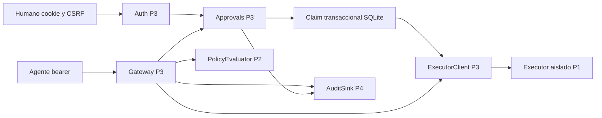
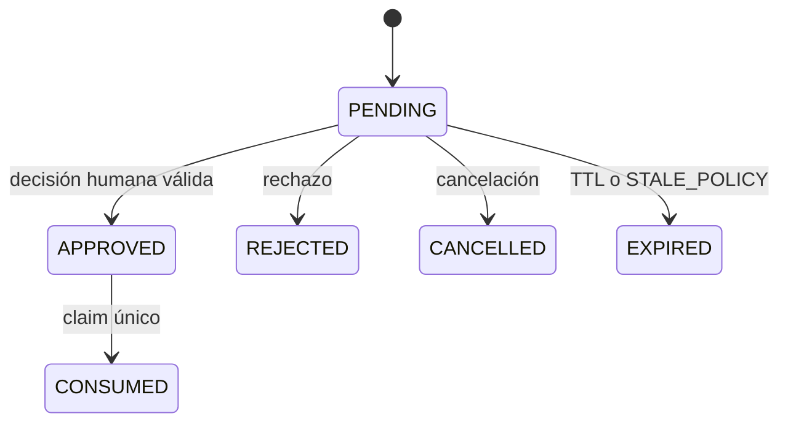

# Persona 3 — Proxy, autenticación y aprobaciones

Estado: planificación. No se ha implementado ni probado funcionalmente este módulo.
Presupuesto: **25 unidades, 25 % del MVP**. Son estimaciones relativas, no horas.

## 1. Identidad de la parte

- Responsable: Persona 3, único dueño humano de este módulo.
- Módulo: gateway obligatorio, identidades, aprobaciones y cliente interno.
- Objetivo: impedir efectos protegidos sin autorización válida para la solicitud exacta.
- Entregable: API segura y persistente más centro de aprobaciones accesible.
- Dependencias: contratos P1, evaluador P2, ejecutor P1, auditoría y componentes P4.
- Las dependencias de implementación pueden sustituirse por fakes contractuales durante desarrollo.
- Las pruebas, depuración, integración y documentación están dentro de las 25 unidades.

## 2. Contexto del proyecto

WALLBA controla los permisos de agentes que utilizan herramientas.
El agente puede estar influido por un documento malicioso; su texto no constituye autoridad.
El gateway construye el contexto confiable desde credenciales y datos del servidor.
Consulta una política determinista y distingue ALLOW, DENY y REQUIRE_APPROVAL.
P1 implementa las herramientas y su ejecutor aislado; P2 implementa decisiones puras.
P4 implementa observabilidad, shell visual y presentación de evidencia.
P3 conecta esos componentes sin permitir que una aprobación cambie de significado.
El navegador presenta decisiones; nunca decide la autorización crítica.
El baseline sin firewall existe solo en el runner de demostración aislado de P1.

Lecturas obligatorias: [arquitectura](../ARCHITECTURE.md),
[API](../API_CONTRACTS.md), [puertos](../INTEGRATION_CONTRACTS.md),
[seguridad](../SECURITY_MODEL.md), [propiedad](../OWNERSHIP_MATRIX.md),
[pruebas](../TEST_STRATEGY.md) y [reglas globales](../../AGENTS.md).

## 3. Objetivos funcionales

1. Autenticar agentes con bearer y humanos con sesiones separadas.
2. Aplicar scopes de agente y RBAC humano a partir de identidad verificada.
3. Rechazar herramientas, operaciones, recursos y campos fuera de contrato.
4. Persistir una solicitud normalizada e inmutable antes de evaluar efectos.
5. Evaluar la política activa y registrar decisión, regla y versión.
6. Bloquear DENY sin invocar el ejecutor.
7. Ejecutar ALLOW mediante capacidad interna firmada y acotada.
8. Crear aprobaciones persistentes que vencen a los cinco minutos server.
9. Permitir aprobación, rechazo y cancelación con autorización humana.
10. Impedir autoaprobación, replay, sustitución de parámetros y carreras.
11. Distinguir fallo confirmado de resultado desconocido tras un timeout.
12. Mostrar lista, detalle y acciones de aprobaciones con accesibilidad.
13. Emitir eventos auditables dentro de la transacción de cambio de estado.
14. Aportar escenarios 6, 7 y 10 de la demo con evidencia reproducible.

## 4. Objetivos técnicos

- Python 3.12, FastAPI, Pydantic 2 estricto y SQLAlchemy 2.
- SQLite local con un solo worker, transacciones breves y restricciones UNIQUE.
- Nunca mantener una transacción abierta durante una llamada HTTP al ejecutor.
- Persistir sesiones, aprobaciones y claims; no usar memoria como fuente de verdad.
- JSON UTF-8, snake_case, UUID y timestamps UTC RFC3339.
- Canonicalización y hashes idénticos a los contratos compartidos.
- SHA-256 para digest; HMAC-SHA256 estándar para capacidad interna.
- Comparar firmas con operación de tiempo constante de biblioteca estándar.
- Derivar identidad, riesgo, entorno y tiempo en el servidor.
- Cierre seguro ante error de política, integridad o auditoría previa.
- Límite de payload y timeout acotados; no reintentar mutaciones ambiguas.
- Prohibir bearer, cookies y secretos HMAC en logs y respuestas.
- Presupuesto orientativo: evaluación local p95 menor a 50 ms con 100 reglas.
- Ese presupuesto se medirá al implementar; todavía no es un resultado obtenido.

## 5. Alcance y exclusiones

P3 construye auth, gateway, ciclo de aprobaciones, cliente interno y su UI.
P3 prueba estados, integridad, scopes, CAS y recuperación.
P1 mantiene app factory, DTO compartidos, catálogo de recursos y ejecutor.
P2 mantiene política, riesgo, validación, versiones y editor visual de políticas.
P4 mantiene componentes comunes, auditoría persistente, dashboard y playground.
No implementar SMTP, SQL arbitrario, shell, conexión a bases productivas ni filesystem libre.
No implementar SSO empresarial, multitenancy o recuperación de contraseña productiva en el MVP.
Usuarios demo se aprovisionan localmente con contraseñas aleatorias fuera de Git.
El modo local no se presenta como IAM empresarial.
Una ampliación de alcance se reestima y revisa con los cuatro responsables.

## 6. Tecnologías

| Tecnología | Uso | Razón |
|---|---|---|
| Python 3.12 | Backend | Base acordada de equipo |
| FastAPI | API y dependencias | Composición y OpenAPI |
| Pydantic 2 | DTO estrictos | Tipos cerrados y campos extra prohibidos |
| SQLAlchemy 2 | Repositorios | Transacciones explícitas |
| SQLite | Control local | Persistencia simple para carga MVP |
| React 19 + TypeScript | Aprobaciones UI | Integración con frontend P4 |
| Vite + Tailwind 4 | Build y estilos | Cliente simple sin segundo backend |
| pytest + HTTPX | Pruebas backend | Fakes y API reproducibles |
| Playwright | Flujos humanos | Cookies, teclado, concurrencia y errores |

Las versiones exactas se fijan en locks durante foundation de P1.
No añadir librerías de firma ni canonicalización sin necesidad y revisión.
Contraseñas con Argon2id mediante biblioteca mantenida; nunca hash casero.
El token de sesión no se almacena en localStorage.

## 7. Arquitectura particular



`IdentityService` produce principal y permisos verificados.
`RequestNormalizer` valida, normaliza y calcula digest sin IO externo.
`GatewayService` orquesta la decisión y nunca importa herramientas concretas.
`ApprovalService` guarda el snapshot y controla los estados humanos.
`ApprovalExecutionService` consume mediante CAS y crea un execution_id único.
`ExecutorClient` firma y envía exactamente la solicitud asociada al claim.
`RecoveryService` consulta receipts; no crea una ejecución nueva al reconciliar.
`AuditSink.append(event, transaction)` persiste la transición junto al evento.



APPROVED y CONSUMED se confirman atómicamente con el claim.
La ejecución tiene estado separado READY, EXECUTING, SUCCEEDED, FAILED o UNKNOWN.
No añadir INVALIDATED al enum: política obsoleta usa EXPIRED con reason STALE_POLICY.
No existe transición terminal de aprobación que permita reutilizarla.

## 8. Estructura de archivos

Árbol previsto; no se crean archivos de producción al aprobar únicamente planificación.

```text
backend/wallba/auth/
  models.py              # P3: humanos, sesiones y credenciales
  service.py             # P3: autenticación y roles
  routes.py              # P3: login, logout, me
backend/wallba/gateway/
  ports.py               # P3: integración por interfaces
  normalization.py       # P3: canonicalización y digest
  repository.py          # P3: snapshots e idempotencia
  service.py             # P3: autorización y routing
  routes.py              # P3: tool-requests
  capability.py          # P3: firma HMAC interna
  executor_client.py     # P3: HTTP sin retry mutante
backend/wallba/approvals/
  models.py              # P3: approval y claim
  repository.py          # P3: CAS y consultas
  service.py             # P3: lifecycle
  execution.py           # P3: consumo y dispatch
  recovery.py            # P3: reconciliación
frontend/src/features/approvals/
  ApprovalList.tsx        # P3: filtros y lista
  ApprovalDetail.tsx      # P3: snapshot y riesgo
  ApprovalActions.tsx     # P3: controles humanos
  api.ts                 # P3: contrato v1
  approvals.test.tsx      # P3: comportamiento
tests/auth/              # P3: identidad y permisos
tests/gateway/           # P3: decisión y bypass
tests/approvals/         # P3: estados y carreras
```

No editar policy, tools, executor, auditoría o componentes de otras personas.
P1 registra migraciones globales; P3 aporta sus modelos y migraciones revisadas.
P4 integra la exportación de ruta UI; P3 conserva su feature y llamadas API.
Cambiar tipos generados exige modificar DTO fuente con P1 y regenerar.

## 9. Contratos

La fuente normativa es [API_CONTRACTS.md](../API_CONTRACTS.md).
Las firmas internas son las de [INTEGRATION_CONTRACTS.md](../INTEGRATION_CONTRACTS.md).
Prefijo público `/api/v1`; el ejecutor nunca es una ruta pública de esa API.

| Método y ruta | Entrada | Salida y acceso |
|---|---|---|
| POST /auth/login | username, password | sesión y csrf_token; rate limit |
| POST /auth/logout | vacío | 204; humano y CSRF |
| GET /auth/me | cookie | identidad y roles |
| POST /tool-requests | ToolCall e Idempotency-Key | estado, decisión y referencias; agente u operator |
| GET /tool-requests/{id} | UUID | estado y receipt; propietario o viewer |
| GET /approvals | filtros status, agent_id, risk | página; viewer |
| GET /approvals/{id} | UUID | snapshot saneado; viewer |
| POST /approvals/{id}/approve | expected_version, reason | estado; approver y CSRF |
| POST /approvals/{id}/reject | expected_version, reason | REJECTED; approver y CSRF |
| POST /approvals/{id}/cancel | expected_version, reason | CANCELLED; operator propietario o approver |

ToolCall tiene request_id, agent_id, tool, operation, resource_id y parameters.
`tool` admite file.read, email.send, record.delete y db.query.
Cada combinación herramienta/operación tiene parámetros cerrados en el contrato global.
Nunca aceptar raw SQL, command, filepath o arbitrary_url.
agent_id debe coincidir con credencial o agente permitido para el operator humano.
Contexto confiable: principal_id, environment_id, resource_version, hora y riesgo server.
CanonicalRequest incluye ToolCall válida y ese principal, entorno y resource_version.
Su digest base no incluye policy_version; la aprobación vincula esa versión por separado.
Strings NFC, claves ordenadas recursivamente, UTF-8, sin whitespace ni floats.
Rechazar claves duplicadas, NaN, infinito y campos desconocidos antes de canonicalizar.
La aprobación guarda digest, snapshot, principal, policy_id/version, entorno y expiry.
El cuerpo approve usa `reason` de 1 a 500 caracteres, nunca `justification` divergente.
El servidor guarda approver_id y decided_at; no acepta estos valores del cliente.

Cookie opaca 256 bits, hash persistido, HttpOnly y SameSite=Strict.
Secure obligatorio salvo loopback HTTP local explícitamente documentado.
Sesión de 8 h absoluta y 30 min inactiva; rotación al login y revocación al logout.
CSRF sincronizado y validación Origin para toda mutación humana.
Bearer de agente en secret mount; solo hash persistido y scopes herramientas/recursos.
Nunca roles humanos en una credencial de agente.

Idempotency-Key UUID se scopa por principal.
Misma clave y payload canónico devuelve el estado persistido; payload distinto da 409.
Un request_id ajeno no revela su estado ni evita la separación de principal.
La idempotencia HTTP no sustituye el nonce interno ni autoriza efectos adicionales.

Errores: 401 identidad, 403 rol/scope o DENY, 404 recurso no visible.
409 conflicto de versión/estado/idempotencia; expiry en approve puede usar 410 según API.
413 payload, 422 esquema, 429 rate limit y 503 dependencia crítica indisponible.
REQUIRE_APPROVAL responde 202; no un éxito de herramienta.
Error estándar: `{error:{code,message,request_id,details:[]}}` sin secretos.
Paginación estable `(created_at,id)`, cursor opaco, límite máximo 100.

Eventos snake_case: request_received, authorization_decided, approval_created,
approval_approved, approval_rejected, approval_expired, approval_cancelled,
execution_claimed, execution_completed, execution_failed y execution_unknown.
Cada evento conserva event_id, request_id, actor, versión, entorno y hashes.
No inventar nombres con puntos que rompan los consumidores P4.

## 10. Plan de implementación paso a paso

Todas las fichas se reflejan en la matriz global y JSON de planificación.
Los pasos incluyen implementación, pruebas y evidencia; no se suman tareas ocultas.

### WAL-P3-001 — Autenticación y separación de identidades — 3 unidades

- Historia: humanos y agentes necesitan identidades verificables con facultades diferentes.
- Prioridad crítica; dueño P3; asistencia p3-proxy-engineer.
- Dependencias internas: ninguna; usa contratos y usuarios sintéticos.
- Archivos: auth/models.py, auth/service.py, auth/routes.py y tests/auth/.
1. Modelar usuarios, hashes de contraseña, sesiones opacas y credenciales de agente.
2. Implementar login, logout, me y validadores separados humano/agente.
3. Aplicar RBAC viewer/operator/approver/policy_admin, scopes y CSRF.
4. Añadir expiración, revocación, rate limit y errores sin enumeración de usuarios.
- Entrada: cookie o bearer; salida: principal verificado o rechazo.
- Validar sesión revocada, rol ausente, scope ajeno, origen y token CSRF.
- Aceptación: dado un bearer de agente, cuando intenta aprobar, recibe 403 y cero efectos.
- Prueba: matriz de roles y credenciales con HTTPX, reloj controlado y fixtures.
- Evidencia: comandos, respuestas saneadas y ausencia de secretos en logs.
- Razón de esfuerzo: investigación de sesiones más separación de credenciales y seguridad.

### WAL-P3-002 — Normalización y solicitud inmutable — 2 unidades

- Historia: política y ejecutor deben ver la misma operación.
- Prioridad alta; asistencia p3-proxy-engineer; depende de WAL-P3-001.
- Archivos: gateway/normalization.py, gateway/repository.py y tests/gateway/.
1. Validar unión discriminada y combinación tool/operation/resource_id.
2. Rechazar extra fields, duplicados JSON, floats y límites excedidos.
3. Canonicalizar mediante reglas compartidas y calcular SHA-256.
4. Persistir snapshot inmutable e idempotencia scoped por principal.
- Entrada: ToolCall y principal; salida: CanonicalRequest y request_digest.
- Error de canonicalización nunca se transforma en solicitud parcialmente válida.
- Aceptación: variar un argumento cambia digest y equivalentes válidos conservan digest.
- Prueba: vectores NFC, listas, claves ordenadas, enteros y colisión de idempotencia.
- Evidencia: vectores compartidos con P1, valores esperados y resultados reales.
- Razón de esfuerzo: lógica acotada con investigación de equivalencia y vectores.

### WAL-P3-003 — Proxy y decisión de política — 3 unidades

- Historia: ninguna herramienta protegida debe ejecutarse fuera de una decisión válida.
- Prioridad crítica; asistencia p3-proxy-engineer; depende de WAL-P3-002.
- Archivos: gateway/ports.py, gateway/service.py, gateway/routes.py.
1. Inyectar PolicyEvaluator, PolicyRepository, ExecutorPort y AuditSink.
2. Construir contexto confiable y cargar snapshot activo de política.
3. Guardar recepción y decisión con eventos antes de permitir efectos.
4. Separar ALLOW, DENY y REQUIRE_APPROVAL sin fallback permisivo.
- Entrada: solicitud canónica; salida: RequestView y decisión trazable.
- Fallo de política o auditoría previa implica 503 y cero invocaciones.
- Aceptación: dada DENY o excepción de evaluador, contador de executor queda cero.
- Prueba: fake para cada decisión, timeout, política ausente y escritura fallida.
- Evidencia: request_id, versión, razón y conteo de efectos.
- Razón de esfuerzo: control crítico con varias dependencias y pruebas negativas.

### WAL-P3-004 — Lifecycle de aprobaciones — 3 unidades

- Historia: el humano necesita inspeccionar una solicitud exacta con tiempo limitado.
- Prioridad alta; asistencia p3-approval-engineer; depende de WAL-P3-003.
- Archivos: approvals/models.py, approvals/repository.py, approvals/service.py.
1. Guardar snapshot, digest, actor, entorno, policy_version y expires_at.
2. Crear PENDING con vencimiento de cinco minutos por reloj UTC server.
3. Implementar listar, detalle, rechazo y cancelación con expected_version.
4. Expirar al actuar aunque el proceso periódico todavía no haya actualizado la fila.
- Entrada: REQUIRE_APPROVAL; salida: approval_id y estado PENDING.
- Política obsoleta usa EXPIRED y reason STALE_POLICY.
- Aceptación: al llegar expires_at, aprobar falla sin efecto incluso con UI stale.
- Prueba: reinicio, TTL límite, cancelación, rechazo y acceso por rol.
- Evidencia: filas antes/después y eventos correlacionados.
- Razón de esfuerzo: máquina de estados persistente con múltiples casos límite.

### WAL-P3-005 — Aprobación exacta y consumo CAS — 3 unidades

- Historia: una decisión humana debe autorizar como máximo un claim.
- Prioridad crítica; asistencia p3-approval-engineer; depende de WAL-P3-004.
- Archivos: approvals/execution.py, approvals/repository.py y tests/approvals/.
1. Validar approver humano, CSRF, reason y prohibición de autoaprobación.
2. Comprobar identidad vigente, digest, entorno, recurso y versión activa de política.
3. Re-evaluar y consumir en transacción CAS con execution_id único.
4. Registrar APPROVED y CONSUMED con eventos antes de enviar al executor.
- Entrada: expected_version y reason; salida: claim y estado de ejecución separado.
- APPROVED/CONSUMED se confirman atómicamente; no hay ventana libre de reuso.
- Aceptación: dos aprobaciones simultáneas crean como máximo un claim.
- Prueba: dos conexiones SQLite reales, replay, revocación y cambio de política.
- Evidencia: restricciones UNIQUE, contador de efecto y eventos.
- Razón de esfuerzo: mayor complejidad transaccional; reserva análisis y fallos.

### WAL-P3-006 — Cliente seguro del ejecutor — 2 unidades

- Historia: el executor solo debe aceptar órdenes auténticas y específicas.
- Prioridad crítica; asistencia p3-proxy-engineer; depende de WAL-P3-003.
- Archivos: gateway/capability.py, gateway/executor_client.py.
1. Firmar envelope contractual HMAC con audience y execution_id.
2. Incluir nonce, TTL de 30 s, digest, principal, entorno, recurso y versión de política.
3. Enviar por red interna al ExecutorPort de P1 y validar receipt.
4. Deshabilitar retry de mutaciones; un timeout posterior al envío produce UNKNOWN.
- Entrada: claim y snapshot; salida: receipt confirmado o estado desconocido.
- Claves solo en API y executor protegido; nunca agente ni baseline.
- Aceptación: capacidad manipulada, expirada o reusable no produce efecto.
- Prueba: firma, nonce, audience y TTL con verificador P1 y fake contractual.
- Evidencia: vectores HMAC y conteo, sin revelar secretos.
- Razón de esfuerzo: integración delimitada con criptografía estándar.

### WAL-P3-007 — Centro de aprobaciones UI — 3 unidades

- Historia: el aprobador debe comprender riesgo, parámetros y consecuencias.
- Prioridad alta; asistencia p3-approval-engineer; depende de WAL-P3-004.
- Archivos: frontend/src/features/approvals/ completo.
1. Crear lista paginada con filtros de estado, agente y riesgo.
2. Mostrar detalle saneado, principal, policy_version, digest y expiración.
3. Añadir approve/reject/cancel con reason y confirmación explícita.
4. Polling de cinco segundos, control de foco y manejo de conflicto 409/410.
- Entrada: cliente generado y componentes P4; salida: UI sobre contrato real o mock rotulado.
- Backend controla permisos aunque la UI esconda botones por rol.
- Aceptación: viewer inspecciona con teclado; solo approver autorizado puede aprobar.
- Prueba: loading, vacío, red caída, stale, doble clic y lector de pantalla.
- Evidencia: capturas y resultados de pruebas de interacción.
- Razón de esfuerzo: feature completa, repartida a P3 para equilibrar frontend P4.

### WAL-P3-008 — Auditoría transaccional y recuperación — 2 unidades

- Historia: un auditor debe reconstruir decisiones y distinguir lo incierto.
- Prioridad crítica; asistencia p3-proxy-engineer; depende de WAL-P3-005 y WAL-P3-006.
- Archivos: approvals/recovery.py, gateway/service.py y tests/approvals/.
1. Usar AuditSink.append(event, transaction) en cada transición persistente.
2. Redactar secretos y guardar digests y referencias de evidencia.
3. Al reiniciar, consultar receipt de claims EXECUTING sin repetir la acción.
4. Conservar UNKNOWN cuando no se pueda probar el efecto ni su ausencia.
- Entrada: journal persistente; salida: estado reconciliado y trazabilidad.
- No crear un bus u outbox paralelo que contradiga el AuditSink local acordado.
- Aceptación: caída después del envío no genera una segunda invocación.
- Prueba: caída antes del claim, después del commit y antes de guardar receipt.
- Evidencia: cronología y execution_id estable.
- Razón de esfuerzo: depuración de persistencia y fallos dentro del presupuesto P3.

### WAL-P3-009 — Casos adversariales e integración — 2 unidades

- Historia: el equipo necesita demostrar manipulación, aprobación y replay.
- Prioridad alta; asistencia p3-proxy-engineer; depende de WAL-P3-007 y WAL-P3-008.
- Archivos: tests/gateway/test_bypass.py y tests/approvals/test_demo_scenarios.py.
1. Aportar fixtures para escenarios 6, 7 y 10 al runner de P1.
2. Probar acceso directo al executor y cambio de principal, entorno o parámetros.
3. Ejecutar política real P2, gateway real P3 y executor aislado P1.
4. Entregar resultados correlacionados a P4 para matriz y playground.
- Entrada: seed estable y recursos sintéticos; salida: evidencia de efectos y bloqueos.
- Los resultados esperados no se presentan como pruebas ejecutadas.
- Aceptación: replay no aumenta conteo y manipulación invalida autorización exacta.
- Prueba: API, integración y E2E sobre recursos desechables.
- Evidencia: comandos, commit, semilla, hashes, timestamps y receipts.
- Razón de esfuerzo: reserva explícita de integración y regresión propia.

### WAL-P3-010 — Entrega y revisión cruzada — 2 unidades

- Historia: el equipo necesita un módulo integrable y revisable.
- Prioridad alta; ejecución directa con wallba-verifier; depende de WAL-P3-009.
- Archivos: este manual y tests/gateway/test_contracts.py.
1. Documentar operación, estados, configuración y recuperación reales.
2. Comparar API y tipos generados contra contrato v1.
3. Revisar con P1 capacidad interna y con P2 cambios de política durante claims.
4. Preparar commit y PR con resultados observados, limitaciones y capturas.
- Entrada: bloque implementado; salida: entrega revisable y estado real actualizado.
- No publicar ni fusionar sin autorización explícita del usuario.
- Aceptación: PR contiene evidencia y no modifica módulos ajenos arbitrariamente.
- Prueba: suites propias, lint, tipado y smoke integrado pertinentes.
- Evidencia: comandos exactos y hallazgos cerrados o pendientes.
- Razón de esfuerzo: documentación, revisión, depuración y entrega tienen costo real.

## 11. Guías de implementación

### Flujo del gateway

```text
authenticate_agent_or_authorized_operator()
strict_parse_and_normalize()
persist_immutable_request_and_idempotency()
load_active_policy_and_trusted_context()
decision = evaluate()
persist_decision_and_audit_event()
if DENY: return 403 with decision evidence
if REQUIRE_APPROVAL: persist_pending_and_return_202()
if ALLOW: claim_unique_execution_then_dispatch()
on_pre_execution_failure: never_dispatch()
```

La política puede cambiar entre evaluación y envío.
La lectura de versión activa y creación de claim deben serializarse en el almacén de control.
Coordinar este requisito con PolicyRepository P2 y la transacción compartida de P1.
Si cambia la versión, reevaluar antes del claim; no conservar ALLOW de versión antigua.
No mantener un bloqueo SQLite durante una llamada de red.
Si el contrato no ofrece una frontera transaccional válida, bloquear ese slice y resolverla.

### Consumo de aprobación

```text
begin_immediate_transaction()
load_approval_and_snapshot()
check_human_role_csrf_not_requester()
check_pending_expected_version_and_server_time()
check_identity_scope_resource_and_digest()
check_active_policy_version_or_expire_STALE_POLICY()
re_evaluate_permissions()
CAS_pending_to_approved_then_consumed()
insert_unique_execution_claim_and_audit_events()
commit()
dispatch_exact_snapshot_once()
record_confirmed_receipt_or_unknown()
```

La aprobación autoriza el snapshot guardado; el endpoint no acepta parámetros nuevos.
Una política nueva DENY o una versión distinta invalida el snapshot previo.
Un cambio de política a ALLOW no permite reutilizar una aprobación antigua.
Un bloqueo previo al claim puede reintentarse acotadamente porque aún no hubo envío.
Después de enviar, un timeout no prueba ausencia de efecto.
At-most-once claim no equivale a exactly-once distribuido.
El journal del executor y sus transacciones sintéticas aportan una segunda barrera.
La reconciliación consulta execution_id; nunca crea otro para repetir a ciegas.

### Identidad y autorización

Usar secrets aleatorios criptográficos, guardar hashes y expirar por reloj server.
No confiar en un campo role, principal_id o environment_id del body.
Una credencial tool:record.delete no concede approver ni policy_admin.
Prohibir autoaprobación comparando solicitante humano, principal y dueño del agente según contrato.
Mostrar roles en UI sirve a usabilidad, pero cada endpoint vuelve a comprobarlos.
CORS usa lista de origen exacta; no wildcard con credenciales.
Rate limit de login devuelve mensaje uniforme para usuario inexistente o password incorrecto.
No capturar cookies en screenshots ni volcados de error.

### UI y errores

La lista muestra origen de datos y tiempo de última actualización.
El contador de expiración es informativo; no sustituye la validación server.
El detalle presenta parámetros saneados y digest copiable para correlación.
El diálogo requiere reason y mantiene foco en el primer error.
Durante envío deshabilitar el botón y anunciar estado mediante región aria-live.
Un 409/410 actualiza detalle y explica que la solicitud cambió o venció.
UNKNOWN se muestra como resultado desconocido con acceso a evidencia.
No ofrecer botón genérico de reintento de una mutación UNKNOWN.
Polling se pausa con pestaña oculta y revalida al recuperar foco.
Respetar reduced-motion y controles de teclado de componentes P4.

## 12. Subagentes disponibles

| Subagente | Uso | Entregable |
|---|---|---|
| [p3-proxy-engineer](../../.cursor/agents/p3-proxy-engineer.md) | Auth, gateway, cliente y normalización | Diff pequeño y pruebas contractuales |
| [p3-approval-engineer](../../.cursor/agents/p3-approval-engineer.md) | Estados, CAS, TTL y UI | Flujo persistente y vista accesible |
| [wallba-verifier](../../.cursor/agents/wallba-verifier.md) | Cierre de slice o PR | Hallazgos independientes y evidencia |

No son responsables humanos adicionales.
Cada invocación recibe ID, alcance, contratos, archivos permitidos y aceptación.
Readonly del verificador limita ediciones; pruebas con escritura las ejecuta el principal.
El manual no constituye sandbox de rutas: revisar siempre el diff.

## 13. Delegación de tareas

Cada ficha identifica su especialista y el humano conserva aceptación final.
Delegar WAL-P3-002 con vectores canónicos y límite explícito de archivos.
Delegar WAL-P3-004 al especialista approvals después de acordar estados.
WAL-P3-007 puede avanzar con MSW contractual antes de que esté listo el backend.
WAL-P3-005 requiere revisión humana de transacciones y carrera.
Investigación de solo lectura puede correr en paralelo con edición disjunta.
No ejecutar dos editores sobre repository.py, modelos o contratos compartidos.
Usar worktree aislado si dos experimentos cambian las mismas migraciones.
No inventar frontmatter allowed_paths para pretender aislamiento de seguridad.
Detener delegación si falta contexto, contrato o se requieren cambios ajenos.
Solicitar verificación de un caso adversarial específico, no una opinión de seguridad.

## 14. Dependencias

| De quién | Recibe | Entrega | Momento |
|---|---|---|---|
| P1 | DTO, recursos, executor y journal | Cliente, firma y vectores | Contratos y primer slice |
| P2 | Evaluador y repositorio de política | Contexto confiable y casos de cambios | Desde mocks |
| P4 | Componentes y AuditSink | Feature approvals, eventos y resultados | En paralelo |

Los contratos se fijan primero; no crear dependencia circular esperando implementaciones completas.
Si executor no existe, usar FakeExecutorPort con contador, retraso y timeout configurable.
Si AuditSink no existe, el fake también debe fallar para probar cierre seguro.
Entregar catálogo de estados a P4 antes de diseñar visualizaciones de aprobaciones.
Las dependencias externas son hitos contractuales, no nuevos propietarios de estas tareas.

## 15. Integración

1. Congelar tool call, decisión, aprobación y receipt mínimos.
2. Revisar vectores canónicos/HMAC con P1 antes de escribir ambos extremos.
3. Montar routers P3 en app factory P1 sin duplicar servidor.
4. Inyectar puertos; evitar imports circulares y herramientas concretas en gateway.
5. Registrar modelos/migraciones P3 mediante mecanismo común P1.
6. Exportar feature approvals para que P4 integre navegación y shell.
7. Cambiar un fake por adaptador real cada vez y ejecutar smoke afectado.
8. Medir efecto en el recurso, no solo respuesta HTTP.
9. Probar DENY con contador cero y approval con un solo efecto.
10. Mantener baseline fuera de toda ruta protegida.

Un enum nuevo afecta frontend exhaustivo y requiere revisión antes de adoptarse.
Una incompatibilidad exige propuesta con antes/después, consumidores y migración.
No editar cliente generado manualmente para ocultar un contrato roto.

## 16. Pruebas

| Nivel | Casos | Evidencia |
|---|---|---|
| Unitarias | Hash, scopes, roles, estados, TTL | pytest y fixtures |
| Persistencia | CAS, UNIQUE, reinicio | SQLite temporal real |
| API | 401/403/409/410/422/429/503 | HTTPX con credenciales sintéticas |
| Integración | Política real, gateway y executor | Conteo y receipts |
| Seguridad | Bypass, replay, mutación y revocación | Casos adversariales |
| Frontend | Foco, polling, loading y conflicto | Interacción y capturas |
| E2E | Aprobar una vez; rechazar sin efecto | P3 aporta flujo, P4 coordina suite |

Probar ALLOW normal además de rechazos.
Probar expiración exacta: `now >= expires_at` deniega.
Probar que logs y respuestas no incluyen bearer o cookie.
Probar que agente no puede invocar rutas de aprobación.
Probar muchas solicitudes concurrentes contra una aprobación y contar efectos reales.
Probar caída antes del claim, después del commit, después del envío y antes del receipt.
Probar executor sin capacidad y desde red no autorizada.
Probar política corrupta, inexistente y reemplazada durante aprobación.
Probar identidad revocada después de crear aprobación.
Probar cookie válida sin CSRF y con Origin no permitido.
Probar filtros y cursores inválidos sin interpolación SQL.
Comando previsto: `pytest tests/auth tests/gateway tests/approvals`.
Frontend y E2E usarán scripts del workspace fijados por P1/P4.
No marcar estas pruebas superadas hasta que existan implementación y salidas reales.

## 17. Criterios de aceptación

- Dado ALLOW válido, cuando se ejecuta, hay decisión, claim y receipt correlacionados.
- Dado DENY, cuando el agente insiste, la herramienta conserva cero invocaciones.
- Dado REQUIRE_APPROVAL, sin humano no cambia ningún recurso.
- Dada aprobación vigente, al cambiar parámetros no coincide el digest y no hay efecto.
- Dado approver válido, al aprobar una vez se registra su identidad y claim único.
- Dada carrera aprobar/cancelar, solo gana una transición.
- Dada aprobación consumida, replay no aumenta el conteo de efectos.
- Dado TTL vencido, UI stale no puede autorizar.
- Dado cambio de política, la aprobación previa queda EXPIRED con reason STALE_POLICY.
- Dado timeout después del envío, la UI muestra UNKNOWN y no éxito ficticio.
- Dado viewer, navegación por teclado permite inspección sin facultad de mutación.
- Dado fallo de auditoría previa, no se invoca executor.

## 18. Definición de terminado

La ficha cumple su aceptación y pruebas pertinentes con evidencia observada.
No hay secretos, datos reales, artefactos temporales o cambios ajenos en diff.
API, errores y enums siguen compatibles con contrato v1.
Toda transición relevante produce auditoría correlacionable.
Toda UI incorpora carga, vacío, error, éxito confirmado y conflicto.
El dueño revisó hallazgos del verificador y justificó pendientes.
Se guardaron comandos, entorno y resultados reales.
Un fake que pasa no demuestra integración real ni aislamiento de red.
Sin evidencia funcional la tarea mantiene su estado inicial Pendiente.

## 19. Riesgos

| Riesgo | Impacto | Mitigación y dueño |
|---|---|---|
| Bypass al executor | Crítico | Red P1 y capacidad P3, revisión conjunta |
| Resultado ambiguo | Alto | Journal y UNKNOWN; P3 |
| SQLite bloqueado | Medio | Worker único y transacciones breves; P3/P1 |
| Política cambia durante claim | Crítico | Frontera transaccional activa; P3/P2 |
| UI aparenta autorización | Alto | Backend siempre valida; P3 |
| HMAC filtrado | Crítico | Secret mounts y rotación; P1/P3 |
| Admin host altera auditoría | Alto | Límite MVP y hashes/export; P4 con revisión P3 |
| UI subestimada | Medio | Primitivas P4 y reestimación; P3 |

Reestimar al primer slice, tras pruebas adversariales y al recibir diseño adicional.
Transferir tareas completas y ownership para conservar equilibrio realista.
No ocultar nueva carga aumentando o reduciendo puntos sin explicación.

## 20. Checklist

- [ ] Contratos y frontera de política/claim revisados.
- [ ] Identidades humanas y agentes separadas.
- [ ] Canonicalización y HMAC tienen vectores compartidos.
- [ ] DENY y errores previos producen cero efectos.
- [ ] Aprobaciones persisten y expiran por reloj server.
- [ ] Snapshot, principal, política y entorno están vinculados.
- [ ] CAS bloquea replay y carreras.
- [ ] UNKNOWN no se reintenta automáticamente.
- [ ] Bypass de executor probado con aislamiento real.
- [ ] UI accesible y mocks rotulados.
- [ ] Auditoría transaccional y recuperación comprobadas.
- [ ] Escenarios 6, 7 y 10 tienen evidencia.
- [ ] Suites propias e integración registradas.
- [ ] PR revisable sin push o merge no autorizado.

## 21. Procedimiento de inicio

1. Abrir la raíz Wallba en Cursor.
2. Inspeccionar git status, rama y archivos; conservar cambios previos.
3. Leer este manual, AGENTS.md y reglas pertinentes de .cursor/rules/.
4. Leer contratos, seguridad, ownership y fixtures comunes.
5. Confirmar aprobación del plan antes de implementar producción.
6. Crear feature/person-3-proxy desde main disponible y revisada.
7. Instalar desde locks P1 y variables de ejemplo sin secretos reales.
8. Elegir WAL-P3 desbloqueada y anotar archivos y aceptación.
9. Confirmar reconocimiento de subagentes en Cursor.
10. Delegar bloque pequeño con contexto explícito y revisar su diff.
11. Ejecutar pruebas pertinentes y registrar resultados antes del siguiente bloque.

Una dependencia faltante se marca Bloqueada con dueño y siguiente acción.
Avanzar trabajo independiente sin inventar contratos ni resultados.

## 22. Procedimiento de entrega

1. Ejecutar pruebas de ficha y del flujo integrado afectado.
2. Revisar git diff --check y ownership de cada archivo.
3. Excluir .env, bases locales, cookies y datos sensibles.
4. Actualizar estado y evidencia mediante documentación revisable.
5. Registrar mocks activos, pruebas omitidas y resultados UNKNOWN.
6. Preparar commit convencional feat(proxy), fix(approvals) o test(auth).
7. Redactar PR con problema, comportamiento final, validación y riesgo.
8. Pedir revisión P2 de autorización y P1 de capacidad interna.
9. Adjuntar capturas saneadas y evidencia de doble aprobación bloqueada.
10. No hacer push ni merge sin autorización expresa.

Ante conflicto de contrato no elegir una variante sin revisar consumidores.
Ante fallo de integración reducir a fixture y comunicar request_id y versión.
Ante error fusionado preferir revert y PR correctivo, sin reescribir historial.

## 23. Prompt de ejecución personal

```text
Actúa como agente principal de la Persona 3 de WALLBA. Comprueba primero que el
humano aprobó implementación; mientras solo esté aprobada planificación, limita
el trabajo a documentación y preparación del siguiente bloque.

Lee AGENTS.md, docs/team/PERSON_3_MASTER_PLAN.md, docs/API_CONTRACTS.md,
docs/INTEGRATION_CONTRACTS.md, docs/OWNERSHIP_MATRIX.md, docs/SECURITY_MODEL.md,
docs/TEST_STRATEGY.md y reglas .cursor/rules/ pertinentes. Inspecciona el estado
real del repositorio y conserva trabajo previo. Usa feature/person-3-proxy.

Ejecuta exclusivamente tareas WAL-P3, presupuesto 25 unidades. Tus rutas son
backend/wallba/auth/, backend/wallba/gateway/, backend/wallba/approvals/,
frontend/src/features/approvals/, tests/auth/, tests/gateway/ y tests/approvals/.
No cambies módulos de P1/P2/P4 ni contratos compartidos arbitrariamente.

Usa .cursor/agents/p3-proxy-engineer.md para auth, normalización, gateway y
cliente interno. Usa .cursor/agents/p3-approval-engineer.md para lifecycle,
CAS, recuperación y UI. Entrega ID, alcance, rutas, contratos, aceptación y
pruebas a cada subagente. Evita editores concurrentes de un mismo archivo.
El humano acepta decisiones críticas de identidad y transacciones.

Selecciona una tarea desbloqueada y usa fakes contractuales mientras falten
implementaciones ajenas. Implementa por bloques. Al cerrar cada bloque revisa
diff, compatibilidad y pruebas. Solicita revisión independiente a
.cursor/agents/wallba-verifier.md. Si readonly impide una prueba con escritura,
ejecútala tú en entorno desechable y proporciona la salida real.

Exige default deny, identidad server, cookie humana CSRF, bearer separado,
política activa, snapshot exacto, TTL cinco minutos, CAS y journal durable.
El executor recibe capacidad HMAC breve y nonce. Timeout ambiguo es UNKNOWN;
nunca repitas automáticamente un efecto destructivo ni uses datos reales.
El agente nunca puede aprobar sus propias solicitudes.

Informa por bloque ID, archivos, decisiones, comandos, resultados observados,
riesgos, pendientes y estado real. No inventes pruebas superadas. Si hay
contrato incompatible, detén solo el bloque afectado y resuélvelo con el dueño.
Prepara commit/PR revisables sin push ni merge no autorizado.
```
