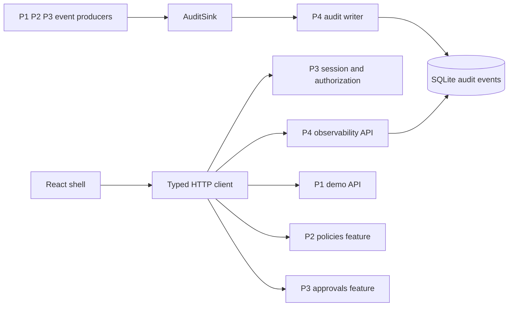
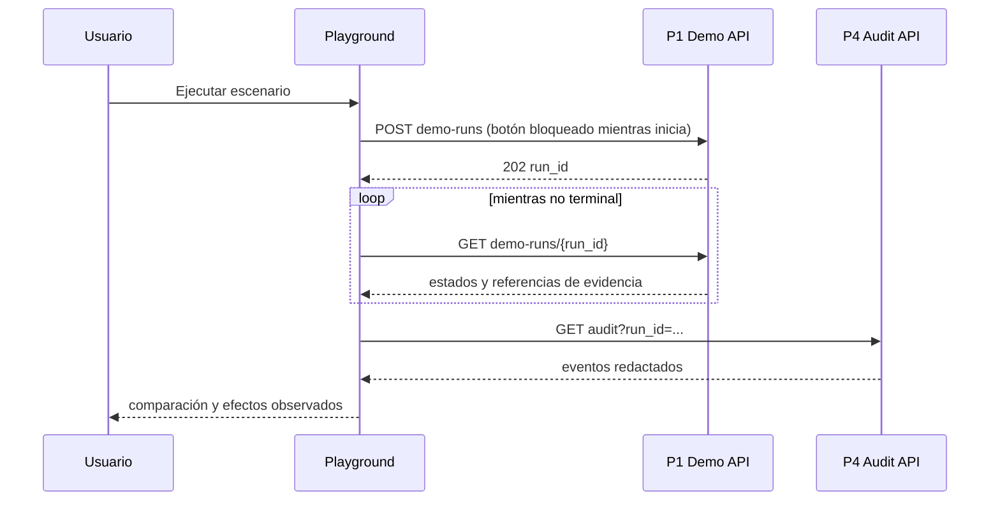

# Persona 4 — Experiencia de producto, auditoría y demostración

Estado: planificación propuesta; no constituye autorización para implementar la aplicación.
Presupuesto: **25 unidades de las 100 del proyecto, 25 % del esfuerzo estimado**.
Identificadores técnicos en inglés; documentación, interfaz inicial y mensajes en español.

## 1. Identidad de la parte

Responsable humano: Persona 4, uno de exactamente cuatro integrantes.
Módulo: interfaz transversal, observabilidad y evidencia de demostración.
Objetivo: permitir comprender, operar y comprobar WALLBA sin trasladar al navegador decisiones de seguridad.
Entregable: aplicación accesible con siete destinos de navegación, auditoría persistente consultable y comparación reproducible.
La Persona 4 implementa cinco pantallas principales más el shell y la matriz; integra las pantallas de políticas y aprobaciones entregadas por P2 y P3.
La auditoría backend también le pertenece para evitar que su interfaz dependa de registros improvisados.
No es responsable de implementar todos los tests del equipo.
Coordina los flujos end-to-end y cada integrante conserva los tests de su módulo.

Dependencias contractuales:

- P1: catálogo de agentes, escenarios y ejecución aislada de demostraciones.
- P2: modelos de política y pantalla de edición controlada.
- P3: identidad de sesión, RBAC, proxy y pantalla de aprobaciones.
- P1/P2/P3: productores de eventos auditables mediante el puerto de auditoría.
- Contratos compartidos: [API](../API_CONTRACTS.md), [integración](../INTEGRATION_CONTRACTS.md), [propiedad](../OWNERSHIP_MATRIX.md).

## 2. Contexto del proyecto

WALLBA intercala un proxy entre agentes de IA y herramientas protegidas.
El motor devuelve `ALLOW`, `DENY` o `REQUIRE_APPROVAL`.
La ejecución ocurre exclusivamente en el ejecutor controlado, después de aplicar la decisión y verificar una aprobación cuando corresponda.
La interfaz presenta el estado decidido por el servidor y los efectos verificados sobre recursos sintéticos.
Una tarjeta verde no acredita por sí misma que una operación haya sido segura.
La evidencia combina identificadores correlacionables, auditoría, estado terminal y diferencias del recurso.

El modo sin firewall existe únicamente dentro del laboratorio aislado.
La interfaz no incorpora un interruptor global que desactive el proxy productivo.
Una ejecución comparativa crea dos entornos hermanos a partir de la misma semilla y un mismo sobre de solicitud.
Los efectos de cada rama pertenecen a sus recursos sintéticos separados.
Los escenarios de aprobación o configuración inválida pueden producir resultados diferentes de una llamada ordinaria; se muestran según su evidencia real.

## 3. Objetivos funcionales

- Navegar entre dashboard, agentes, políticas, aprobaciones, auditoría, Playground y matriz de ataques.
- Iniciar y cerrar sesión utilizando el contrato de P3.
- Mostrar herramientas y permisos de cada agente como información recibida del backend.
- Presentar KPIs trazables al filtro temporal activo.
- Consultar auditoría mediante filtros, búsqueda y paginación estable.
- Abrir una operación y reconstruir su secuencia de eventos.
- Seleccionar uno de los diez escenarios iniciales y ejecutar una comparación controlada.
- Mostrar parámetros, decisión, política, riesgo, efectos y evidencia por rama.
- Distinguir una denegación de una operación fallida o de resultado desconocido.
- Representar pendientes, expiraciones y decisiones humanas sin ejecutar directamente herramientas.
- Mostrar la matriz únicamente con resultados persistidos de ejecuciones reales.
- Exportar evidencia redactada por una API autenticada.
- Mostrar explícitamente `Ejemplo de desarrollo` en vistas alimentadas por MSW.
- Permitir inspección de estados vacíos y fallos sin fabricar registros.

## 4. Objetivos técnicos

La SPA utiliza tipos derivados del mismo contrato que valida el servidor.
Cada respuesta desconocida debe producir un error de contrato visible en desarrollo y un mensaje seguro en la interfaz.
La aplicación nunca reconstruye una decisión de autorización a partir de colores o permisos locales.
Los controles se ocultan o deshabilitan según capacidades de sesión para orientar al usuario; el servidor vuelve a autorizar cada petición.
No se guardan tokens en `localStorage`, URL, logs ni persistencia de TanStack Query.
Las consultas sensibles se eliminan de caché al cerrar sesión o cambiar de identidad.
Las respuestas de auditoría llevan redacción aplicada en el servidor.
El contenido de documentos maliciosos se representa como texto, sin HTML inyectado.

Objetivos medibles de producto para el MVP local:

- Todas las acciones esenciales se completan con teclado.
- Ninguna información depende exclusivamente del color.
- La interfaz funciona desde 360 px hasta escritorio amplio sin perder acciones.
- La auditoría pagina en el servidor; el cliente no carga toda la historia.
- Se propone presupuesto de respuesta p95 menor de 500 ms para lecturas paginadas con 10 000 eventos en equipo de referencia documentado.
- Se registra equipo, volumen y concurrencia de la medición; el presupuesto es un objetivo por validar.
- Las demostraciones mantienen su estado al recargar mediante su identificador persistido.
- El render de una tabla no bloquea otras rutas; se limita cada página a 50 filas, máximo permitido 100.

## 5. Alcance y exclusiones

Incluido: shell, componentes comunes, dashboard, agentes, auditoría, Playground, matriz, API de observabilidad, exportación redactada y tests end-to-end.
Incluido: puntos de extensión de rutas para políticas y aprobaciones.
Incluido: estados comunes de sesión y la integración visual de login/logout según contrato de P3.
Excluido de su propiedad: evaluador, proxy, ejecutor, credenciales de herramientas, decisiones de aprobación y activación de políticas.
P2 implementa `frontend/src/features/policies/`.
P3 implementa `frontend/src/features/approvals/` y la lógica backend de autenticación.
P1 implementa `backend/wallba/demo/` y `backend/wallba/agents/`.
Las revisiones entre personas no transfieren propiedad de código.

Fuera del MVP: streaming complejo, analítica predictiva, editor visual de diagramas de políticas, multitenencia, correo real y conectores productivos.
Polling de dos segundos mientras hay ejecución activa conserva la demostrabilidad sin añadir WebSockets.
La pausa al ocultar la pestaña y el backoff con jitter limitan consultas innecesarias.
Las funciones futuras conservan puertos de consulta para sustituir el transporte sin reescribir pantallas.

## 6. Tecnologías

React 19 con TypeScript estricto y Vite: SPA local, sin necesidad inicial de SSR.
Tailwind CSS 4: tokens CSS y composición consistente de estados.
React Router: rutas explícitas y páginas enlazables.
TanStack Query: cancelación, invalidación y caché de consultas no persistente.
MSW: simulación HTTP con contratos iguales al servidor; uso exclusivo de desarrollo y tests.
Vitest y Testing Library: componentes y comportamiento de interacción.
Playwright y axe-core: recorridos reales de navegador y detección automatizada de barreras.
Pydantic 2 y FastAPI: validación de consultas/respuestas de observabilidad.
SQLAlchemy 2 y SQLite: consultas persistentes en el único worker del MVP.
Las familias de versión se fijarán a revisiones compatibles y lockfiles en el trabajo de bootstrap de P1.
No instalar versiones por intuición ni declarar una combinación probada antes de ejecutar el smoke del proyecto.
No incorporar una librería de gráficos hasta comprobar que las barras y tablas accesibles básicas resultan insuficientes.

## 7. Arquitectura particular



Componentes principales:

- `AppShell`: navegación, identidad activa, título de ruta y zona de alertas.
- `ApiClient`: cookies de sesión, cabecera CSRF en mutaciones y conversión de errores.
- `QueryProvider`: política de retry, cancelación y limpieza de datos de sesión.
- `AuditWriter`: secuencia, redacción, encadenamiento e inserción transaccional.
- `AuditQueryService`: búsqueda permitida, filtros y cursor estable.
- `DashboardQueryService`: agregaciones sobre el mismo rango de auditoría.
- `EvidenceExportService`: manifiesto redactado y checksums verificables.
- `ComparisonView`: dos ramas de una ejecución, sin volver a calcular resultados.
- `AttackMatrix`: una fila por escenario y última ejecución elegida explícitamente.



## 8. Estructura de archivos

Árbol previsto; estos archivos se crearán después de aprobar la planificación.

```text
frontend/src/
  app/
    AppShell.tsx
    routes.tsx
    providers.tsx
  api/
    generated.ts              # P1 generado; P4 no lo edita
    client.ts
    queryKeys.ts
  components/
    StatusBadge.tsx
    DataTable.tsx
    ErrorPanel.tsx
    EmptyState.tsx
    ConfirmDialog.tsx
    JsonDetails.tsx
  styles/
    tokens.css
  features/
    dashboard/
      DashboardPage.tsx
      dashboardQueries.ts
    agents/
      AgentsPage.tsx
      AgentDetails.tsx
    audit/
      AuditPage.tsx
      AuditTimeline.tsx
      auditQueries.ts
    playground/
      PlaygroundPage.tsx
      ComparisonView.tsx
      demoQueries.ts
    attack-matrix/
      AttackMatrixPage.tsx
    policies/                 # P2; no editar sin coordinación
    approvals/                # P3; no editar sin coordinación
  mocks/
    browser.ts
    handlers.ts
backend/wallba/observability/
  ports.py
  writer.py
  redaction.py
  queries.py
  exports.py
  router.py
  schemas.py
tests/observability/
tests/e2e/
```

`ports.py` expone el protocolo que otros módulos consumen; sus cambios requieren revisión del consumidor.
`writer.py` consume el helper canónico compartido de P1 para serializar eventos redactados; no duplica su algoritmo ni mantiene otra implementación.
`writer.py` asigna secuencias y hashes dentro de la transacción del evento.
`queries.py` solo compone consultas parametrizadas a partir de campos permitidos.
`exports.py` produce descargas sin rutas de archivo controladas por el usuario.
Los DTO públicos centrales pertenecen al propietario definido en la matriz global; no se duplican localmente.

## 9. Contratos

La fuente normativa es [API_CONTRACTS](../API_CONTRACTS.md); este resumen determina los consumidores y productores de P4.
Todas las rutas comienzan con `/api/v1` y exigen identidad humana autorizada, excepto los productores internos del puerto.

| Ruta | Uso de P4 | Resultado esperado |
|---|---|---|
| `GET /dashboard` | implementar y consumir | contadores, rango UTC, distribución y fecha de corte |
| `GET /agents` | consumir P1 | colección paginada con ID, nombre, estado y herramientas |
| `GET /agents/{agent_id}` | consumir P1 | permisos declarados y contexto permitido |
| `GET /audit` | implementar y consumir | página de eventos redactados y `next_cursor` |
| `GET /audit/{event_id}` | implementar y consumir | detalle y enlaces por `request_id` |
| `GET /audit/export` | implementar y consumir | JSONL redactado, manifiesto, rango obligatorio y máximo 10 000 eventos |
| `GET /scenarios` | consumir P1 | catálogo versionado y recursos sintéticos |
| `POST /demo-runs` | consumir P1 | `202` con `run_id` y estado inicial |
| `GET /demo-runs/{run_id}` | consumir P1 | ramas, estados, evidencia y efectos |
| `GET /matrix` | consumir P1 | resultados derivados de demo-runs persistidos |
| `GET /demo-runs/{run_id}/evidence` | consumir P1 | manifiesto redactado descargable |

DTO mínimo que necesita el render de auditoría:

```text
AuditEvent:
  event_id: UUID
  sequence: integer
  occurred_at: UTC timestamp
  request_id: UUID | null
  run_id: UUID | null
  event_type: string enum
  principal_id: opaque string
  tool: file.read | email.send | record.delete | db.query | null
  decision: ALLOW | DENY | REQUIRE_APPROVAL | null
  risk: LOW | MEDIUM | HIGH | CRITICAL | null
  policy_version: integer | null
  reason_code: string
  request_digest: hex string | null
  previous_hash: hex string
  event_hash: hex string
```

El puerto contractual es `AuditSink.append(event, transaction) -> event_id`, compartiendo la transacción SQLite de control con el productor. El escritor recibe un borrador sin secuencia ni hashes.
El servidor determina actor autenticado, timestamp, correlación y orden; no confía en esos valores recibidos del navegador.
Los campos opcionales no se sustituyen por valores ficticios.
Eventos administrativos como policy_activated y demo_started pueden tener request_id y request_digest nulos; usar event_id/run_id para correlación, sin inventar ToolCall.
Cada enum nuevo requiere actualización del contrato y un fallback visual seguro para clientes anteriores.
La UI muestra un código no reconocido como `Estado desconocido` y conserva su valor textual para diagnóstico sin afirmar éxito.

Filtros permitidos: `from`, `to`, `agent_id`, `request_id`, `decision`, `risk`, `tool`, `cursor`, `limit` y búsqueda limitada por IDs y códigos.
Las fechas viajan en UTC y se presentan con zona horaria explícita del navegador.
La búsqueda no ejecuta SQL ni busca secretos eliminados por redacción.
Los errores usan `error.code`, `error.message`, `error.request_id` y detalles seguros del contrato común.
`401` limpia sesión; `403` presenta falta de permiso; `409` solicita refrescar; `422` asocia errores a campos; `503` conserva la vista y ofrece reintentar lectura.
El navegador no reintenta automáticamente mutaciones que podrían iniciar otra ejecución.

## 10. Plan de implementación paso a paso

El presupuesto se calcula sobre entrega comprobable, incluyendo investigación, construcción, pruebas, integración y documentación.
Las dependencias locales se repiten en [metadatos](../planning/person-4-tasks.json).
Las dependencias de otras personas se resuelven mediante contratos y mocks; no implican esperar su módulo completo.

### WAL-P4-001 — Shell, tokens y navegación — 3 unidades

Historia: como operador quiero reconocer mi ubicación, estado de sesión y acciones disponibles.
Prioridad: crítica. Dependencias locales: ninguna.
Archivos: `frontend/src/app/`, `frontend/src/styles/`, `frontend/src/components/`.
Delegación: `p4-frontend-designer`; la persona revisa tokens y recorrido con teclado.
Estimación: 0,5 investigación/diseño + 1,5 implementación + 0,5 pruebas + 0,5 integración/documentación.

1. Definir tokens, tipografía local de sistema y densidad de tablas.
2. Construir shell, encabezado, navegación y rutas reservadas para P2/P3.
3. Implementar badges, vacíos, carga, error, diálogo y panel de JSON accesible.
4. Añadir menú móvil y enlace para saltar al contenido.
5. Comprobar teclado, foco, contraste y captura de tres anchos.

Aceptación: Given una sesión válida, When se visita cada ruta a 360/768/1440 px, Then se identifica ruta activa y todas las acciones esenciales tienen foco visible.
Evidencia: capturas, revisión de contraste y resultado de tests de componentes.

### WAL-P4-002 — Cliente HTTP, caché y mocks — 2 unidades

Historia: como desarrollador quiero avanzar con APIs compatibles antes de disponer de todos los servicios.
Prioridad: crítica. Dependencias locales: WAL-P4-001.
Archivos: `frontend/src/api/client.ts`, `frontend/src/api/queryKeys.ts`, `frontend/src/mocks/`, `frontend/src/app/providers.tsx`. `frontend/src/api/generated.ts` pertenece a P1 y se regenera desde contratos: P4 no lo edita a mano.
Delegación: `p4-observability-demo`.
Estimación: 0,25 investigación + 0,75 construcción + 0,5 tests + 0,5 integración/documentación.

1. Implementar cliente tipado con credentials, CSRF y error común.
2. Definir query keys con identidad, filtro y cursor.
3. Configurar mocks tipados, marca persistente de ejemplo y escenarios de error.
4. Prohibir arranque de MSW en build de distribución.
5. Limpiar caché en logout y probar cambio de usuario.

Aceptación: Given respuestas simuladas y una expiración de sesión, When se cambia de usuario, Then no quedan datos del usuario anterior y todos los mocks visibles están identificados.
Evidencia: tests de cliente y comparación de fixtures con los esquemas públicos.

### WAL-P4-003 — Persistencia y puerto de auditoría — 4 unidades

Historia: como auditor quiero reconstruir decisiones con eventos ordenados y sin secretos.
Prioridad: crítica. Dependencias locales: ninguna.
Archivos: `backend/wallba/observability/{ports,writer,redaction}.py`, `tests/observability/`.
Delegación: `p4-observability-demo`; revisión humana y `wallba-verifier`.
Estimación: 0,75 diseño/investigación + 1,5 implementación + 1 pruebas adversariales + 0,75 integración/documentación.

1. Acordar `AuditSink` con P1/P2/P3 y ejemplos de cada tipo de evento.
2. Implementar lista permitida de campos y redacción de correo/cuerpo/token/rutas sensibles.
3. Persistir secuencia y hash anterior mediante escritura serializada transaccional.
4. Fallar de forma segura en eventos críticos previos a ejecución.
5. Probar rollbacks, concurrencia y manipulación de un evento anterior.

Aceptación: Given dos productores concurrentes, When se insertan eventos, Then no se repiten secuencias, la cadena se verifica y ningún secreto de los fixtures aparece en almacenamiento/exportación.
Evidencia: consultas de prueba, verificación de cadena y logs de tests redactados.

### WAL-P4-004 — API de auditoría, agregaciones y exportación — 3 unidades

Historia: como operador quiero consultar y descargar evidencia con límites y permisos consistentes.
Prioridad: alta. Dependencias locales: WAL-P4-003.
Archivos: `backend/wallba/observability/{queries,exports,router,schemas}.py`, `tests/observability/`.
Delegación: `p4-observability-demo`.
Estimación: 0,25 diseño + 1,25 construcción + 0,75 tests + 0,75 integración/documentación.

1. Añadir filtros permitidos, cursores opacos y límites.
2. Agregar métricas por ventana UTC y devolver `as_of`.
3. Exponer detalle solo tras comprobar RBAC.
4. Crear exportación de evidencia con manifiesto y checksum.
5. Medir rendimiento con conjunto sintético de 10 000 eventos.

Aceptación: Given una ventana temporal fija, When se consultan tabla y dashboard, Then los totales coinciden y la paginación no repite ni omite eventos del snapshot.
Evidencia: tests API, benchmark con equipo/volumen y exportación de muestra claramente sintética.

### WAL-P4-005 — Dashboard y agentes — 2 unidades

Historia: como operador quiero conocer actividad y capacidades declaradas de cada agente.
Prioridad: alta. Dependencias locales: WAL-P4-001, WAL-P4-002.
Archivos: `frontend/src/features/dashboard/`, `frontend/src/features/agents/`.
Delegación: `p4-frontend-designer`.
Estimación: 0,25 diseño + 0,75 construcción + 0,5 tests + 0,5 integración/documentación.

1. Construir KPIs que distingan decisiones, ejecución y aprobaciones pendientes.
2. Presentar distribución de riesgo como barras y tabla textual equivalente.
3. Listar agentes, estado y herramientas; abrir detalles mediante URL.
4. Mostrar filtro temporal, fecha de corte y ausencia de datos.
5. Validar que una denegación no se cuenta como ejecución fallida.

Aceptación: Given una respuesta con cero eventos y dos agentes, When se abre dashboard, Then se muestran ceros reales, estado vacío y los agentes sin inferir permisos adicionales.
Evidencia: tests de componentes y captura de la vista vacía.

### WAL-P4-006 — Explorador de auditoría — 2 unidades

Historia: como auditor quiero localizar una llamada y seguir su decisión hasta su efecto.
Prioridad: alta. Dependencias locales: WAL-P4-002, WAL-P4-004.
Archivos: `frontend/src/features/audit/`.
Delegación: `p4-observability-demo`.
Estimación: 0,25 diseño + 0,75 construcción + 0,5 tests + 0,5 integración/documentación.

1. Sincronizar filtros permitidos con URL sin incluir información sensible.
2. Construir tabla paginada, detalle y timeline por correlación.
3. Mostrar hashes, integridad verificada y límites de la garantía.
4. Descargar evidencia y anunciar finalización con región de estado.
5. Probar navegación atrás, recarga y cursor inválido.

Aceptación: Given un `request_id`, When se aplica el filtro y se abre detalle, Then aparecen solo eventos correlacionados y la descarga conserva los mismos IDs.
Evidencia: test de integración UI/API y manifiesto descargado.

### WAL-P4-007 — Playground comparativo — 4 unidades

Historia: como evaluador quiero observar el mismo intento con y sin firewall sobre datos desechables equivalentes.
Prioridad: crítica. Dependencias locales: WAL-P4-002, WAL-P4-006.
Archivos: `frontend/src/features/playground/`.
Delegación: `p4-observability-demo`; diseño revisado por `p4-frontend-designer` secuencialmente.
Estimación: 0,5 modelado + 1,5 construcción + 1 tests + 1 integración/documentación.

1. Seleccionar catálogo y mostrar objetivo, riesgo, herramienta y semilla.
2. Confirmar explícitamente que los recursos son sintéticos.
3. Enviar `POST /demo-runs` con el botón deshabilitado durante el inicio. El contrato actual no exige `Idempotency-Key` en esta ruta; el servidor devuelve `409` si ya hay un run activo.
4. Consultar estado persistido y recuperar run tras recarga.
5. Presentar ramas lado a lado o apiladas, parámetros idénticos y diferencia de efectos.
6. Enlazar evidencia y solicitudes pendientes al centro de aprobaciones de P3.
7. Evitar reenvío automático en timeout; consultar el estado disponible del run y resolver el inicio ambiguo antes de ofrecer otro intento. No asumir deduplicación por clave en esta ruta.

Aceptación: Given el escenario de eliminación prohibida, When finaliza la comparación, Then la rama sin firewall muestra el efecto sintético observado y la protegida muestra decisión y ausencia de efecto verificadas, únicamente si la ejecución produjo esas evidencias.
Evidencia: vídeo/capturas del run real, manifiesto y aserciones sobre recursos iniciales/finales.

### WAL-P4-008 — Matriz de ataques — 1 unidad

Historia: como evaluador quiero comparar escenarios y distinguir lo probado de lo pendiente.
Prioridad: alta. Dependencias locales: WAL-P4-007.
Archivos: `frontend/src/features/attack-matrix/`.
Delegación: `p4-observability-demo`.
Estimación: 0,5 construcción + 0,25 tests + 0,25 documentación/integración.

1. Renderizar herramienta, parámetros redactados, riesgo, política, dos resultados y motivo.
2. Añadir IDs, fecha, versión y enlace a evidencia por fila.
3. Mostrar `No ejecutado` cuando falta run persistido.
4. Permitir inspeccionar una ejecución anterior sin sobrescribir historia.

Aceptación: Given diez escenarios y tres runs completos, When se abre la matriz, Then siete filas permanecen no ejecutadas y ninguna se presenta como prueba superada.
Evidencia: prueba de render contra fixture parcial y recorrido con backend real.

### WAL-P4-009 — Integración, accesibilidad y entrega E2E — 4 unidades

Historia: como equipo quiero una demostración verificable y una interfaz que no oculte fallos de seguridad.
Prioridad: crítica. Dependencias locales: WAL-P4-005, WAL-P4-006, WAL-P4-007, WAL-P4-008.
Archivos: `tests/e2e/`, `frontend/src/` dentro de propiedad P4, documentación de evidencia P4.
Delegación: persona coordina; especialistas corrigen sus áreas; `wallba-verifier` revisa independientemente.
Estimación: 0,5 planificación + 1 automatización + 1 integración + 1 validación visual/accesibilidad + 0,5 documentación.

1. Integrar rutas de políticas y aprobaciones sin editar su lógica interna.
2. Automatizar login, lectura permitida, denegación, aprobación y comparación.
3. Recorrer los diez escenarios con sus propietarios para generar evidencia.
4. Ejecutar axe y revisión manual de teclado, zoom, lector de pantalla y reducido movimiento.
5. Verificar limpieza de caché, errores de red y estados `UNKNOWN`.
6. Publicar registro de comandos ejecutados y resultados reales, sin push no autorizado.

Aceptación: Given un entorno limpio y semillas documentadas, When se ejecuta el recorrido completo, Then cada resultado se enlaza a evidencia persistida, no hay violaciones críticas de accesibilidad conocidas y los errores conservan un estado comprensible.
Evidencia: reportes Playwright/axe, capturas revisadas, manifiesto y lista explícita de pendientes.

Suma: 3 + 2 + 4 + 3 + 2 + 2 + 4 + 1 + 4 = **25**.

## 11. Guías de implementación

### Sistema visual propuesto

No se recibieron capturas, imágenes ni identidad visual concreta.
Esta propuesta puede validarse con el usuario antes de cerrar la dirección visual; no debe presentarse como una referencia proporcionada.
Fondo `#0B1120`, superficies `#111C30`, superficie elevada `#19263C`, texto principal `#F1F5F9`, secundario `#CBD5E1`, acento `#67E8F9`.
Semánticos propuestos: permitido verde, denegado rojo, aprobación ámbar e indeterminado gris, siempre acompañados de palabra e icono.
El contraste se mide en combinaciones reales; los hexadecimales son valores iniciales y no acreditan conformidad automática.
Tipografía: `system-ui` para interfaz, `ui-monospace` para IDs y JSON.
Escala de espaciado: 4, 8, 12, 16, 24, 32 y 48 px.
Altura de interacción mínima propuesta 44 px y borde de foco de 2 px con offset.
Tablas densas conservan lectura clara y sus acciones mantienen área suficiente.
Animaciones de 120–180 ms solo para transición de panel y feedback; `prefers-reduced-motion` elimina movimientos no esenciales.

### Pantallas y relación con APIs

Dashboard: barra temporal, cuatro KPIs, actividad reciente, distribución por riesgo y decisiones.
Consume `/dashboard` y enlaces filtrados a `/audit`; muestra `as_of`, no mezcla períodos y excluye baseline por defecto. Una consulta baseline explícita lleva badge visible.
Agentes: búsqueda por nombre/ID, estado, herramientas declaradas y panel de detalle.
Consume `/agents` y `/agents/{agent_id}`; el listado no permite cambiar privilegios.
Políticas: shell ofrece ruta y espacio; P2 aporta listado/editor, validación y activación según RBAC.
La ruta muestra versión activa y errores del servidor; no activa un YAML solo porque el editor lo haya parseado.
Aprobaciones: shell ofrece ruta; P3 aporta pendientes, detalle, motivo, vencimiento y decisión humana.
Una aprobación vencida se actualiza consultando servidor; el reloj visual es orientativo.
Auditoría: filtros, tabla, timeline y exportación; consume APIs de P4.
Playground: selección de escenario, descripción del entorno sintético, inicio, dos ramas, estado y efectos.
Consume APIs de P1 y enlaza auditoría de P4 y aprobación de P3.
Matriz: tabla con diez escenarios, estados no ejecutados y resultados de runs reales, más expansión de evidencia.
Consume `/matrix` y enlaces a `/demo-runs/{run_id}`.

En móvil la barra lateral pasa a menú desplegable, las ramas se apilan y las tablas permiten scroll horizontal con título y encabezados conservados.
No se eliminan columnas de motivo/evidencia para aparentar simplicidad.
En tablet se usa navegación compacta y en escritorio sidebar de 240 px.
La vista de detalle usa ruta propia; evita diálogos enormes imposibles de navegar en pantallas pequeñas.

### Estados compartidos

Carga inicial: skeleton estable con `aria-busy`; evitar KPI cero antes de recibir respuesta.
Actualización: conservar datos anteriores indicando fecha y actualización pendiente.
Vacío: explicar filtro activo y ofrecer limpiarlo; no añadir actividad de muestra silenciosamente.
Error: mensaje localizado y código de correlación; no mostrar stack trace ni cuerpos arbitrarios.
Sin permiso: explicar la capacidad requerida y mantener navegación accesible.
Timeout de mutación: estado de resultado pendiente de comprobar; buscar solicitud por ID antes de reenviar.
`UNKNOWN`: mostrar incertidumbre, último evento y siguiente acción segura; no ofrecer `Ejecutar de nuevo` por defecto.
Sesión vencida: cerrar vistas sensibles, limpiar caché y volver al acceso.

### Encadenamiento de auditoría

```text
append(draft, transaction):
  verify_schema(draft)
  safe_event = redact_allowlisted_fields(draft)
  sequence, previous_hash = lock_and_read_tail(transaction)
  canonical_bytes = P1_shared_canonical_json(safe_event + sequence + previous_hash)
  event_hash = sha256(canonical_bytes)
  insert_event_and_advance_tail(transaction)
  return event_id, event_hash
```

La representación canónica utiliza el helper de P1 y su contrato de UTF-8, orden de claves y tipos permitidos. P4 prueba su integración sobre eventos y no implementa una variante propia.
La primera entrada usa un hash raíz documentado; la secuencia es monotónica.
El escritor se integra con la misma unidad de trabajo cuando el evento forma parte de una transición crítica.
Una escritura fallida antes de autorizar ejecución debe impedir el efecto protegido.
Si falla registrar un resultado después de producirse el efecto, el journal del ejecutor conserva su estado y se abre reconciliación; nunca se falsea una denegación retroactiva.
La cadena detecta alteraciones frente a un ancla de confianza conocida; un administrador con acceso completo puede reescribir base y cadena.
Exportar un hash ancla firmado o guardado externamente permite una evolución posterior; el MVP no promete inmutabilidad frente al administrador del host.
La auditoría no almacena cuerpos completos de archivos o correos, bearer tokens, cookies ni credenciales.

## 12. Subagentes disponibles

`p4-frontend-designer`: componentes, tokens, interacción, responsive y accesibilidad.
Archivo: [p4-frontend-designer](../../.cursor/agents/p4-frontend-designer.md).
`p4-observability-demo`: auditoría, consultas, trazabilidad y comparación visual.
Archivo: [p4-observability-demo](../../.cursor/agents/p4-observability-demo.md).
`wallba-verifier`: inspección independiente de contratos, cobertura y evidencia.
Archivo: [wallba-verifier](../../.cursor/agents/wallba-verifier.md).
El verificador de solo lectura no debe ejecutar pruebas que escriban en el workspace o modifiquen bases; el agente principal ejecuta esas pruebas en entorno aislado y le entrega resultados para revisión.
El humano conserva responsabilidad de cada aceptación.

## 13. Delegación de tareas

WAL-P4-001 y WAL-P4-005: diseñador; WAL-P4-002/003/004/006/008: observabilidad; WAL-P4-007: observabilidad con revisión posterior de diseño; WAL-P4-009: coordinación humana y revisión independiente.
Delegación secuencial cuando dos especialistas necesitan editar `AppShell`, tokens o cliente HTTP.
Investigación de accesibilidad y análisis de contrato pueden realizarse en paralelo al trabajo backend de auditoría porque no escriben los mismos archivos.
Ediciones paralelas con solapamiento potencial requieren worktrees limpios, ramas separadas y merge revisado por el propietario.
No asumir que `readonly` equivale a sandbox de red o permite lanzar cualquier comando.
Detener delegación cuando falte contrato, haya divergencia de DTO o el diff incluya módulos P2/P3/P1 sin acuerdo.

Ejemplo de encargo al diseñador: implementar WAL-P4-001 usando los tokens de este plan, solo en app/components/styles; devolver capturas, pruebas y limitaciones de contraste.
Ejemplo a observabilidad: implementar WAL-P4-003 con fixtures secretos falsos y demostrar que no aparecen en persistencia ni exportación.
Ejemplo al verificador: revisar un diff de WAL-P4-007 y los resultados de una ejecución real; comprobar equivalencia de solicitud y separación de recursos sin editar.

## 14. Dependencias

Recibe de P1: contrato de agentes, catálogo de diez escenarios, `run_id`, semillas, snapshots y referencias verificables de efectos.
Entrega a P1: puerto de auditoría y requerimientos concretos de DTO para comparación.
Recibe de P2: decisiones, versiones de política, códigos de motivo y ruta `PoliciesPage` integrada.
Entrega a P2: componentes, tokens y formato visual común de errores.
Recibe de P3: sesión/capacidades, CSRF, estados de aprobación, correlación y ruta `ApprovalsPage`.
Entrega a P3: puerto auditado y shell de navegación sin lógica de autorización duplicada.
El acuerdo de contratos precede a la implementación real; MSW permite construir pantallas desde el primer bloque.
Las comprobaciones de integración real comienzan por la lectura permitida y se amplían progresivamente.

## 15. Integración

1. Revisar contratos y registrar diferencias antes de modificar DTO.
2. Añadir el puerto P4 a la composición de dependencias de P1 mediante PR revisado por P1.
3. Integrar primero productor de un evento y endpoint de consulta.
4. Conectar dashboard y auditoría a datos reales, desactivando MSW.
5. Integrar route exports P2/P3 con props mínimas y proveedores comunes.
6. Conectar Playground a runner P1 y mostrar un caso real antes de completar el catálogo.
7. Validar igualdad de parámetros y semillas en ambas ramas con evidencia del backend.
8. Ejecutar suite contractual y recorrido completo con reinicio entre escenarios.

No mezclar fixtures de MSW con datos reales dentro de la misma comparación.
Los cambios incompatibles de contrato requieren revisión de productores y consumidores, actualización coordinada y regeneración de tipos.
Un workaround visual no resuelve un error de seguridad: se bloquea el cierre de la tarea hasta que el propietario lo corrija.

## 16. Pruebas

Unitarias backend: redacción recursiva con listas, campos inesperados, tipos inválidos y determinismo de hash de eventos consumiendo el helper compartido P1.
Persistencia: orden, rollback, cadena rota, cursores, filtros inclusivos/exclusivos y escrituras simultáneas.
API: autenticación, RBAC, límites, errores seguros y exportación de un run inexistente o no permitido.
Contrato: todos los fixtures MSW se validan con los esquemas compartidos y no contienen campos inventados.
Frontend: navegación, foco, diálogos, carga/vacío/error, caracteres largos y ausencia de resultados.
Playground: doble click, reload, timeout, ramas parciales, aprobación pendiente, expiración y estado desconocido.
Auditoría: filtro por ID, rango sin resultados, cursor obsoleto y búsqueda con metacaracteres.
Seguridad: XSS en motivo, contenido de documento malicioso representado como texto, secretos sintéticos y logout con otra sesión posterior.
Accesibilidad: axe más revisión manual de teclado, orden de foco, zoom 200 %, lector de pantalla y movimiento reducido.
E2E: cada escenario tiene propietario backend; P4 verifica presentación y recorrido, no sustituye sus pruebas unitarias.

Comandos previstos, una vez creados scripts y dependencias por P1:

```text
python -m pytest tests/observability -q
npm --prefix frontend run typecheck
npm --prefix frontend run test -- --run
npm --prefix frontend run build
npm --prefix frontend run test:e2e
```

Estos comandos son parte del plan y todavía no acreditan tests ejecutados.
Cada reporte registra commit, versiones, comando, exit code, semilla y fecha UTC.
Las capturas se toman de runs identificados y se redactan antes de adjuntar.
Un fallo intermitente se investiga; no se elimina una aserción para convertirlo en verde.

## 17. Criterios de aceptación

- Given una acción denegada, When se abre su timeline, Then se observa la política, motivo y evidencia de ausencia de efecto, si está disponible, sin confundir DENY con error.
- Given una aprobación pendiente, When se abre su enlace, Then el usuario llega a la solicitud exacta de P3 y el agente no dispone de ese control.
- Given datos inexistentes, When se abre matriz, Then aparece `No ejecutado` y ningún resultado supuesto.
- Given parámetros manipulados devueltos por un escenario, When se comparan ramas, Then se muestra el fallo de integridad reportado por servidor.
- Given un evento que contiene HTML malicioso, When se abre su detalle, Then se muestra texto sin ejecución ni navegación inesperada.
- Given una sesión sin privilegios, When se intenta exportar, Then servidor rechaza y la UI presenta el error seguro.
- Given un run completado, When se recarga la URL, Then se recuperan estado y evidencia persistidos.
- Given un error de auditoría crítico, When se intenta ejecutar una operación protegida, Then la integración falla de forma segura según el journal y no se inventa un éxito.

## 18. Definición de terminado

La tarea mantiene su ID, esfuerzo, propietario y criterio verificable.
El diff respeta rutas de propiedad y tiene revisión de contratos cuando corresponde.
No hay estados simulados presentados como datos reales.
Los tests pertinentes se ejecutaron y sus comandos/resultados están registrados.
La revisión visual contempla escritorio y móvil, estados de error y teclado.
La documentación explica los límites de las garantías de auditoría.
No quedan secretos, credenciales ni datos personales reales en fixtures o artefactos.
El humano revisó la evidencia y las limitaciones antes de marcar completado.
La suite E2E común no sustituye los criterios individuales de cada tarea.

## 19. Riesgos

Riesgo: carga de frontend excesiva; mitigación: P2 conserva políticas y P3 aprobaciones, con componentes comunes entregados temprano.
Riesgo: UI acusa bloqueo sin comprobar efectos; mitigación: mostrar por separado decisión, ejecución y snapshot del recurso.
Riesgo: resultados obsoletos por caché; mitigación: invalidación por identidad y run, timestamps visibles y polling terminal.
Riesgo: SQLite bloqueado por auditoría; mitigación: transacciones cortas, único worker y prueba de concurrencia representativa.
Riesgo: cadena de hashes vendida como inmutabilidad; mitigación: documentar el límite frente al administrador y mantener anclas de exportación.
Riesgo: incremento de alcance visual; mitigación: propuesta explícita y revisión de estimaciones conservando 25 puntos por persona mediante redistribución acordada.
Riesgo: pruebas E2E lentas o frágiles; mitigación: semillas y reloj controlables, selecciones por rol y aislamiento de recursos por run.
Riesgo: error después de un efecto; mitigación: mostrar UNKNOWN y journal, sin retry automático.
Riesgo: capturas contienen secretos; mitigación: fixtures sintéticos y redacción previa a persistencia/exportación.

## 20. Checklist

- [x] Revisar los contratos, las rutas de propiedad y el presupuesto.
- [ ] Completar WAL-P4-001 y aprobar tokens propuestos.
- [x] Completar WAL-P4-002 y validar fixtures contra contratos.
- [x] Completar WAL-P4-003 con pruebas de redacción y concurrencia.
- [x] Completar WAL-P4-004 con permisos y paginación estable.
- [ ] Completar WAL-P4-005 sin métricas fabricadas.
- [ ] Completar WAL-P4-006 con timeline y exportación.
- [ ] Completar WAL-P4-007 sobre dos entornos equivalentes.
- [ ] Completar WAL-P4-008 conservando filas no ejecutadas.
- [ ] Completar WAL-P4-009 con revisión visual y evidencia real.
- [ ] Revisar el diff y registrar pendientes, comandos y resultados.

## 21. Procedimiento de inicio

Abrir la carpeta raíz `Wallba` en Cursor, no una subcarpeta aislada.
Leer este plan, `AGENTS.md`, reglas globales y los tres contratos enlazados.
Confirmar que la implementación funcional está aprobada antes de crear código.
Revisar `git status`, remoto y rama sin descartar cambios existentes.
Si existe el repositorio autorizado, crear `feature/person-4-dashboard` desde `main` actualizado.
Si no existe checkout real o el remoto sigue inaccesible, seguir el procedimiento global de bootstrap y no inventar su estado.
Seleccionar una tarea desbloqueada; empezar WAL-P4-001 y WAL-P4-003 en paralelo solo con archivos separados.
Comprobar que están disponibles las configuraciones de los subagentes de Cursor.
Entregar al subagente el ID, objetivo, rutas permitidas, contrato, criterio y pruebas requeridas.
Guardar decisiones en el PR o documento correspondiente sin cambiar de forma unilateral los contratos.

## 22. Procedimiento de entrega

Preparar commits pequeños con prefijo `feat(ui):`, `feat(audit):`, `test(e2e):` o `docs:` y referencia al ID.
Ejecutar checks relevantes y documentar resultados realmente observados.
Adjuntar capturas de estados normal/vacío/error y los reportes necesarios.
El PR explica comportamiento, rutas, contrato, validación, evidencia y limitaciones.
Solicitar revisión de P1 cuando cambie composición de servicios, de P2/P3 cuando se consuman nuevos eventos y del propietario de cualquier contrato compartido.
No hacer push ni merge sin autorización explícita del usuario.
No aceptar un reporte de subagente como prueba suficiente; inspeccionar diff y evidencia.
Si una tarea se bloquea, registrar causa, dato faltante, contrato afectado y siguiente tarea independiente.
Si aparece requisito nuevo, reestimar primero el esfuerzo y coordinar redistribución documentada; no ocultarlo dentro de las 25 unidades existentes.
Si el contrato resulta incompatible, detener el tramo dependiente y acordar migración con productor/consumidor antes de reanudar.
Después de la revisión humana, actualizar el estado en la fuente de tareas y regenerar/validar matrices según el procedimiento global.

## 23. Prompt de ejecución personal para Cursor

```text
Actúa como agente principal de la Persona 4 de WALLBA. Antes de implementar,
confirma en el contexto que el humano aprobó la implementación funcional.
Lee AGENTS.md, docs/team/PERSON_4_MASTER_PLAN.md,
docs/API_CONTRACTS.md, docs/INTEGRATION_CONTRACTS.md,
docs/OWNERSHIP_MATRIX.md, docs/TASK_MATRIX.md y las reglas .cursor/rules/.
Trabaja únicamente en las tareas WAL-P4-001 a WAL-P4-009 y en sus rutas permitidas.
Presupuesto de planificación: 25 unidades, uno de cuatro responsables humanos.
No modifiques frontend/src/features/policies/ ni approvals/, ni el motor,
proxy, autenticación o runner de P1/P2/P3 sin acuerdo explícito del propietario.
Usa .cursor/agents/p4-frontend-designer.md para UI y accesibilidad,
.cursor/agents/p4-observability-demo.md para auditoría y comparación,
y .cursor/agents/wallba-verifier.md para inspección independiente.
Incluye en cada encargo ID, objetivo, contratos, archivos permitidos,
criterios de aceptación, pruebas y formato de reporte. Los subagentes
no conocen automáticamente esta conversación: entrega el contexto necesario.
Avanza por bloques pequeños y verifica diff, tests y evidencia al terminar cada bloque.
No delegues ediciones simultáneas de un mismo archivo; usa secuencia o worktrees.
El verificador de solo lectura inspecciona evidencia; las pruebas que escriban
las ejecuta el principal en el entorno aislado apropiado.
Implementa primero componentes/contratos y mocks señalizados; conecta después
servicios reales de forma progresiva. No presentes fixtures como ejecuciones reales.
No tomes decisiones críticas de autorización en el navegador.
Usa datos sintéticos, dos entornos aislados equivalentes y evidencia persistida
para el Playground. Muestra UNKNOWN y No ejecutado cuando corresponda.
Al cerrar cada tarea informa archivos, decisiones, comandos ejecutados,
resultados observados, riesgos y pendientes. Solicita revisión humana.
No hagas push, merge ni publicación sin autorización explícita.
Si aparece una incompatibilidad contractual o archivo ajeno, detén ese tramo,
registra el bloqueo y continúa solo con trabajo independiente autorizado.
```


